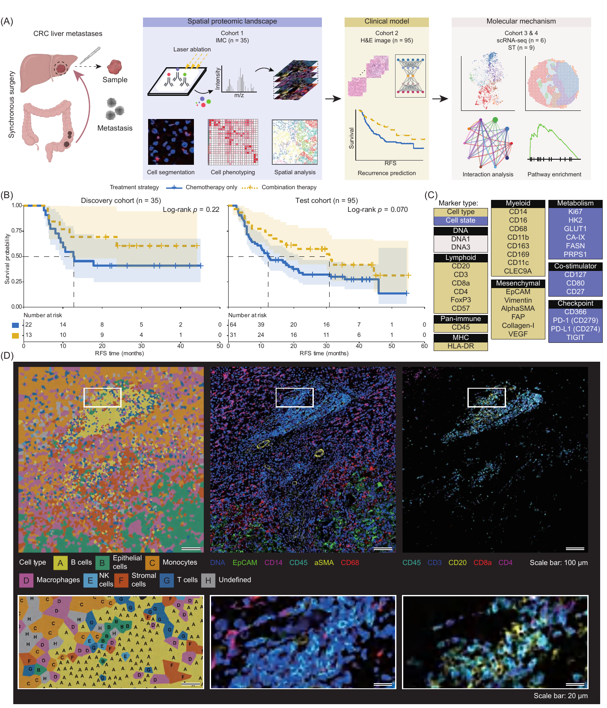
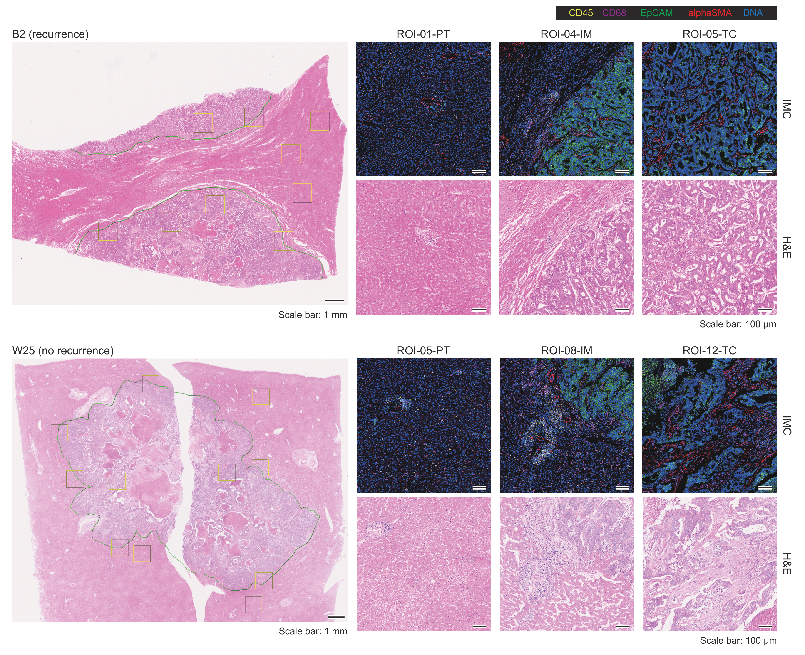
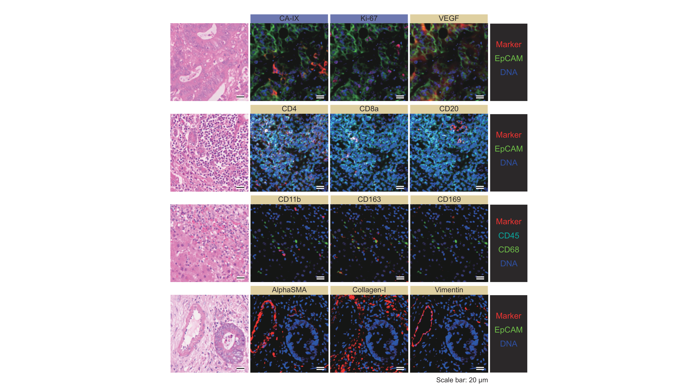

## Purpose

Figure 1 introduces the study framework and IMC imaging context for colorectal liver metastases (CRLM). Panel B compares recurrence-free survival (RFS) between postoperative chemotherapy alone and chemotherapy plus targeted therapy in the FDZS-1 discovery and FDZS-2 independent test cohorts.

## Inputs and analytical units

The [R entry point](01_plot_treatment_rfs.R) requires a Supplementary Tables workbook containing `Supplementary Table 1` (35 FDZS-1 patients) and `Supplementary Table 5` (95 FDZS-2 patients), with a title row followed by the displayed column headers. Each worksheet must provide one complete row per unique patient, positive RFS time in months from completion of primary and liver metastasis resection, recurrence status (`1 = recurrence`, `0 = censored`), and both treatment groups (`Chemo` and `Combo`). Discovery-table labels are mapped from recurrence/no recurrence and FOLFOX alone/FOLFOX plus targeted therapy. The public workbook contains Supplementary Tables 1–4; the complete Figure 1B input requires Table 5 as well, as described in the [public data contract](../../docs/data_contract.md#supplementary-tables). The patient is the statistical unit.

## Figure 1B: treatment-stratified RFS

### Configuration and worksheet normalization

The source defines editable workbook/output paths and the required worksheet fields, then maps both cohorts to common patient, RFS, event, and treatment variables.

<!-- source: 01_plot_treatment_rfs.R; lines: 1-33 -->
```{r figure1b_configuration, eval=FALSE}
#!/usr/bin/env Rscript

# Figure 1B treatment-stratified recurrence-free survival curves.
#
# Input: the current Supplementary Tables workbook. Supplementary Tables 1 and
# 5 provide the FDZS-1 and FDZS-2 patient-level RFS records, respectively.
# Outputs: one two-panel Kaplan-Meier PDF and a cohort-level summary TSV.
# Runtime: host Conda environment Spatial with R 4.2.2.

# Edit these paths and set RUN_FIGURE1B to TRUE before direct execution.
RUN_FIGURE1B <- FALSE

FIGURE1B_CONFIG <- list(
  supplementary_workbook = "path/to/Supplementary Tables.xlsx",
  discovery_sheet = "Supplementary Table 1",
  test_sheet = "Supplementary Table 5",
  output_dir = "path/to/figure1_outputs"
)

required_fields <- c("patient_id", "rfs_time_months", "rfs_event", "treatment")
table1_fields <- c(
  "Patient ID",
  "Recurrence status during follow-up",
  "RFS time from completion of primary and liver metastasis resection (months)",
  "Postoperative adjuvant treatment group"
)
table5_fields <- c(
  "Patient ID",
  "RFS event status (1 = recurrence; 0 = censored)",
  "RFS time from completion of primary and liver metastasis resection (months)",
  "Treatment"
)

```

<!-- source: 01_plot_treatment_rfs.R; lines: 34-96 -->
```{r figure1b_read_normalize, eval=FALSE}
#' Read one patient-level supplementary table.
#'
#' @param path Path to the current Supplementary Tables workbook.
#' @param sheet Exact worksheet name.
#' @return A data frame retaining the displayed field names.
read_supplementary_table <- function(path, sheet) {
  if (!file.exists(path)) stop("Input does not exist: ", path)
  as.data.frame(
    readxl::read_excel(path, sheet = sheet, skip = 1, .name_repair = "minimal"),
    check.names = FALSE,
    stringsAsFactors = FALSE
  )
}

#' Require the displayed source fields for one worksheet.
#'
#' @param data Raw supplementary-table data.
#' @param fields Required displayed column names.
#' @param sheet Worksheet label used in errors.
#' @return The input data invisibly.
require_source_fields <- function(data, fields, sheet) {
  missing_fields <- setdiff(fields, names(data))
  if (length(missing_fields) > 0L) {
    stop(sheet, " is missing: ", paste(missing_fields, collapse = ", "))
  }
  invisible(data)
}

#' Normalize Supplementary Table 1 to the Figure 1B contract.
#'
#' @param data Current FDZS-1 supplementary table.
#' @return A patient-level data frame with the common analysis fields.
normalize_discovery_table <- function(data) {
  require_source_fields(data, table1_fields, "Supplementary Table 1")
  event_map <- c("No recurrence" = 0L, "Recurrence" = 1L)
  treatment_map <- c(
    "FOLFOX alone" = "Chemo",
    "FOLFOX plus targeted therapy" = "Combo"
  )
  data.frame(
    patient_id = trimws(as.character(data[["Patient ID"]])),
    rfs_time_months = data[["RFS time from completion of primary and liver metastasis resection (months)"]],
    rfs_event = unname(event_map[as.character(data[["Recurrence status during follow-up"]])]),
    treatment = unname(treatment_map[as.character(data[["Postoperative adjuvant treatment group"]])]),
    stringsAsFactors = FALSE
  )
}

#' Normalize Supplementary Table 5 to the Figure 1B contract.
#'
#' @param data Current FDZS-2 supplementary table.
#' @return A patient-level data frame with the common analysis fields.
normalize_test_table <- function(data) {
  require_source_fields(data, table5_fields, "Supplementary Table 5")
  data.frame(
    patient_id = trimws(as.character(data[["Patient ID"]])),
    rfs_time_months = data[["RFS time from completion of primary and liver metastasis resection (months)"]],
    rfs_event = data[["RFS event status (1 = recurrence; 0 = censored)"]],
    treatment = as.character(data[["Treatment"]]),
    stringsAsFactors = FALSE
  )
}

```

### Patient-level validation

The validation function checks cohort size, unique patient identifiers, complete RFS fields, binary event coding, and treatment membership.

<!-- source: 01_plot_treatment_rfs.R; lines: 97-133 -->
```{r figure1b_validate_patients, eval=FALSE}
#' Validate one cohort's treatment/RFS input contract.
#'
#' @param data Patient-level public table.
#' @param cohort Cohort label used in validation errors.
#' @param expected_rows Required number of unique patient rows.
#' @return A validated data frame with analysis fields normalized for plotting.
validate_patient_table <- function(data, cohort, expected_rows) {
  missing_fields <- setdiff(required_fields, names(data))
  if (length(missing_fields) > 0L) {
    stop(cohort, " table is missing: ", paste(missing_fields, collapse = ", "))
  }
  if (nrow(data) != expected_rows) {
    stop(cohort, " table must contain exactly ", expected_rows, " rows; found ", nrow(data), ".")
  }

  data$patient_id <- as.character(data$patient_id)
  if (anyNA(data$patient_id) || any(!nzchar(data$patient_id))) {
    stop(cohort, " table has missing patient_id values.")
  }
  if (anyDuplicated(data$patient_id)) {
    stop(cohort, " table has duplicate patient_id values; no deduplication is performed.")
  }

  for (field in c("rfs_time_months", "rfs_event")) {
    data[[field]] <- suppressWarnings(as.numeric(data[[field]]))
    if (any(!is.finite(data[[field]]))) stop(cohort, " table has non-finite ", field, " values.")
  }
  if (any(data$rfs_time_months <= 0)) stop(cohort, " table has non-positive rfs_time_months values.")
  if (any(!data$rfs_event %in% c(0, 1))) stop(cohort, " table rfs_event must use 1=recurrence and 0=censored.")
  if (!all(as.character(data$treatment) %in% c("Chemo", "Combo"))) {
    stop(cohort, " table treatment must contain only Chemo or Combo.")
  }
  data$treatment <- factor(as.character(data$treatment), levels = c("Chemo", "Combo"))
  if (any(table(data$treatment) == 0L)) stop(cohort, " table must contain both treatment groups.")
  data
}

```

### Cohort summaries and survival comparison

The code counts patients, treatment groups, and recurrence events, and compares treatment-stratified survival distributions using a nominal two-sided log-rank test.

<!-- source: 01_plot_treatment_rfs.R; lines: 134-151 -->
```{r figure1b_logrank_summary, eval=FALSE}
#' Calculate cohort-level counts and a nominal two-sided log-rank P value.
#'
#' @param data Validated patient-level table.
#' @param cohort Cohort label written to the output summary.
#' @return A one-row data frame.
summarize_cohort <- function(data, cohort) {
  fit <- survival::survdiff(survival::Surv(rfs_time_months, rfs_event) ~ treatment, data = data)
  data.frame(
    cohort = cohort,
    n_total = nrow(data),
    n_chemo = sum(data$treatment == "Chemo"),
    n_combo = sum(data$treatment == "Combo"),
    recurrence_events = sum(data$rfs_event),
    nominal_logrank_p_value = stats::pchisq(fit$chisq, df = length(fit$n) - 1L, lower.tail = FALSE),
    stringsAsFactors = FALSE
  )
}

```

### Kaplan–Meier curves

Kaplan–Meier estimates use RFS time and recurrence-event status. The released plotting code draws treatment-specific curves, censor marks, and median-survival guides, with time in months. The assembled publication panel also includes 95% confidence bands and numbers at risk.

<!-- source: 01_plot_treatment_rfs.R; lines: 152-221 -->
```{r figure1b_kaplan_meier, eval=FALSE}
#' Build one treatment-stratified Kaplan-Meier panel.
#'
#' @param data Validated patient-level table.
#' @param cohort_title Plot title.
#' @param p_value Nominal two-sided log-rank P value from the cohort summary.
#' @param show_y_axis Whether to show the y-axis label and tick labels.
#' @return A ggplot object.
plot_treatment_rfs <- function(data, cohort_title, p_value, show_y_axis = TRUE) {
  fit <- survival::survfit(survival::Surv(rfs_time_months, rfs_event) ~ treatment, data = data)
  p_label <- if (p_value >= 0.1) {
    sprintf("log-rank p = %.2f", p_value)
  } else if (p_value >= 0.001) {
    sprintf("log-rank p = %.3f", p_value)
  } else {
    "log-rank p < 0.001"
  }
  max_time <- max(data$rfs_time_months)

  km_plot <- survminer::ggsurvplot(
    fit = fit,
    data = data,
    pval = FALSE,
    conf.int = FALSE,
    risk.table = FALSE,
    linetype = "strata",
    surv.median.line = "hv",
    censor.shape = 3,
    censor.size = 2.2,
    size = 0.8,
    break.time.by = 10,
    break.y.by = 0.25,
    xlim = c(0, max_time),
    ylim = c(0, 1),
    axes.offset = FALSE,
    ggtheme = ggplot2::theme_classic(),
    palette = c("#0073C2FF", "#EFC000FF"),
    title = cohort_title,
    xlab = "RFS Time (months)",
    ylab = "Survival probability",
    legend = "none"
  )
  panel <- km_plot$plot +
    ggplot2::annotate(
      "text",
      x = Inf,
      y = 0.92,
      label = p_label,
      hjust = 1.05,
      vjust = 0,
      size = 3.5,
      fontface = "bold"
    ) +
    ggplot2::theme(
      plot.title = ggplot2::element_text(size = 11, face = "bold", hjust = 0.5),
      axis.title = ggplot2::element_text(size = 9, face = "bold"),
      axis.text = ggplot2::element_text(size = 8, colour = "black"),
      axis.line = ggplot2::element_line(linewidth = 0.45, colour = "black"),
      axis.ticks = ggplot2::element_line(linewidth = 0.45, colour = "black"),
      plot.margin = ggplot2::margin(4, 8, 4, 6)
    )
  if (!show_y_axis) {
    panel <- panel + ggplot2::theme(
      axis.title.y = ggplot2::element_blank(),
      axis.text.y = ggplot2::element_blank(),
      axis.ticks.y = ggplot2::element_blank()
    )
  }
  panel
}

```

### Panel composition

The discovery and test curves are arranged side by side with a shared treatment legend. Blue solid lines identify chemotherapy only, and yellow dashed lines identify combination therapy.

<!-- source: 01_plot_treatment_rfs.R; lines: 222-287 -->
```{r figure1b_compose_panel, eval=FALSE}
#' Render the two-panel Figure 1B replacement.
#'
#' @param discovery Validated FDZS-1 patient-level table.
#' @param test Validated FDZS-2 patient-level table.
#' @param p_values Named vector of cohort-level nominal log-rank P values.
#' @param path Destination PDF path.
#' @return An invisible NULL after writing the PDF.
write_figure1b_pdf <- function(discovery, test, p_values, path) {
  legend_data <- data.frame(
    x = rep(c(1, 2), times = 2),
    y = rep(c(1, 2), each = 2),
    treatment = factor(rep(c("Chemo", "Combo"), each = 2), levels = c("Chemo", "Combo"))
  )
  legend_plot <- ggplot2::ggplot(
    legend_data,
    ggplot2::aes(x = x, y = y, colour = treatment, linetype = treatment, shape = treatment)
  ) +
    ggplot2::geom_line(linewidth = 0.8) +
    ggplot2::geom_point(size = 2.2) +
    ggplot2::scale_colour_manual(
      name = "Treatment strategy",
      values = c(Chemo = "#0073C2FF", Combo = "#EFC000FF"),
      labels = c(Chemo = "Chemotherapy Only", Combo = "Combination Therapy")
    ) +
    ggplot2::scale_linetype_manual(
      name = "Treatment strategy",
      values = c(Chemo = "solid", Combo = "dashed"),
      labels = c(Chemo = "Chemotherapy Only", Combo = "Combination Therapy")
    ) +
    ggplot2::scale_shape_manual(
      name = "Treatment strategy",
      values = c(Chemo = 3, Combo = 3),
      labels = c(Chemo = "Chemotherapy Only", Combo = "Combination Therapy")
    ) +
    ggplot2::theme_void() +
    ggplot2::theme(
      legend.position = "top",
      legend.direction = "horizontal",
      legend.title = ggplot2::element_text(size = 9, face = "bold"),
      legend.text = ggplot2::element_text(size = 9),
      legend.key.width = grid::unit(1.1, "cm"),
      legend.margin = ggplot2::margin(0, 0, 0, 0)
    )
  legend <- cowplot::get_legend(legend_plot)
  panels <- cowplot::plot_grid(
    plot_treatment_rfs(discovery, "Discovery cohort (n=35)", p_values[["FDZS-1"]]),
    plot_treatment_rfs(test, "Validation cohort (n=95)", p_values[["FDZS-2"]], show_y_axis = FALSE),
    ncol = 2,
    align = "hv",
    axis = "tblr",
    rel_widths = c(1, 1)
  )
  header <- cowplot::plot_grid(
    cowplot::ggdraw() + cowplot::draw_label("B", x = 0, hjust = 0, fontface = "bold", size = 12),
    legend,
    ncol = 2,
    rel_widths = c(0.06, 0.94)
  )
  figure <- cowplot::plot_grid(header, panels, ncol = 1, rel_heights = c(0.16, 0.84))

  grDevices::cairo_pdf(path, width = 8.0, height = 3.3, family = "sans")
  print(figure)
  grDevices::dev.off()
  invisible(NULL)
}

```

### Output generation

The driver reads and validates both worksheets, assembles the two-panel PDF, and saves the cohort-level summary.

<!-- source: 01_plot_treatment_rfs.R; lines: 288-328 -->
```{r figure1b_write_outputs, eval=FALSE}
#' Generate the Figure 1B public treatment/RFS outputs.
#'
#' @param config Editable input and output paths.
#' @return An invisible list containing the two cohort summaries.
run_figure1b <- function(config) {
  required_packages <- c("readxl", "survival", "survminer", "ggplot2", "cowplot")
  missing_packages <- required_packages[!vapply(required_packages, requireNamespace, logical(1), quietly = TRUE)]
  if (length(missing_packages) > 0L) {
    stop("Missing required packages: ", paste(missing_packages, collapse = ", "))
  }

  discovery <- validate_patient_table(
    normalize_discovery_table(read_supplementary_table(config$supplementary_workbook, config$discovery_sheet)),
    "FDZS-1",
    35L
  )
  test <- validate_patient_table(
    normalize_test_table(read_supplementary_table(config$supplementary_workbook, config$test_sheet)),
    "FDZS-2",
    95L
  )
  summary <- rbind(
    summarize_cohort(discovery, "FDZS-1"),
    summarize_cohort(test, "FDZS-2")
  )
  p_values <- stats::setNames(summary$nominal_logrank_p_value, summary$cohort)

  dir.create(config$output_dir, recursive = TRUE, showWarnings = FALSE)
  write_figure1b_pdf(
    discovery,
    test,
    p_values,
    file.path(config$output_dir, "Figure1B_treatment_RFS_revised.pdf")
  )
  write.table(summary, file.path(config$output_dir, "Figure1B_treatment_RFS_summary.tsv"), sep = "\t", row.names = FALSE, quote = FALSE)
  invisible(summary)
}

if (isTRUE(RUN_FIGURE1B)) {
  run_figure1b(FIGURE1B_CONFIG)
}
```

### Publication result


**Figure 1. Multi-omics framework reveals the spatial landscape of colorectal liver metastases.** (A) Study workflow integrating IMC in FDZS-1 (35 patients), H&E-based evaluation in FDZS-2 (95 patients), scRNA-seq (6 patients), and spatial transcriptomics (9 patients). (B) Patient-level treatment-stratified RFS: chemotherapy only (blue solid) and combination therapy (yellow dashed), with censor marks, 95% confidence bands, median-RFS guides, numbers at risk, and nominal log-rank P values of 0.22 and 0.070. (C) Custom 35-plex IMC antibody-panel overview. (D) Representative cell-type map and marker overlays with boxed-region enlargements; scale bars, 100 µm (top) and 20 µm (bottom).

[Complete Figure 1 PDF](report_assets/figure1_publication.pdf) · [Publication 1B discovery PDF](report_assets/figure1b_discovery_95ci.pdf) · [Publication 1B test PDF](report_assets/figure1b_test_95ci.pdf) · [Released-code two-panel PDF](report_assets/figure1b_treatment_rfs.pdf) · [Cohort summary](report_assets/figure1b_treatment_rfs_summary.tsv)

| Cohort | Patients | Chemotherapy only | Combination therapy | Recurrence events | Nominal log-rank P |
|---|---:|---:|---:|---:|---:|
| FDZS-1 | 35 | 22 | 13 | 18 | 0.222512 |
| FDZS-2 | 95 | 64 | 31 | 62 | 0.070231 |

Combination-therapy curves were generally above chemotherapy-only curves in both cohorts. The log-rank comparisons yielded P = 0.223 in FDZS-1 and P = 0.070 in FDZS-2; neither met the nominal 0.05 threshold.

## Imaging context and related supplements

The imaging panels document tissue-region sampling and the marker overlays used for cell annotation. PT denotes peritumoral tissue, IM the invasive margin, and TC the tumor core. Antibody details are provided in Supplementary Table 3; the [panel overview](README.md#assembled-publication-panels) describes the assembled artwork.


**Figure S1. Spatial characterization of colorectal liver metastases across tissue regions.** Representative whole-slide H&E images and matched PT, IM, and TC views from two patients. IMC overlays show CD45, CD68, EpCAM, alphaSMA, and DNA. Scale bars in the artwork, 1 mm (whole-slide views) and 100 µm (magnified views).


**Figure S2. Representative IMC marker images for cell type annotation in CRLM.** Matched H&E and IMC views show CAIX, Ki-67, and VEGF in the first row; CD4, CD8a, and CD20 in the second; CD11b, CD163, and CD169 in the third; and alphaSMA, Collagen-I, and Vimentin in the fourth. Color keys identify the marker, epithelial or immune-cell channels, and DNA. Scale bars, 20 µm.
