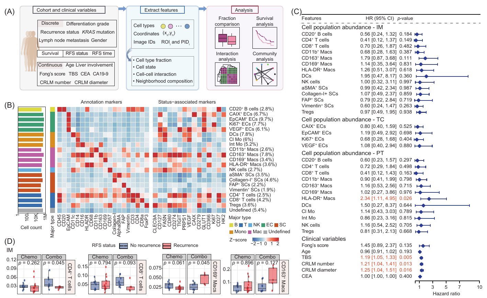
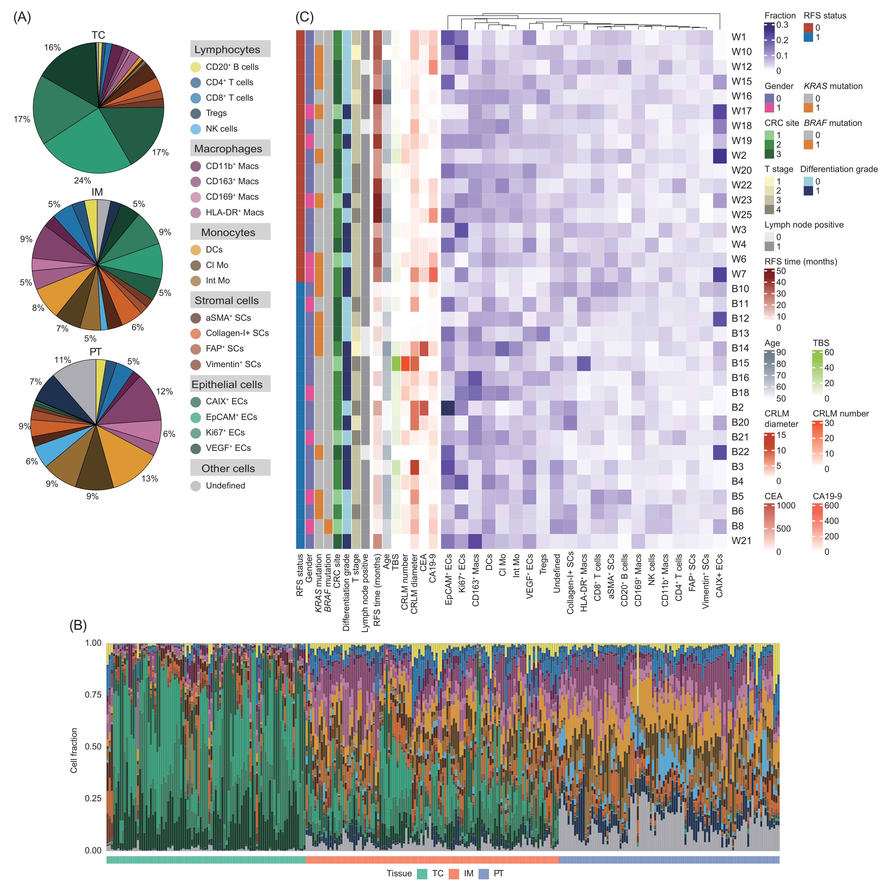
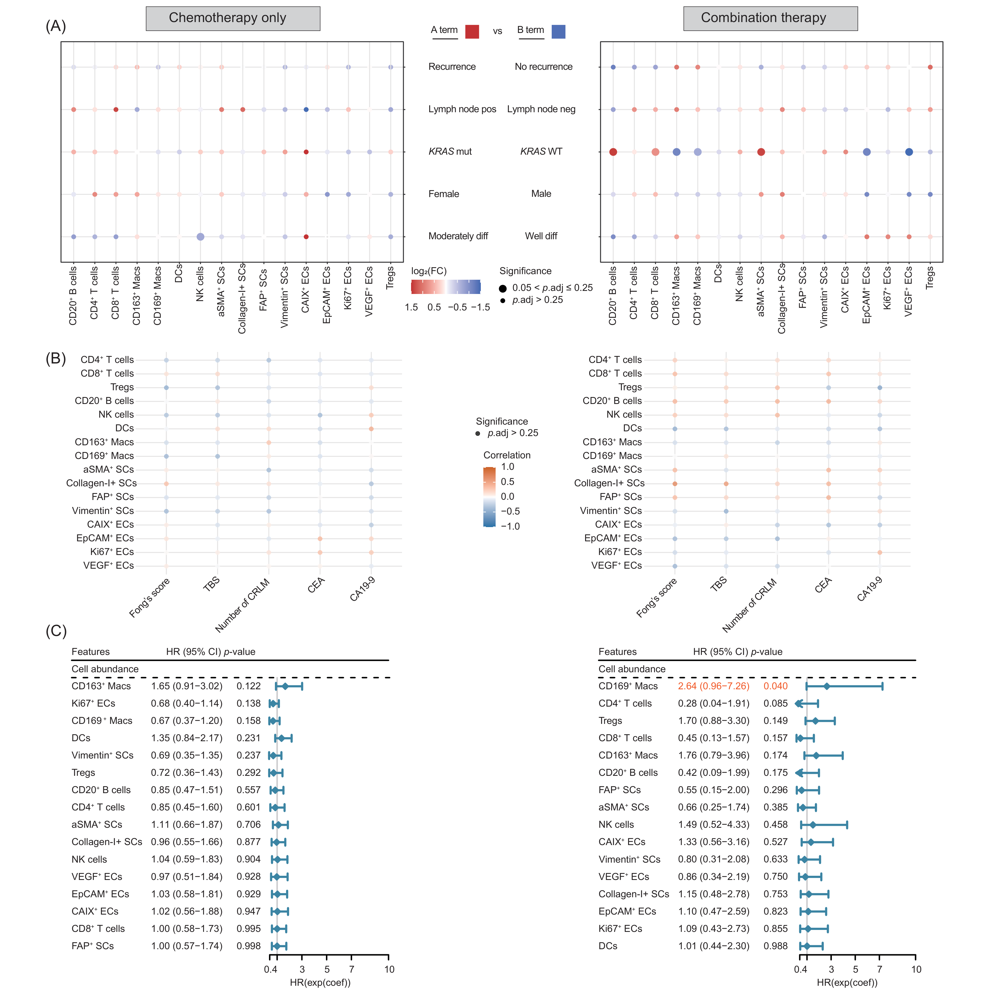
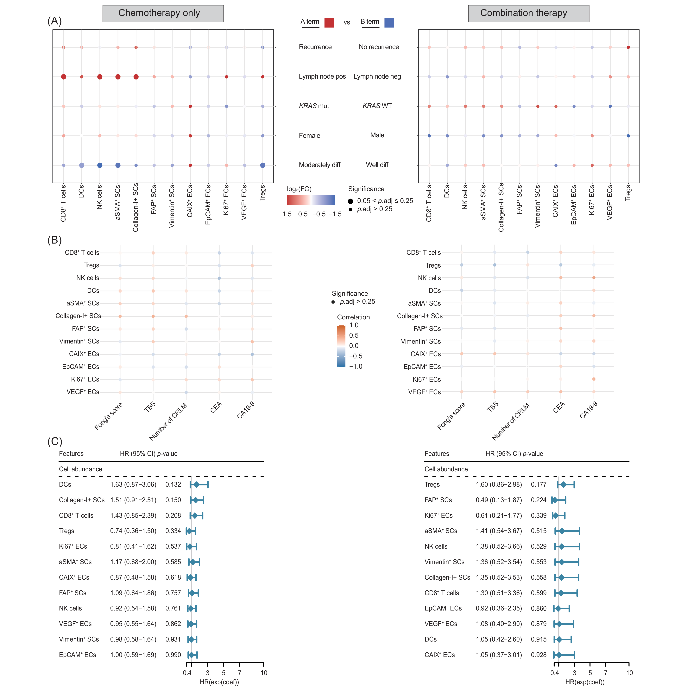

## Purpose

Figure 2 characterizes cell-subpopulation marker profiles and examines associations between cellular composition, clinical features, and recurrence in colorectal liver metastases (CRLM). The R analyses cover Figure 2B and 2D and Supplementary Figures 3–5.

## Inputs and analytical units

The three [R entry points](README.md) use `FDZS1_IMC_processed.rds`, a `SingleCellExperiment` with marker expression in `assay(sce)`, marker names in `rownames(sce)`, and cell annotations and clinical fields in `colData(sce)`. The [public data contract](../../docs/data_contract.md#fdzs-1-imc) describes 35 patients, 311 ROIs, and 2,018,260 cells in tumor core (`TC`), invasive margin (`IM`), and peritumoral liver (`PT`). Cells are nested within ROIs (`ID`) and patients (`PID`). `RFS_event` encodes recurrence during follow-up (`1`) or censored/no recurrence (`0`); `RFS_time` is measured in months from completion of resection. `Chemo` denotes FOLFOX alone and `Combo` denotes FOLFOX plus targeted therapy.

Required fields across the entry points are `PID`, `ID`, `Tissue`, `SubType`, `MajorType2`, `RFS_event`, `RFS_time`, `Treatment`, `Gender`, `KRAS_mutation`, `CRC_site`, `Differential_grade`, `T_stage`, `Lymph_positive`, `Age`, `fong_score`, `TBS`, `CRLM_number`, `CRLM_size`, `CEA`, and `CA199`. The heatmap requires the 20 annotation markers listed in its source and the remaining assay markers. Named `MajorType2` and `SubType` palettes are read from `metadata(sce)$color_vectors`. Each source defines editable `sce_path` and `output_dir` settings.

The publication figures present subtype marker profiles, tissue and ROI composition, patient composition, and patient-level clinical associations. The current R code below summarizes marker expression by subtype; calculates pooled tissue, ROI, and pooled patient fractions; and averages ROI fractions within each patient and tissue for association analyses, including zero fractions for absent subtypes. `UNKNOWN` contributes to composition denominators. The displayed figures retain the publication presentation, and the source sections describe the current code's inputs and calculations.

## Figure 2: clinical workflow, marker profiles, and recurrence



**Figure 2. Cellular composition of CRLM is associated with recurrence.** (A) Workflow connecting clinical variables with IMC-derived features. (B) Mean marker expression across 21 cell subpopulations, standardized by marker, with subtype counts, percentages, and major-type annotations. (C) Published RFS Cox estimates for cell fractions in IM, TC, and PT and selected clinical variables; points and intervals show HRs and 95% CIs, with nominal P values. (D) Patient-level IM fractions of CD4+ T cells, CD8+ T cells, CD169+ macrophages, and CD163+ macrophages by recurrence status and treatment; nominal Wilcoxon P values are shown. [Download the publication PDF](report_assets/figure2_publication.pdf).

## Figure 2B: cell-subpopulation marker profiles

### Configuration and packages

The [heatmap entry point](01_plot_cell_subpopulation_heatmap.R) summarizes mean expression for each subtype after retaining IM, PT, and TC cells.

<!-- source: 01_plot_cell_subpopulation_heatmap.R; lines: 1-20 -->
```{r figure2b_configuration, eval=FALSE}
#!/usr/bin/env Rscript

# Target: Figure 2B cell-subpopulation marker heatmap.
# Purpose: Summarize IMC cell subpopulations and visualize scaled marker expression.
# Inputs: A SingleCellExperiment RDS with assay data, current annotations, and palettes.
# Outputs: A subtype summary TSV and Figure 2B marker-heatmap PDF in `output_dir`.
# Workflow: 1. Load and validate the SCE. 2. Retain IM/PT/TC cells. 3. Summarize
# subtype abundance and expression. 4. Write the summary and render the heatmap.

# Directly editable interactive configuration.
sce_path <- file.path("data", "FDZS1_IMC_processed.rds")
output_dir <- file.path("results", "Figure2", "figure2B")

suppressPackageStartupMessages({
  library(SingleCellExperiment)
  library(ComplexHeatmap)
  library(circlize)
  library(grid)
})

```

### Subtype means and heatmap

The function calculates marker means across cells within each subtype, standardizes each marker across subtype means, and separates annotation markers from status-associated markers. It writes subtype counts, fractions, and unscaled expression means, then displays the z-scores with major-lineage colors and a log10 cell-count annotation.

<!-- source: 01_plot_cell_subpopulation_heatmap.R; lines: 21-146 -->
```{r figure2b_marker_profiles, eval=FALSE}
#' Create the Figure 2B marker-expression heatmap and subtype summary.
#'
#' @param sce_path Character scalar path to the input SingleCellExperiment RDS.
#' @param output_dir Character scalar path to the directory for Figure 2B outputs.
#' @return Integer device number returned by `dev.off()` after writing the TSV summary and PDF heatmap.
run_figure2b <- function(sce_path, output_dir) {
  # Load the cell-level object and require the annotation fields used throughout the panel.
  if (!file.exists(sce_path)) stop("SCE input does not exist: ", sce_path)
  sce <- readRDS(sce_path)
  required_fields <- c("Tissue", "SubType", "MajorType2")
  missing_fields <- setdiff(required_fields, colnames(colData(sce)))
  if (length(missing_fields) > 0L) stop("Missing colData field(s): ", paste(missing_fields, collapse = ", "))

  # Restrict the analysis unit to cells from the three tissue compartments shown in Figure 2.
  retained <- colData(sce)$Tissue %in% c("IM", "PT", "TC")
  if (!any(retained)) stop("No IM, PT, or TC cells are available.")
  sce <- sce[, retained]
  meta <- as.data.frame(colData(sce))

  # Separate lineage-annotation markers from the remaining status-associated marker columns.
  annotation_markers <- c(
    "CD45", "CD20", "EpCAM", "CD11c", "CD14", "CD16", "HLADR", "CD68",
    "CD11b", "CD163", "CD169", "CD57", "CollagenI", "AlphaSMA", "FAP",
    "Vimentin", "CD3", "CD4", "CD8a", "FoxP3"
  )
  markers <- rownames(sce)
  missing_markers <- setdiff(annotation_markers, markers)
  if (length(missing_markers) > 0L) stop("Missing annotation marker(s): ", paste(missing_markers, collapse = ", "))

  # Use the SCE palette so subtype-to-major-type annotations remain consistent across figures.
  color_vectors <- metadata(sce)$color_vectors
  major_palette <- color_vectors$MajorType2
  if (is.null(major_palette)) stop("metadata(sce)$color_vectors$MajorType2 is required.")

  subtypes <- sort(unique(as.character(meta$SubType)))
  #' Map one subtype to its observed MajorType2 label.
  #'
  #' @param subtype Character scalar subtype label present in `meta$SubType`.
  #' @return Character scalar MajorType2 label for the subtype.
  major_types <- vapply(subtypes, function(subtype) {
    # Each subtype inherits the major-type label observed for its cells.
    as.character(meta$MajorType2[match(subtype, meta$SubType)])
  }, character(1L))
  if (any(!major_types %in% names(major_palette))) stop("MajorType2 palette is incomplete.")

  # Aggregate expression at the subtype level before marker-wise scaling for display.
  expression <- assay(sce)
  #' Calculate marker-wise mean expression for one subtype.
  #'
  #' @param subtype Character scalar subtype label present in `meta$SubType`.
  #' @return Numeric vector of mean expression values, one per SCE marker.
  mean_expression <- vapply(subtypes, function(subtype) {
    # Retain one mean per marker using all retained cells assigned to this subtype.
    rowMeans(expression[, meta$SubType == subtype, drop = FALSE])
  }, numeric(nrow(expression)))
  mean_expression <- t(mean_expression)
  colnames(mean_expression) <- markers

  #' Count retained cells assigned to one subtype.
  #'
  #' @param subtype Character scalar subtype label present in `meta$SubType`.
  #' @return Numeric scalar number of retained cells with the subtype label.
  # Pair expression summaries with retained-cell counts and cohort-wide cell fractions.
  cell_count <- vapply(subtypes, function(subtype) sum(meta$SubType == subtype), numeric(1L))
  summary_table <- data.frame(
    subtype = subtypes,
    major_type = major_types,
    cell_count = cell_count,
    cell_fraction = cell_count / ncol(sce),
    check.names = FALSE
  )
  summary_table <- cbind(summary_table, as.data.frame(mean_expression, check.names = FALSE))

  # Export the unscaled subtype summary as the numerical source for the panel.
  dir.create(output_dir, recursive = TRUE, showWarnings = FALSE)
  write.table(
    summary_table,
    file.path(output_dir, "figure2B_cell_subpopulation_summary.tsv"),
    sep = "\t", row.names = FALSE, quote = FALSE
  )

  # Construct row labels, scaled marker values, and aligned annotations for the heatmap.
  rownames(mean_expression) <- paste0(subtypes, " (", format(round(summary_table$cell_fraction * 100, 1), nsmall = 1), "%)")
  scaled_expression <- scale(mean_expression)
  status_markers <- setdiff(markers, annotation_markers)
  color_function <- circlize::colorRamp2(c(-2, 0, 2), c("#2166ac", "#f7f7f7", "#b2182b"))
  cell_count_colors <- unname(major_palette[major_types])

  # Assemble abundance and major-lineage annotations beside the two marker blocks.
  cell_count_annotation <- rowAnnotation(
    CellCount = anno_barplot(
      log10(summary_table$cell_count + 1), bar_width = 0.8,
      gp = gpar(fill = cell_count_colors, col = "white"),
      axis_param = list(side = "bottom", at = c(0, 2, 4, 6), labels = c("1", "100", "10K", "1M"), gp = gpar(fontsize = 8)),
      width = unit(3, "cm")
    ),
    width = unit(3, "cm")
  )
  major_annotation <- rowAnnotation(
    MajorType = major_types,
    col = list(MajorType = major_palette),
    width = unit(0.5, "cm")
  )
  annotation_heatmap <- Heatmap(
    scaled_expression[, annotation_markers, drop = FALSE], name = "Z-score", col = color_function,
    cluster_rows = FALSE, cluster_columns = FALSE, show_row_names = FALSE,
    column_title = "Annotation Markers", width = unit(10, "cm"), rect_gp = gpar(col = "white", lwd = 0.5)
  )
  status_heatmap <- Heatmap(
    scaled_expression[, status_markers, drop = FALSE], name = "Z-score2", col = color_function,
    cluster_rows = FALSE, cluster_columns = FALSE, show_heatmap_legend = FALSE,
    column_title = "Status-Associated Markers", width = unit(8, "cm"), rect_gp = gpar(col = "white", lwd = 0.5)
  )

  # Render the combined annotations and heatmaps to the Figure 2B PDF.
  pdf(file.path(output_dir, "figure2B_cell_subpopulation_marker_heatmap.pdf"), width = 16, height = 6)
  draw(
    cell_count_annotation + major_annotation + annotation_heatmap + status_heatmap,
    column_title = "Cell Type Marker Expression Profile", heatmap_legend_side = "right"
  )
  dev.off()
}

if (sys.nframe() == 0L) {
  run_figure2b(sce_path, output_dir)
}
```

## Supplementary Figure 3: tissue, ROI, and patient composition

### Configuration and packages

The [composition entry point](02_plot_tissue_composition.R) defines the input, output directory, and plotting dependencies.

<!-- source: 02_plot_tissue_composition.R; lines: 1-24 -->
```{r figureS3_configuration, eval=FALSE}
#!/usr/bin/env Rscript

# Target: Supplementary Figure 3 tissue-composition panels associated with Figure 2.
# Purpose: Quantify subtype composition across tissues, ROIs, and patients.
# Inputs: A SingleCellExperiment RDS with current annotations and clinical metadata.
# Outputs: Three composition TSV files and three Supplementary Figure 3 PDF panels.
# Workflow: 1. Load and validate the SCE. 2. Retain IM/PT/TC cells. 3. Calculate
# pooled, ROI, and patient fractions. 4. Write tables and render composition plots.

# Directly editable interactive configuration.
sce_path <- file.path("data", "FDZS1_IMC_processed.rds")
output_dir <- file.path("results", "Figure2", "supplementary_figureS3")

suppressPackageStartupMessages({
  library(SingleCellExperiment)
  library(dplyr)
  library(tidyr)
  library(tibble)
  library(ggplot2)
  library(cowplot)
  library(patchwork)
  library(ComplexHeatmap)
  library(circlize)
})
```

### Composition summaries

S3A counts cells within each tissue and divides subtype counts by that tissue's total cell count. S3B calculates subtype fractions within each ROI and displays stacked bars with a tissue strip. S3C pools retained cells within patients, fills absent subtype combinations with zero, and displays raw fractions beside clinical annotations with patients ordered by recurrence status.

<!-- source: 02_plot_tissue_composition.R; lines: 25-164 -->
```{r figureS3_composition, eval=FALSE}

#' Create tissue, ROI, and patient cell-subtype composition outputs.
#'
#' @param sce_path Character scalar path to the input SingleCellExperiment RDS.
#' @param output_dir Character scalar path to the directory for Supplementary Figure 3 outputs.
#' @return Integer device number returned by `dev.off()` after writing composition tables and PDF plots.
run_tissue_composition <- function(sce_path, output_dir) {
  # Load the SCE and require the identifiers and clinical fields used by all three panels.
  if (!file.exists(sce_path)) stop("SCE input does not exist: ", sce_path)
  sce <- readRDS(sce_path)
  clinical_fields <- c(
    "PID", "ID", "Tissue", "SubType", "RFS_event", "Gender", "KRAS_mutation",
    "CRC_site", "Differential_grade", "T_stage", "Lymph_positive",
    "RFS_time", "Age", "TBS", "CRLM_number", "CRLM_size", "CEA", "CA199"
  )
  missing_fields <- setdiff(clinical_fields, colnames(colData(sce)))
  if (length(missing_fields) > 0L) stop("Missing colData field(s): ", paste(missing_fields, collapse = ", "))

  # Restrict composition summaries to cells from the displayed TC, IM, and PT compartments.
  retained <- colData(sce)$Tissue %in% c("IM", "PT", "TC")
  if (!any(retained)) stop("No IM, PT, or TC cells are available.")
  sce <- sce[, retained]
  meta <- as.data.frame(colData(sce))
  tissue_order <- c("TC", "IM", "PT")
  if (!all(tissue_order %in% meta$Tissue)) stop("All TC, IM, and PT tissues are required.")

  # Preserve the shared subtype color mapping across pooled, ROI, and patient views.
  subtype_palette <- metadata(sce)$color_vectors$SubType
  if (is.null(subtype_palette)) stop("metadata(sce)$color_vectors$SubType is required.")
  observed_subtypes <- sort(unique(as.character(meta$SubType)))
  if (any(!observed_subtypes %in% names(subtype_palette))) stop("SubType palette is incomplete.")
  dir.create(output_dir, recursive = TRUE, showWarnings = FALSE)

  # Aggregate all retained cells within tissue to obtain the pooled panel fractions.
  pooled_fractions <- meta %>%
    count(Tissue, SubType, name = "cell_count") %>%
    group_by(Tissue) %>%
    mutate(cell_fraction = cell_count / sum(cell_count)) %>%
    ungroup() %>%
    mutate(Tissue = factor(Tissue, levels = tissue_order), SubType = factor(SubType, levels = observed_subtypes)) %>%
    arrange(Tissue, SubType)
  write.table(pooled_fractions, file.path(output_dir, "figureS3A_pooled_tissue_subtype_fractions.tsv"), sep = "\t", row.names = FALSE, quote = FALSE)

  #' Build one pooled tissue-composition pie chart.
  #'
  #' @param tissue Character scalar tissue code included in `tissue_order`.
  #' @return A ggplot object showing subtype fractions for the requested tissue.
  pie_plots <- lapply(tissue_order, function(tissue) {
    # Build one composition panel from the pooled fractions for a single tissue.
    plot_data <- filter(pooled_fractions, Tissue == tissue)
    ggplot(plot_data, aes(x = "", y = cell_fraction, fill = SubType)) +
      geom_col(width = 1, color = "black", show.legend = TRUE) +
      coord_polar("y", start = 0) +
      scale_fill_manual(values = subtype_palette) +
      geom_text(aes(label = ifelse(cell_fraction > 0.05, scales::percent(cell_fraction, accuracy = 1), "")), position = position_stack(vjust = 0.5), size = 3) +
      labs(title = tissue) + theme_void() +
      theme(plot.title = element_text(hjust = 0.5, size = 20, face = "bold"), legend.position = "top", legend.title = element_blank())
  })
  # Export the aligned tissue-level pie charts as Supplementary Figure 3A.
  pdf(file.path(output_dir, "figureS3A_tissue_composition_pie_charts.pdf"), width = 20, height = 10)
  print(cowplot::plot_grid(plotlist = pie_plots, ncol = 3))
  dev.off()

  # Calculate subtype fractions independently within each patient ROI.
  roi_fractions <- meta %>%
    count(PID, ID, Tissue, SubType, name = "cell_count") %>%
    group_by(PID, ID, Tissue) %>%
    mutate(cell_fraction = cell_count / sum(cell_count)) %>%
    ungroup() %>%
    mutate(Tissue = factor(Tissue, levels = tissue_order), SubType = factor(SubType, levels = observed_subtypes)) %>%
    arrange(Tissue, ID, SubType)
  write.table(roi_fractions, file.path(output_dir, "figureS3B_roi_subtype_fractions.tsv"), sep = "\t", row.names = FALSE, quote = FALSE)

  # Construct aligned ROI composition bars and a tissue strip on the same ROI order.
  roi_order <- roi_fractions %>% distinct(ID, Tissue) %>% arrange(Tissue, ID)
  stacked_bars <- ggplot(roi_fractions, aes(x = factor(ID, levels = roi_order$ID), y = cell_fraction, fill = SubType)) +
    geom_col(color = "black", width = 1) + scale_fill_manual(values = subtype_palette) +
    labs(x = "", y = "Cell Fraction", title = "Cell Fractions in Each ROI by Tissue") +
    theme_minimal() + theme(axis.text.x = element_blank(), panel.grid = element_blank(), legend.position = "top", legend.title = element_blank())
  tissue_bar <- ggplot(roi_order, aes(x = factor(ID, levels = ID), y = 0.5, fill = Tissue)) +
    geom_col(width = 1) + scale_fill_brewer(palette = "Set2") + theme_minimal() +
    theme(axis.title = element_blank(), axis.text = element_blank(), axis.ticks = element_blank(), panel.grid = element_blank(), legend.position = "bottom")
  # Export the stacked ROI composition view as Supplementary Figure 3B.
  pdf(file.path(output_dir, "figureS3B_roi_subtype_fractions.pdf"), width = 15, height = 8)
  print(stacked_bars / tissue_bar + plot_layout(heights = c(14, 1)))
  dev.off()

  # Aggregate cells by patient and complete absent subtype combinations with zero fractions.
  patient_order <- meta %>% distinct(PID, RFS_event) %>% arrange(RFS_event) %>% pull(PID)
  patient_fractions <- meta %>%
    count(PID, SubType, name = "cell_count") %>%
    group_by(PID) %>%
    mutate(cell_fraction = cell_count / sum(cell_count)) %>%
    ungroup() %>%
    complete(PID = patient_order, SubType = observed_subtypes, fill = list(cell_count = 0, cell_fraction = 0)) %>%
    mutate(PID = factor(PID, levels = patient_order), SubType = factor(SubType, levels = observed_subtypes)) %>%
    arrange(PID, SubType)
  write.table(patient_fractions, file.path(output_dir, "figureS3C_patient_subtype_fractions.tsv"), sep = "\t", row.names = FALSE, quote = FALSE)

  # Align the patient-by-subtype matrix with one clinical annotation record per patient.
  fraction_table <- patient_fractions %>%
    select(PID, SubType, cell_fraction) %>%
    pivot_wider(names_from = SubType, values_from = cell_fraction)
  rownames(fraction_table) <- NULL
  fraction_matrix <- fraction_table %>% column_to_rownames("PID") %>% as.matrix()
  clinical_annotation <- meta %>%
    select(all_of(clinical_fields[-c(2L, 3L, 4L)])) %>%
    distinct(PID, .keep_all = TRUE) %>%
    slice(match(patient_order, PID))
  rownames(clinical_annotation) <- NULL
  clinical_annotation <- clinical_annotation %>% column_to_rownames("PID")
  discrete_vars <- c("RFS_event", "Gender", "KRAS_mutation", "CRC_site", "Differential_grade", "T_stage", "Lymph_positive")
  continuous_vars <- c("RFS_time", "Age", "TBS", "CRLM_number", "CRLM_size", "CEA", "CA199")
  discrete_colors <- list(
    RFS_event = c("0" = "#bc3c29ff", "1" = "#0072b5ff"), Gender = c("0" = "#7876b1ff", "1" = "#ee4c97ff"),
    KRAS_mutation = c("0" = "grey", "1" = "#e18727ff"),
    CRC_site = c("1" = "lightgreen", "2" = "forestgreen", "3" = "darkgreen"), Differential_grade = c("0" = "lightblue", "1" = "darkblue"),
    T_stage = c("1" = "lemonchiffon", "2" = "lemonchiffon2", "3" = "lemonchiffon3", "4" = "lemonchiffon4"), Lymph_positive = c("0" = "white", "1" = "grey60")
  )
  #' Create a continuous clinical-variable color function.
  #'
  #' @param variable Character scalar naming a continuous clinical annotation column.
  #' @return A circlize color-mapping function spanning the observed annotation range.
  # Map each continuous variable across its observed patient-level range.
  continuous_colors <- lapply(continuous_vars, function(variable) colorRamp2(range(clinical_annotation[[variable]], na.rm = TRUE), c("white", "red4")))
  names(continuous_colors) <- continuous_vars
  # Construct clinical annotations and the composition heatmap on the shared patient axis.
  clinical_ha <- HeatmapAnnotation(df = clinical_annotation[, discrete_vars, drop = FALSE], col = discrete_colors, which = "row") +
    HeatmapAnnotation(df = clinical_annotation[, continuous_vars, drop = FALSE], col = continuous_colors, which = "row")
  heatmap_colors <- colorRamp2(c(0, max(fraction_matrix)), c("white", "navy"))
  clinical_heatmap <- Heatmap(fraction_matrix, name = "Fraction", col = heatmap_colors, show_row_names = TRUE, show_column_names = TRUE, cluster_rows = FALSE, cluster_columns = TRUE, column_names_side = "bottom")
  # Export the patient-level composition and clinical annotation panel.
  pdf(file.path(output_dir, "figureS3C_patient_clinical_composition_heatmap.pdf"), width = 15, height = 15)
  draw(clinical_ha + clinical_heatmap)
  dev.off()
}

if (sys.nframe() == 0L) {
  run_tissue_composition(sce_path, output_dir)
}
```



**Figure S3. Cellular composition varies across CRLM tissue regions.** (A) Pooled cell-subtype proportions in TC, IM, and PT. (B) Subtype fractions within individual ROIs, with a tissue annotation strip. (C) Patient rows with categorical and continuous clinical annotations and pooled subtype fractions; the displayed clinical roster includes BRAF mutation. Colors and numeric codes follow the publication keys. [Download the source PDF for panel A](report_assets/figureS3A_tissue_composition.pdf).

Tumor-core epithelial subtypes account for approximately 74% of cells using the displayed rounded percentages. IM shows mixed epithelial, immune, and stromal composition, whereas PT has larger monocyte and macrophage fractions. These are pooled-cell descriptions of the sampled compartments.

## Figure 2D and Supplementary Figures 4–5: clinical associations

### Configuration and subtype selection

The [abundance entry point](03_analyze_treatment_stratified_abundance.R) defines tissue-specific subtype rosters and analyzes IM and TC within `Overall`, `Chemo`, and `Combo` strata.

<!-- source: 03_analyze_treatment_stratified_abundance.R; lines: 1-47 -->
```{r figure2_abundance_configuration, eval=FALSE}
#!/usr/bin/env Rscript

# Target: Figure 2D and treatment-stratified abundance analyses.
# Purpose: Relate patient-level tissue subtype fractions to clinical variables,
# recurrence, and treatment strata.
# Inputs: A SingleCellExperiment RDS with subtype, tissue, treatment, recurrence,
# and clinical metadata.
# Outputs: Statistical-result TSVs plus Figure 2D and Supplementary Figure 4/5 PDFs.
# Workflow: 1. Load and validate the SCE. 2. Derive patient tissue fractions. 3. Run
# prespecified stratum-specific tests. 4. Write results and render figure panels.

# Directly editable interactive configuration.
sce_path <- file.path("data", "FDZS1_IMC_processed.rds")
output_dir <- file.path("results", "Figure2", "treatment_stratified_abundance")

suppressPackageStartupMessages({
  library(SingleCellExperiment)
  library(dplyr)
  library(tidyr)
  library(ggplot2)
  library(survival)
  library(forestplot)
  library(grid)
})

#' Select tissue-specific subtype labels for downstream analyses.
#'
#' @param tissue Character scalar tissue code: `TC`, `IM`, or `PT`.
#' @param all_cell_types Character vector of observed subtype labels.
#' @return Character vector of unique subtype labels selected for the tissue.
cell_types_for_tissue <- function(tissue, all_cell_types) {
  # Partition observed subtype labels into biological lineages used by tissue-specific panels.
  tumor_cells <- all_cell_types[grepl("^TC_", all_cell_types)]
  stromal_cells <- all_cell_types[grepl("^SC_", all_cell_types)]
  mono_cells <- all_cell_types[grepl("^Mono_", all_cell_types)]
  macro_cells <- all_cell_types[grepl("^Macro_", all_cell_types)]
  immune_cells <- intersect(c("B", "CD4T", "CD8T", "NK", "Treg"), all_cell_types)
  # Retain only the lineage combinations defined for the requested tissue compartment.
  selected <- switch(
    tissue,
    TC = c(tumor_cells, stromal_cells, intersect(c("CD8T", "NK", "Treg", "Mono_CD11c"), all_cell_types)),
    IM = c(tumor_cells, stromal_cells, immune_cells, intersect(c("Mono_CD11c", "Macro_CD163", "Macro_CD169"), all_cell_types)),
    PT = c(stromal_cells, immune_cells, mono_cells, macro_cells)
  )
  unique(selected)
}

```

### Patient-tissue fractions in the current code

Subtype counts are completed with zeros within each observed ROI and tissue. Fractions are calculated within ROIs, then averaged across a patient's ROIs in that tissue.

<!-- source: 03_analyze_treatment_stratified_abundance.R; lines: 48-65 -->
```{r figure2_patient_tissue_fractions, eval=FALSE}
#' Calculate patient-level mean ROI fractions by tissue and subtype.
#'
#' @param meta Data frame of retained-cell metadata containing PID, ID, Tissue, and SubType.
#' @return Tibble with one mean ROI fraction for each patient, tissue, and subtype.
calculate_patient_tissue_fractions <- function(meta) {
  # Complete subtype counts within each ROI, then average ROI fractions at the patient-tissue level.
  meta %>%
    count(PID, ID, Tissue, SubType, name = "cell_count") %>%
    group_by(Tissue) %>%
    complete(nesting(PID, ID), SubType, fill = list(cell_count = 0L)) %>%
    ungroup() %>%
    group_by(PID, ID, Tissue) %>%
    mutate(roi_fraction = cell_count / sum(cell_count)) %>%
    ungroup() %>%
    group_by(PID, Tissue, SubType) %>%
    summarise(mean_roi_fraction = mean(roi_fraction), .groups = "drop")
}

```

### Correlation and Cox displays

The correlation plot encodes Spearman coefficients by color and BH-adjusted P-value categories by size. The forest plot displays subtype hazard ratios, 95% confidence intervals, and nominal likelihood-ratio P values.

<!-- source: 03_analyze_treatment_stratified_abundance.R; lines: 66-93 -->
```{r figure2_correlation_plot, eval=FALSE}
#' Create a clinical-correlation bubble plot for selected cell subtypes.
#'
#' @param correlation_results Data frame of subtype-clinical Spearman test results.
#' @param cell_type_order Character vector specifying subtype display order.
#' @return A ggplot object encoding correlation coefficients and adjusted P-value categories.
create_correlation_plot <- function(correlation_results, cell_type_order) {
  # Convert adjusted P values to display categories while preserving the requested subtype order.
  plot_data <- correlation_results %>%
    mutate(
      p_level = case_when(
        p_adjusted <= 0.01 ~ "p.adj <= 0.01",
        p_adjusted <= 0.05 ~ "0.01 < p.adj <= 0.05",
        p_adjusted <= 0.25 ~ "0.05 < p.adj <= 0.25",
        TRUE ~ "p.adj > 0.25"
      ),
      subtype = factor(subtype, levels = rev(cell_type_order)),
      clinical_variable = factor(clinical_variable, levels = unique(clinical_variable)),
      p_level = factor(p_level, levels = c("p.adj <= 0.01", "0.01 < p.adj <= 0.05", "0.05 < p.adj <= 0.25", "p.adj > 0.25"))
    )
  # Encode association direction by color and adjusted-significance category by point size.
  ggplot(plot_data, aes(x = clinical_variable, y = subtype, color = spearman_rho, size = p_level)) +
    geom_point(alpha = 0.8) +
    scale_color_gradient2(low = "#0072B2", mid = "white", high = "#D55E00", midpoint = 0, limits = c(-1, 1), name = "Correlation") +
    scale_size_manual(values = c("p.adj <= 0.01" = 8, "0.01 < p.adj <= 0.05" = 6, "0.05 < p.adj <= 0.25" = 4, "p.adj > 0.25" = 2), name = "Significance") +
    labs(title = "Correlation Between Cell Abundance and Clinical Factors", x = NULL, y = NULL) +
    theme_minimal(base_size = 12) + theme(axis.text.x = element_text(angle = 45, hjust = 1), legend.position = "right")
}

```

<!-- source: 03_analyze_treatment_stratified_abundance.R; lines: 94-114 -->
```{r figure2_cox_plot, eval=FALSE}
#' Create a univariable Cox-model forest plot.
#'
#' @param cox_results Data frame containing subtype hazard ratios, confidence intervals, and P values.
#' @return A forestplot graphical object drawn on the active graphics device.
create_forest_plot <- function(cox_results) {
  # Order model terms by nominal evidence and format effect estimates for the label table.
  plot_data <- cox_results %>% arrange(p_raw) %>%
    mutate(
      hr_ci = sprintf("%.2f (%.2f-%.2f)", hazard_ratio, ci_lower, ci_upper),
      p_text = scales::pvalue(p_raw, accuracy = 0.001)
    )
  labeltext <- rbind(c("Features", "HR (95% CI)", "P value"), as.matrix(plot_data[, c("subtype", "hr_ci", "p_text")]))
  # Draw hazard ratios and confidence intervals relative to the null value of one.
  forestplot::forestplot(
    labeltext = labeltext,
    mean = c(NA, plot_data$hazard_ratio), lower = c(NA, plot_data$ci_lower), upper = c(NA, plot_data$ci_upper),
    is.summary = c(TRUE, rep(FALSE, nrow(plot_data))), zero = 1, xlab = "HR (exp(coef))", title = "Univariable Cox Analysis",
    graph.pos = "right", boxsize = 0.35, col = fpColors(box = "#2E86AB", lines = "#2E86AB", summary = "#2E86AB")
  )
}

```

### Association tests and panel outputs

In the current code, strata with at least 10 patients enter the supplementary analyses. Spearman tests compare subtype fractions with Fong score, TBS, number of metastases, CEA, and CA19-9. Two-sided Wilcoxon rank-sum tests compare eligible binary clinical groups. Univariable Cox models use `Surv(RFS_time, RFS_event)` with subtype fractions scaled by one sample SD. BH adjustment covers the subtype-by-continuous-variable matrix within each tissue-treatment stratum for Spearman tests, subtypes within each binary clinical variable and stratum for Wilcoxon tests, and subtypes within each stratum for Cox models.

Supplementary Figure 4 concerns IM and Supplementary Figure 5 concerns TC. For each treatment, panel A displays binary clinical comparisons, panel B displays continuous-variable correlations, and panel C displays univariable Cox estimates. The source writes both nominal and adjusted P values to the statistical tables.

The current Figure 2D code selects IM `CD4T`, `CD8T`, `Macro_CD169`, and `Macro_CD163` fractions and compares recurrence groups within each treatment. Each test requires at least six patients and at least three patients in each recurrence group. The output boxplots show patient observations and nominal two-sided Wilcoxon P values.

<!-- source: 03_analyze_treatment_stratified_abundance.R; lines: 115-288 -->
```{r figure2_treatment_stratified_analysis, eval=FALSE}
#' Run treatment-stratified abundance, association, and recurrence analyses.
#'
#' @param sce_path Character scalar path to the input SingleCellExperiment RDS.
#' @param output_dir Character scalar path to the directory for Figure 2 and supplementary outputs.
#' @return Invisibly returns the final PDF path from `ggsave()` after writing statistical tables and PDF figures.
run_treatment_stratified_abundance <- function(sce_path, output_dir) {
  # Load the SCE and require all identifiers, outcomes, treatments, and covariates used below.
  if (!file.exists(sce_path)) stop("SCE input does not exist: ", sce_path)
  sce <- readRDS(sce_path)
  continuous_vars <- c("fong_score", "TBS", "CRLM_number", "CEA", "CA199")
  discrete_vars <- c("RFS_event", "Treatment", "Gender", "KRAS_mutation", "Differential_grade", "Lymph_positive")
  required_fields <- c("PID", "ID", "Tissue", "SubType", "RFS_time", unique(c(continuous_vars, discrete_vars)))
  missing_fields <- setdiff(required_fields, colnames(colData(sce)))
  if (length(missing_fields) > 0L) stop("Missing colData field(s): ", paste(missing_fields, collapse = ", "))

  # Restrict the cell input to the three analyzed tissue compartments.
  retained <- colData(sce)$Tissue %in% c("IM", "PT", "TC")
  if (!any(retained)) stop("No IM, PT, or TC cells are available.")
  meta <- as.data.frame(colData(sce[, retained]))
  if (!all(c("Chemo", "Combo") %in% unique(meta$Treatment))) stop("Treatment must include Chemo and Combo.")
  dir.create(output_dir, recursive = TRUE, showWarnings = FALSE)

  # Derive patient-level mean ROI fractions and attach one clinical record per patient.
  patient_tissue_fractions <- calculate_patient_tissue_fractions(meta)
  clinical_data <- meta %>% select(PID, all_of(c(continuous_vars, discrete_vars, "RFS_time"))) %>% distinct(PID, .keep_all = TRUE)
  patient_tissue_fractions <- left_join(patient_tissue_fractions, clinical_data, by = "PID")
  write.table(patient_tissue_fractions, file.path(output_dir, "patient_tissue_subtype_fractions.tsv"), sep = "\t", row.names = FALSE, quote = FALSE)

  # Create one row per patient-tissue combination for subtype-wise tests and models.
  patient_wide <- patient_tissue_fractions %>%
    select(PID, Tissue, SubType, mean_roi_fraction) %>%
    pivot_wider(names_from = SubType, values_from = mean_roi_fraction, values_fill = 0) %>%
    left_join(clinical_data, by = "PID")
  all_cell_types <- setdiff(sort(unique(as.character(meta$SubType))), "UNKNOWN")
  treatment_groups <- list(Overall = c("Chemo", "Combo"), Chemo = "Chemo", Combo = "Combo")
  analysis_tissues <- c("IM", "TC")
  correlation_rows <- list()
  discrete_rows <- list()
  cox_rows <- list()

  # Evaluate each tissue separately within the overall cohort and each treatment stratum.
  for (treatment_name in names(treatment_groups)) {
    for (tissue_name in analysis_tissues) {
      # Select the patient-tissue analysis rows and subtype roster for this stratum.
      data_subset <- patient_wide %>% filter(Tissue == tissue_name, Treatment %in% treatment_groups[[treatment_name]])
      if (nrow(data_subset) < 10L) next
      cell_types <- cell_types_for_tissue(tissue_name, all_cell_types)
      cell_types <- intersect(cell_types, names(data_subset))

      # Test patient-level subtype fractions against each continuous clinical variable.
      correlation_stratum <- list()
      for (subtype in cell_types) {
        for (clinical_variable in continuous_vars) {
          complete <- stats::complete.cases(data_subset[, c(subtype, clinical_variable)])
          test <- cor.test(data_subset[[subtype]][complete], data_subset[[clinical_variable]][complete], method = "spearman", exact = FALSE)
          correlation_stratum[[length(correlation_stratum) + 1L]] <- data.frame(
            tissue = tissue_name, treatment_stratum = treatment_name, subtype = subtype, clinical_variable = clinical_variable,
            spearman_rho = unname(test$estimate), p_raw = test$p.value, n = sum(complete), stringsAsFactors = FALSE
          )
        }
      }
      # Control the false-discovery rate within this tissue-treatment correlation family.
      correlation_stratum <- bind_rows(correlation_stratum) %>% mutate(p_adjusted = p.adjust(p_raw, method = "BH"))
      correlation_rows[[length(correlation_rows) + 1L]] <- correlation_stratum

      # Compare subtype fractions across eligible binary clinical groups at the patient level.
      discrete_stratum <- list()
      for (clinical_variable in discrete_vars) {
        observed_levels <- sort(unique(stats::na.omit(data_subset[[clinical_variable]])))
        if (length(observed_levels) != 2L) next
        variable_rows <- list()
        for (subtype in cell_types) {
          complete <- stats::complete.cases(data_subset[, c(subtype, clinical_variable)])
          test_data <- data_subset[complete, ]
          test <- wilcox.test(test_data[[subtype]] ~ test_data[[clinical_variable]], alternative = "two.sided")
          mean_group_1 <- mean(test_data[[subtype]][test_data[[clinical_variable]] == observed_levels[[1L]]])
          mean_group_2 <- mean(test_data[[subtype]][test_data[[clinical_variable]] == observed_levels[[2L]]])
          variable_rows[[length(variable_rows) + 1L]] <- data.frame(
            tissue = tissue_name, treatment_stratum = treatment_name, clinical_variable = clinical_variable, subtype = subtype,
            group_1 = as.character(observed_levels[[1L]]), group_2 = as.character(observed_levels[[2L]]), fold_change_group2_vs_group1 = mean_group_2 / (mean_group_1 + 1e-9),
            p_raw = test$p.value, n = nrow(test_data), recurrence_count = sum(test_data$RFS_event == 1), stringsAsFactors = FALSE
          )
        }
        # Adjust subtype tests together within each binary clinical variable.
        discrete_stratum[[length(discrete_stratum) + 1L]] <- bind_rows(variable_rows) %>% mutate(p_adjusted = p.adjust(p_raw, method = "BH"))
      }
      discrete_stratum <- bind_rows(discrete_stratum)
      discrete_rows[[length(discrete_rows) + 1L]] <- discrete_stratum

      # Fit one patient-level univariable recurrence model per selected subtype.
      cox_stratum <- list()
      for (subtype in cell_types) {
        complete <- stats::complete.cases(data_subset[, c(subtype, "RFS_time", "RFS_event")])
        cox_data <- data_subset[complete, ]
        model <- coxph(Surv(cox_data$RFS_time, cox_data$RFS_event) ~ scale(cox_data[[subtype]]))
        model_summary <- summary(model)
        cox_stratum[[length(cox_stratum) + 1L]] <- data.frame(
          tissue = tissue_name, treatment_stratum = treatment_name, subtype = subtype,
          hazard_ratio = model_summary$conf.int[1L, "exp(coef)"], ci_lower = model_summary$conf.int[1L, "lower .95"], ci_upper = model_summary$conf.int[1L, "upper .95"],
          p_raw = model_summary$logtest["pvalue"], n = nrow(cox_data), recurrence_count = sum(cox_data$RFS_event == 1), stringsAsFactors = FALSE
        )
      }
      # Adjust model P values across the subtype family for this tissue-treatment stratum.
      cox_stratum <- bind_rows(cox_stratum) %>% mutate(p_adjusted = p.adjust(p_raw, method = "BH"))
      cox_rows[[length(cox_rows) + 1L]] <- cox_stratum

      # Construct the treatment-specific discrete, correlation, and Cox supplementary panels.
      if (treatment_name != "Overall") {
        figure_prefix <- if (tissue_name == "IM") "figureS4" else "figureS5"
        discrete_plot <- discrete_stratum %>%
          mutate(log2_fold_change = pmax(-1.5, pmin(1.5, log2(fold_change_group2_vs_group1))),
                 p_level = case_when(p_adjusted <= 0.01 ~ "p.adj <= 0.01", p_adjusted <= 0.05 ~ "0.01 < p.adj <= 0.05", p_adjusted <= 0.25 ~ "0.05 < p.adj <= 0.25", TRUE ~ "p.adj > 0.25"))
        p_discrete <- ggplot(discrete_plot, aes(x = subtype, y = clinical_variable, size = p_level, colour = log2_fold_change)) +
          geom_point() + scale_color_gradient2(low = "royalblue", mid = "white", high = "firebrick3", name = "Log2 FC") +
          labs(title = paste("Discrete Variable Analysis:", tissue_name, treatment_name), x = "Cell Subtype", y = "Clinical Feature") +
          theme_bw() + theme(axis.text.x = element_text(angle = 90, hjust = 1))
        # Export the three aligned evidence views for this treatment and tissue.
        ggsave(file.path(output_dir, paste0(figure_prefix, "A_discrete_", tissue_name, "_", treatment_name, ".pdf")), p_discrete, width = 10, height = 6)
        ggsave(file.path(output_dir, paste0(figure_prefix, "B_correlation_", tissue_name, "_", treatment_name, ".pdf")), create_correlation_plot(correlation_stratum, cell_types), width = 8, height = 6)
        pdf(file.path(output_dir, paste0(figure_prefix, "C_univariable_cox_", tissue_name, "_", treatment_name, ".pdf")), width = 10, height = 8)
        create_forest_plot(cox_stratum)
        dev.off()
      }
    }
  }

  # Consolidate and export all treatment-tissue statistical results.
  correlation_results <- bind_rows(correlation_rows)
  discrete_results <- bind_rows(discrete_rows)
  cox_results <- bind_rows(cox_rows)
  write.table(correlation_results, file.path(output_dir, "treatment_stratified_spearman_results.tsv"), sep = "\t", row.names = FALSE, quote = FALSE)
  write.table(discrete_results, file.path(output_dir, "treatment_stratified_wilcoxon_results.tsv"), sep = "\t", row.names = FALSE, quote = FALSE)
  write.table(cox_results, file.path(output_dir, "treatment_stratified_univariable_cox_results.tsv"), sep = "\t", row.names = FALSE, quote = FALSE)

  # Select the predefined IM subtypes and reshape patient fractions for Figure 2D.
  figure2d_subtypes <- c("CD4T", "CD8T", "Macro_CD169", "Macro_CD163")
  missing_figure2d_subtypes <- setdiff(figure2d_subtypes, names(patient_wide))
  if (length(missing_figure2d_subtypes) > 0L) stop("Figure 2D subtype(s) are absent: ", paste(missing_figure2d_subtypes, collapse = ", "))
  figure2d_data <- patient_wide %>% filter(Tissue == "IM", Treatment %in% c("Chemo", "Combo")) %>%
    select(PID, Treatment, RFS_event, all_of(figure2d_subtypes)) %>%
    pivot_longer(cols = all_of(figure2d_subtypes), names_to = "subtype", values_to = "mean_roi_fraction")
  figure2d_results <- figure2d_data %>%
    group_by(Treatment, subtype) %>%
    #' Test recurrence-group abundance differences within one treatment-subtype group.
    #'
    #' @param data Tibble containing one treatment and subtype group of patient fractions.
    #' @param key One-row tibble identifying the current group.
    #' @return One-row data frame of Wilcoxon results, or a zero-row data frame when the group is insufficient.
    group_modify(function(data, key) {
      # Test only treatment-subtype groups with both recurrence states sufficiently represented.
      group_counts <- table(data$RFS_event)
      if (nrow(data) < 6L || length(group_counts) != 2L || min(group_counts) < 3L) return(data.frame())
      test <- wilcox.test(mean_roi_fraction ~ RFS_event, data = data, alternative = "two.sided")
      data.frame(p_raw = test$p.value, n = nrow(data), recurrence_count = sum(data$RFS_event == 1))
    }) %>% ungroup()
  if (nrow(figure2d_results) == 0L) stop("Figure 2D requires at least six patients and three patients per RFS_event group in each treatment-subtype comparison.")
  # Export Figure 2D test results and construct their panel-specific annotations.
  write.table(figure2d_results, file.path(output_dir, "figure2D_IM_recurrence_wilcoxon.tsv"), sep = "\t", row.names = FALSE, quote = FALSE)
  figure2d_labels <- figure2d_results %>% mutate(label = paste0("p = ", format.pval(p_raw, digits = 3, eps = 0.001)), y = max(figure2d_data$mean_roi_fraction) * 1.05)
  # Plot patient observations and recurrence-group distributions within each treatment facet.
  p_figure2d <- ggplot(figure2d_data, aes(x = factor(RFS_event), y = mean_roi_fraction)) +
    geom_jitter(aes(color = factor(RFS_event)), width = 0.1, size = 2, alpha = 0.6) +
    geom_boxplot(aes(fill = factor(RFS_event)), alpha = 0.5, outlier.shape = NA) +
    facet_grid(subtype ~ Treatment, scales = "free_y") +
    geom_text(data = figure2d_labels, aes(x = 1.5, y = y, label = label), inherit.aes = FALSE, size = 3) +
    labs(x = "RFS_event (0 = no recurrence, 1 = recurrence)", y = "Mean ROI cell fraction", fill = "RFS_event", color = "RFS_event") +
    theme_bw(base_size = 14) + theme(legend.position = "top", strip.text.y = element_text(angle = 0))
  # Export the completed Figure 2D recurrence-abundance panel.
  ggsave(file.path(output_dir, "figure2D_IM_recurrence_boxplots.pdf"), p_figure2d, width = 6, height = 12)
}

if (sys.nframe() == 0L) {
  run_treatment_stratified_abundance(sce_path, output_dir)
}
```


## Published treatment-stratified associations



**Figure S4. Associations between IM cell abundance and clinical variables by treatment.** Patient-level IM subtype fractions are shown for chemotherapy only (left) and combination therapy (right). (A) Binary clinical comparisons: color denotes log2 fold change for the labeled A term relative to B term, and dot size denotes the BH-adjusted P-value category. (B) Spearman correlations with Fong score, TBS, CRLM number, CEA, and CA19-9; color denotes correlation and dot size denotes the BH-adjusted P-value category. (C) Univariable RFS Cox estimates per one SD of subtype fraction, with HRs, 95% CIs, and nominal likelihood-ratio P values.



**Figure S5. Associations between TC cell abundance and clinical variables by treatment.** Patient-level TC subtype fractions are shown for chemotherapy only (left) and combination therapy (right). (A) Binary clinical comparisons: color denotes log2 fold change for the labeled A term relative to B term, and dot size denotes the BH-adjusted P-value category. (B) Spearman correlations with the continuous clinical variables shown; color denotes correlation and dot size denotes the BH-adjusted P-value category. (C) Univariable RFS Cox estimates per one SD of subtype fraction, with HRs, 95% CIs, and nominal likelihood-ratio P values.
