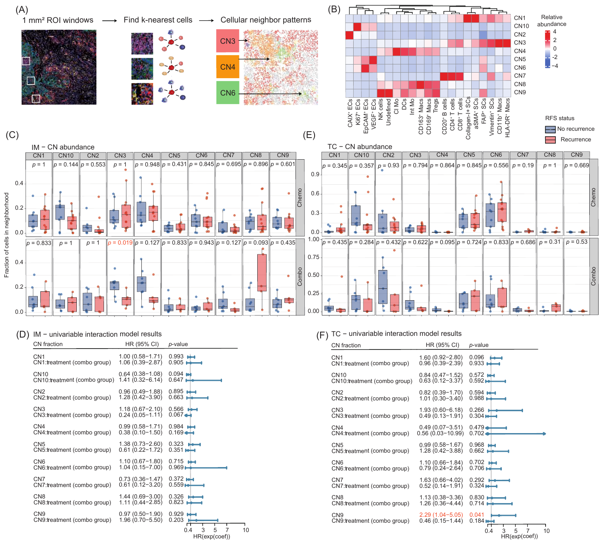
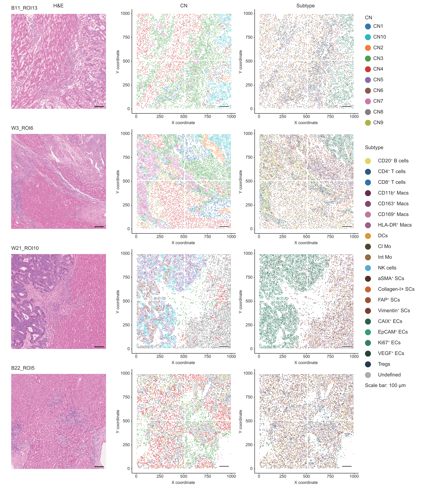
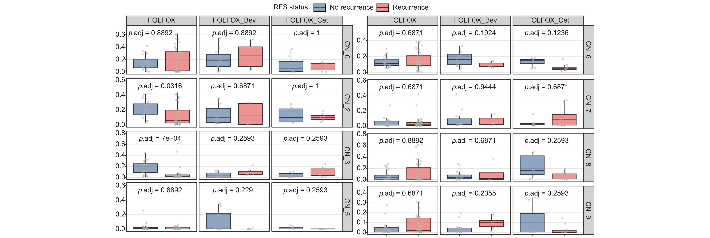
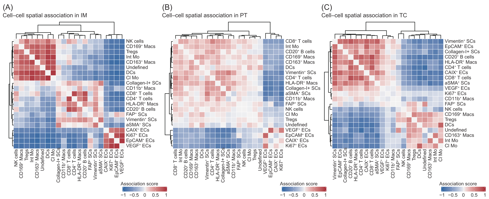

## Purpose

Figure 3 characterizes cellular neighborhoods (CNs) and their patient-level abundance and recurrence-free survival (RFS) associations in the invasive margin (IM) and tumor core (TC) of colorectal liver metastases. Figure S6 summarizes pairwise spatial associations across IM, peritumoral liver tissue (PT), and TC. Figure S7 shows representative spatial CN maps, and Figure S8 shows peritumoral CN abundance by adjuvant regimen. The figures present the current publication results; the code sections document the current public workflows.

## Inputs and analytical units

The [CN entry point](01_cellular_neighborhoods.R) consumes `FDZS1_IMC_processed.rds`, the FDZS-1 `SingleCellExperiment` described in the [public data contract](../../docs/data_contract.md#fdzs-1-imc): 35 markers, 2,018,260 cells, 35 patients, and 311 ROIs. Required complete cell metadata are unique `CellID`, ROI `ID`, patient `PID`, `Tissue`, `Position`, `SubType`, `Treatment`, `RFS_time`, and `RFS_event`. Each patient must have one consistent clinical record. Coordinates are in micrometres; RFS is in months from completion of primary and liver metastasis resection; `RFS_event` is 1 for recurrence and 0 for censored/no recurrence. Treatment groups are chemotherapy alone (`Chemo`) and chemotherapy plus targeted therapy (`Combo`). Cells are nested within ROIs and patients. CN assignment uses within-ROI neighborhoods; abundance and Cox analyses use patients within tissue.

The [Supplementary Figure 6 producer](supplementary/FigureS6/00_generate_interaction_pvalues.R) uses the same spatial identifiers, coordinates, tissue labels, and 21 subtype annotations. Its [consumer](supplementary/FigureS6/01_pairwise_interactions.R) requires a complete, identically ordered 21-by-21 `ClosePvalue.csv` matrix for every member of its fixed roster: 117 IM, 102 PT, and 69 TC ROIs. Each ROI contributes one signed score per subtype pair; the tissue roster defines the averaging denominator. Shared implementations are linked in [coordinates.R](../../src/imc/coordinates.R) and [spatial_interactions.R](../../src/imc/spatial_interactions.R).

## Figure 3: cellular neighborhoods



**Figure 3. Cellular neighborhood patterns in tumor core and invasive margin.** (A) CN identification workflow and example spatial patterns. (B) Scaled cell-subpopulation composition of ten CNs. (C, E) Patient-level CN fractions in IM and TC, comparing no recurrence (blue) with recurrence (red) within Chemo and Combo groups; nominal Wilcoxon P values are displayed. (D, F) CN-fraction and CN-by-treatment Cox terms, with hazard ratios, 95% confidence intervals, and nominal P values. The CN term describes the association in Chemo, and the interaction term describes its change in Combo. [Publication PDF](report_assets/figure3_publication.pdf).

### Public CN workflow: configuration and input preparation

The source specifies input/output paths, package requirements, the shared coordinate interface, and the required cell metadata.

<!-- source: 01_cellular_neighborhoods.R; lines: 1-58 -->
```{r figure3_cn_configuration, eval=FALSE}
# Target: Figure 3B-F cellular-neighborhood analysis.
# Purpose: derive inverse-distance weighted, within-ROI cellular neighborhoods;
# summarize their patient-level abundances; and produce the figure-source tables
# and plots. The configured analysis loads the canonical SCE.
# Inputs: an FDZS1_IMC_processed.rds SingleCellExperiment and the shared coordinate helper.
# Outputs: cellular-neighborhood assignments, neighbor fractions, composition
# matrices/heatmaps, patient-level fractions, and tissue-specific summaries/plots.
# Ordered workflow: validate dependencies and SCE metadata; convert Position to
# coordinates; derive neighborhoods; save assignments and composition; summarize
# patient fractions; then write IM and TC statistical summaries and plots.

# Edit these paths and set run to TRUE for a sequential analysis invocation.
figure3_config <- list(
    run = FALSE,
    sce_path = "PATH/TO/FDZS1_IMC_processed.rds",
    output_dir = "PATH/TO/Figure3_output",
    script_dir = "figures/Figure3"
)

#' Verify that required R packages are installed.
#'
#' @param packages Character vector of package names.
#' @return Invisibly `NULL`; stops when a required package is unavailable.
require_packages <- function(packages) {
    # Resolve all analysis dependencies before any data object is loaded.
    missing <- packages[!vapply(packages, requireNamespace, logical(1), quietly = TRUE)]
    if (length(missing) > 0L) stop("Missing required packages: ", paste(missing, collapse = ", "))
}

#' Load the coordinate-conversion interface.
#'
#' @param script_dir Directory containing this Figure 3 script.
#' @return Invisibly `NULL`; sources `coordinates.R` and requires
#'   `position_to_xy()` to be defined.
load_shared_coordinates <- function(script_dir) {
    # Source the shared Position parser relative to the public Figure 3 directory.
    helper <- normalizePath(file.path(script_dir, "..", "..", "src", "imc", "coordinates.R"), mustWork = FALSE)
    if (!file.exists(helper)) stop("Required src/imc coordinate interface is missing: ", helper)
    source(helper)
    if (!exists("position_to_xy", mode = "function")) {
        stop("src/imc coordinates.R must define position_to_xy().")
    }
}

required_cell_columns <- c("CellID", "ID", "PID", "Tissue", "Position", "SubType", "Treatment", "RFS_time", "RFS_event")

#' Validate required cell-level metadata at the SCE boundary.
#'
#' @param cell_data Data frame created from SCE `colData()`.
#' @return Invisibly `NULL`; stops for missing required columns or non-unique
#'   `CellID` values.
validate_cell_metadata <- function(cell_data) {
    # Enforce the cell-level identifier and clinical-field contract at the SCE boundary.
    missing <- setdiff(required_cell_columns, names(cell_data))
    if (length(missing) > 0L) stop("SCE colData is missing: ", paste(missing, collapse = ", "))
    if (anyDuplicated(cell_data$CellID)) stop("CellID must be unique at the SCE input boundary.")
}

```

### Neighborhood assignment

For each cell, subtype fractions are calculated from its 20 nearest cells within the same patient–ROI, weighting each neighbor by `1 / (distance + 1e-9)`. K-means uses 10 clusters, seed 42, 20 starts, and 100 maximum iterations. Clusters containing fewer than 5,000 cells are assigned to `CN_Other`. Cell identifiers align the assignments to metadata.

<!-- source: 01_cellular_neighborhoods.R; lines: 59-145 -->
```{r figure3_cn_assignment, eval=FALSE}
#' Calculate inverse-distance weighted subtype fractions within each ROI.
#'
#' @param cell_data Cell metadata with `CellID`, `ID`, `SubType`, `x`, and `y`.
#' @param k_neighbors Number of within-ROI nearest neighbors per cell.
#' @param n_cores Number of parallel ROI workers.
#' @return Data frame of per-cell neighborhood subtype fractions and coordinates.
inverse_distance_fractions <- function(cell_data, k_neighbors = 20L, n_cores = 12L) {
    # Fix a common subtype feature axis for every cell and ROI.
    subtype_order <- sort(unique(as.character(cell_data$SubType)))
    # Preserve the patient-to-ROI hierarchy even if an ROI label is reused.
    by_roi <- split(
        cell_data,
        interaction(cell_data$PID, cell_data$ID, drop = TRUE, lex.order = TRUE)
    )

    #' Calculate weighted subtype fractions for one ROI.
    #'
    #' @param roi_data Cell metadata for one ROI.
    #' @return A per-cell fraction data frame, or `NULL` when the ROI has fewer
    #'   than `k_neighbors + 1` cells.
    worker <- function(roi_data) {
        # Retain only ROIs large enough to define the requested within-ROI neighborhood.
        if (nrow(roi_data) < k_neighbors + 1L) return(NULL)
        # Find spatial neighbors in micrometre coordinates for every cell in this ROI.
        knn <- FNN::get.knn(as.matrix(roi_data[, c("x", "y")]), k = k_neighbors)
        fractions <- matrix(0, nrow = nrow(roi_data), ncol = length(subtype_order),
            dimnames = list(NULL, subtype_order))
        # Convert neighbor labels to inverse-distance weighted subtype fractions per index cell.
        for (i in seq_len(nrow(roi_data))) {
            weights <- 1 / (knn$nn.dist[i, ] + 1e-9)
            weighted <- tapply(
                weights,
                factor(as.character(roi_data$SubType[knn$nn.index[i, ]]), levels = subtype_order),
                sum
            )
            weighted[is.na(weighted)] <- 0
            fractions[i, ] <- as.numeric(weighted) / sum(weights)
        }
        # Return cell identifiers and coordinates aligned row-wise with the fraction matrix.
        data.frame(CellID = roi_data$CellID, ID = roi_data$ID, fractions,
            x = roi_data$x, y = roi_data$y, check.names = FALSE)
    }
    # Calculate each ROI independently, then restore a single per-cell table.
    fractions <- parallel::mclapply(by_roi, worker, mc.cores = n_cores)
    do.call(rbind, Filter(Negate(is.null), fractions))
}

#' Cluster inverse-distance neighborhood profiles into cellular neighborhoods.
#'
#' @param cell_data Cell metadata with subtype and coordinate columns.
#' @param k_neighbors Number of within-ROI nearest neighbors per cell.
#' @param n_clusters Number of k-means neighborhood clusters.
#' @param n_cores Number of parallel ROI workers.
#' @return List containing `assignments` and `neighbor_fractions` data frames.
detect_cellular_neighborhoods <- function(cell_data, k_neighbors = 20L, n_clusters = 10L,
                                          n_cores = 12L) {
    # Build the per-cell neighborhood feature matrix on the shared subtype axis.
    fractions <- inverse_distance_fractions(cell_data, k_neighbors, n_cores)
    if (is.null(fractions) || nrow(fractions) < n_clusters) {
        stop("Fewer than ", n_clusters, " cells have valid within-ROI neighborhoods.")
    }
    # Fit the specified k-means model using only subtype-fraction features.
    feature_columns <- setdiff(names(fractions), c("CellID", "ID", "x", "y"))
    set.seed(42)
    cluster <- stats::kmeans(as.matrix(fractions[, feature_columns, drop = FALSE]),
        centers = n_clusters, nstart = 20, iter.max = 100)$cluster
    # Construct per-cell labels and merge clusters below the fixed cell-count threshold.
    assignments <- fractions[, c("CellID", "ID"), drop = FALSE]
    assignments$CNP20 <- paste0("CN", cluster)
    counts <- table(assignments$CNP20)
    assignments$CNP20[assignments$CNP20 %in% names(counts)[counts < 5000L]] <- "CN_Other"
    list(assignments = assignments, neighbor_fractions = fractions)
}

#' Attach cellular-neighborhood assignments to cell metadata.
#'
#' @param cell_data Cell metadata with `CellID`.
#' @param assignments Per-cell neighborhood assignments with `CellID` and `CNP20`.
#' @return `cell_data` with a `CNP20` column.
attach_cn_assignments <- function(cell_data, assignments) {
    # Match labels by unique CellID so the original cell metadata order is preserved.
    if (anyDuplicated(assignments$CellID)) stop("CN assignment CellID values must be unique.")
    index <- match(cell_data$CellID, assignments$CellID)
    cell_data$CNP20 <- assignments$CNP20[index]
    cell_data
}

```

### Figure S7: spatial CN maps



**Figure S7. Spatial visualization of cellular neighborhoods in CRLM.** Representative ROIs B11_ROI13, W3_ROI6, W21_ROI10, and B22_ROI5 show H&E staining (left), CN assignments (middle), and cell phenotypes (right). Each map point represents one cell. Scale bars, 100 µm.

### Patient-level abundance

Assigned cells are counted by patient, tissue, and CN. Within each tissue, absent patient–CN combinations receive zero counts. Fractions divide each CN count by the patient's total assigned cells in that tissue, and one clinical record is attached per patient.

<!-- source: 01_cellular_neighborhoods.R; lines: 146-187 -->
```{r figure3_cn_patient_fractions, eval=FALSE}
#' Extract one clinical record per patient from cell metadata.
#'
#' @param cell_data Cell metadata containing patient-level clinical variables.
#' @return Data frame with `PID`, `Treatment`, `RFS_time`, and `RFS_event`.
patient_clinical_data <- function(cell_data) {
    # Collapse repeated cell metadata to one invariant clinical record per patient.
    clinical <- unique(cell_data[, c("PID", "Treatment", "RFS_time", "RFS_event"), drop = FALSE])
    duplicates <- duplicated(clinical$PID) | duplicated(clinical$PID, fromLast = TRUE)
    if (any(duplicates)) stop("Clinical variables must be unique within PID.")
    clinical
}

#' Calculate cellular-neighborhood fractions for each patient and tissue.
#'
#' @param cell_data Cell metadata with `CNP20` assignments.
#' @return Patient-tissue-neighborhood fraction data joined to clinical variables.
patient_cn_fractions <- function(cell_data) {
    # Retain assigned cells in the three tissue compartments used for patient summaries.
    selected <- cell_data[cell_data$Tissue %in% c("IM", "PT", "TC") & !is.na(cell_data$CNP20), , drop = FALSE]
    # Count cells at the patient-tissue-neighborhood analysis unit.
    counts <- dplyr::summarise(
        dplyr::group_by(
            dplyr::mutate(selected, PID = as.character(PID), CNP20 = as.character(CNP20)),
            PID, Tissue, CNP20
        ),
        cell_count_in_cn = dplyr::n(), .groups = "drop"
    )
    # Complete absent patient-neighborhood combinations within each tissue with zero counts.
    counts <- dplyr::group_modify(
        dplyr::group_by(counts, Tissue),
        ~ tidyr::complete(.x, PID, CNP20, fill = list(cell_count_in_cn = 0L))
    )
    # Normalize neighborhood counts within each patient-tissue total.
    fractions <- dplyr::mutate(
        dplyr::group_by(counts, PID, Tissue),
        total_cells_in_group = sum(cell_count_in_cn),
        fraction = cell_count_in_cn / total_cells_in_group
    )
    # Attach one clinical record to every patient-tissue-neighborhood fraction.
    dplyr::left_join(dplyr::ungroup(fractions), patient_clinical_data(selected), by = "PID")
}

```

### Figure 3C and 3E: recurrence comparisons in IM and TC

Vector source panels: [IM abundance (3C)](report_assets/figure3C_im_cn_abundance.pdf) and [TC abundance (3E)](report_assets/figure3E_tc_cn_abundance.pdf).

Within each treatment–CN group, the current workflow uses a Wilcoxon test to compare patient fractions by recurrence status when there are at least six patients and at least three in each recurrence group. The table includes nominal and Benjamini–Hochberg-adjusted P values across the eligible tests within a tissue. Boxplots display individual patients and nominal P values, with treatment in rows and CN in columns.

<!-- source: 01_cellular_neighborhoods.R; lines: 188-255 -->
```{r figure3_cn_recurrence_comparison, eval=FALSE}
#' Perform nominal Wilcoxon comparisons by treatment and neighborhood.
#'
#' @param tissue_data Patient-level cellular-neighborhood fractions for one tissue.
#' @return Data frame of eligible tests with nominal and BH-adjusted P values.
nominal_wilcoxon <- function(tissue_data) {
    # Partition patient fractions into independent treatment-neighborhood test groups.
    groups <- split(tissue_data, interaction(tissue_data$Treatment, tissue_data$CNP20, drop = TRUE))

    #' Test one treatment-neighborhood group when both recurrence groups are eligible.
    #'
    #' @param group_data Patient-level fractions for one treatment-neighborhood group.
    #' @return One-row nominal Wilcoxon result, or `NULL` when eligibility criteria
    #'   are not met.
    test_group <- function(group_data) {
        # Require both recurrence groups and the prespecified minimum patient representation.
        status_counts <- table(group_data$RFS_event)
        if (nrow(group_data) < 6L || length(status_counts) != 2L || min(status_counts) < 3L) return(NULL)
        # Compare patient-level neighborhood fractions between recurrence groups.
        test <- stats::wilcox.test(fraction ~ RFS_event, data = group_data)
        data.frame(
            Treatment = as.character(group_data$Treatment[1]), CNP20 = as.character(group_data$CNP20[1]),
            n = nrow(group_data), n_RFS_event0 = unname(status_counts["0"]), n_RFS_event1 = unname(status_counts["1"]),
            p_value = unname(test$p.value), stringsAsFactors = FALSE
        )
    }
    # Combine eligible tests and adjust across the tissue-level test family.
    rows <- lapply(groups, test_group)
    rows <- Filter(Negate(is.null), rows)
    if (length(rows) == 0L) return(data.frame())
    result <- do.call(rbind, rows)
    result$p_adjusted_bh <- stats::p.adjust(result$p_value, method = "BH")
    result
}

#' Plot patient cellular-neighborhood fractions by treatment and recurrence status.
#'
#' @param tissue_data Patient-level cellular-neighborhood fractions for one tissue.
#' @param wilcoxon_results Results returned by `nominal_wilcoxon()`.
#' @param tissue Tissue label used in the plot subtitle.
#' @param output_file PDF path for the saved plot.
#' @return Invisibly returns `output_file`, as returned by `ggsave()`, after writing one PDF.
plot_cn_frequency <- function(tissue_data, wilcoxon_results, tissue, output_file) {
    # Construct patient-level recurrence comparisons faceted by treatment and neighborhood.
    plot <- ggplot2::ggplot(tissue_data, ggplot2::aes(x = factor(RFS_event), y = fraction)) +
        ggplot2::geom_jitter(ggplot2::aes(color = factor(RFS_event)), width = 0.1, size = 2, alpha = 0.6) +
        ggplot2::geom_boxplot(ggplot2::aes(fill = factor(RFS_event)), alpha = 0.5, outlier.shape = NA) +
        ggplot2::facet_grid(Treatment ~ CNP20, scales = "free_y") +
        ggplot2::scale_fill_manual(values = c("0" = "#0072B2", "1" = "#D55E00")) +
        ggplot2::scale_color_manual(values = c("0" = "#0072B2", "1" = "#D55E00")) +
        ggplot2::labs(
            subtitle = paste0(tissue, " - CN Abundance by RFS Event, Grouped by Treatment"),
            x = "RFS Event (0 = No Recurrence, 1 = Recurrence)", y = "Fraction of Cells in Neighborhood"
        ) +
        ggplot2::theme_bw(base_size = 14) +
        ggplot2::theme(legend.position = "none", strip.text.y = ggplot2::element_text(angle = 0))
    # Place nominal test annotations above their corresponding treatment-neighborhood facets.
    if (nrow(wilcoxon_results) > 0L) {
        labels <- dplyr::mutate(wilcoxon_results,
            label = paste0("p = ", format.pval(p_value, digits = 2, eps = 0.001)),
            x = 1.5,
            y = vapply(split(tissue_data$fraction, interaction(tissue_data$Treatment, tissue_data$CNP20, drop = TRUE)), max, numeric(1))[interaction(wilcoxon_results$Treatment, wilcoxon_results$CNP20, drop = TRUE)] * 1.08
        )
        plot <- plot + ggplot2::geom_text(data = labels, ggplot2::aes(x = x, y = y, label = label), inherit.aes = FALSE, size = 3)
    }
    # Export the tissue-specific abundance panel.
    ggplot2::ggsave(output_file, plot, width = 12, height = 7.5)
}

```

### Figure 3D and 3F: CN-by-treatment RFS associations

Vector source panels: [IM Cox results (3D)](report_assets/figure3D_im_cn_cox.pdf) and [TC Cox results (3F)](report_assets/figure3F_tc_cn_cox.pdf).

The current workflow fits a separate Cox model for each CN and tissue: `Surv(RFS_time, RFS_event) ~ scale(CN fraction) * Treatment`. The exported terms are the CN coefficient in the reference treatment group and its treatment interaction, with hazard ratios, 95% confidence intervals, and nominal Wald P values. The forest plot's source label `Baseline hazard` refers to the reference-treatment CN coefficient.

<!-- source: 01_cellular_neighborhoods.R; lines: 256-308 -->
```{r figure3_cn_cox, eval=FALSE}
#' Fit cellular-neighborhood fraction by treatment Cox interaction models.
#'
#' @param tissue_data Patient-level cellular-neighborhood fractions for one tissue.
#' @return Data frame of baseline and treatment-interaction hazard-ratio terms.
cox_summary <- function(tissue_data) {
    # Reshape patient-level neighborhood fractions to one row per patient for modeling.
    wide <- tidyr::pivot_wider(tissue_data[, c("PID", "CNP20", "fraction", "Treatment", "RFS_time", "RFS_event")],
        names_from = "CNP20", values_from = "fraction")
    features <- setdiff(names(wide), c("PID", "Treatment", "RFS_time", "RFS_event"))

    #' Fit and extract the prespecified Cox model for one neighborhood feature.
    #'
    #' @param feature Name of one wide-format neighborhood-fraction column.
    #' @return Two-row data frame containing the baseline and treatment-interaction
    #'   model terms.
    fit_feature <- function(feature) {
        # Fit the neighborhood main effect and its treatment interaction for one feature.
        model <- survival::coxph(stats::as.formula(paste0("survival::Surv(RFS_time, RFS_event) ~ scale(`", feature, "`) * Treatment")), data = wide)
        # Extract the baseline neighborhood and treatment-interaction estimates with confidence limits.
        summary <- summary(model)
        terms <- summary$coefficients[, "Pr(>|z|)"]
        keep <- c(1L, 3L)
        data.frame(
            CNP20 = feature, term = rownames(summary$coefficients)[keep],
            HR = summary$conf.int[keep, "exp(coef)"], Lower = summary$conf.int[keep, "lower .95"],
            Upper = summary$conf.int[keep, "upper .95"], p_value = terms[keep], row.names = NULL
        )
    }
    # Stack feature-specific model terms into a single tissue summary.
    rows <- lapply(features, fit_feature)
    do.call(rbind, rows)
}

#' Plot a forest summary of cellular-neighborhood Cox model terms.
#'
#' @param cox_results Results returned by `cox_summary()`.
#' @param tissue Tissue label used in the plot title.
#' @param output_file PDF path for the saved forest plot.
#' @return Invisibly returns `output_file`, as returned by `ggsave()`, after writing one PDF.
plot_cox_summary <- function(cox_results, tissue, output_file) {
    # Label baseline and interaction terms before arranging hazard ratios for display.
    cox_results$term_label <- ifelse(grepl(":Treatment", cox_results$term), "Interaction", "Baseline hazard")
    cox_results$label <- paste(cox_results$CNP20, cox_results$term_label, sep = " - ")
    plot <- ggplot2::ggplot(cox_results, ggplot2::aes(x = HR, y = reorder(label, HR), color = term_label)) +
        ggplot2::geom_vline(xintercept = 1, linetype = "dashed", color = "grey60") +
        ggplot2::geom_errorbarh(ggplot2::aes(xmin = Lower, xmax = Upper), height = 0.2) +
        ggplot2::geom_point() + ggplot2::scale_x_log10() +
        ggplot2::labs(title = paste0(tissue, " - Univariable Interaction Model Results"), x = "Hazard ratio", y = NULL, color = NULL) +
        ggplot2::theme_bw(base_size = 12)
    # Export a height-adjusted forest plot containing all tissue model terms.
    ggplot2::ggsave(output_file, plot, width = 10, height = max(8, 0.3 * nrow(cox_results) + 3))
}

```

### Figure 3B: composition heatmap and workflow assembly

[Vector source composition panel (3B)](report_assets/figure3B_cn_composition.pdf).

The current workflow sets seed 619, loads metadata, parses coordinates, and computes CN assignments using 12 ROI workers. For IM, PT, and TC cells, it derives subtype proportions within each CN and exports a heatmap scaled by subtype column, with fixed CN row order and clustered subtype columns. It then saves patient fractions and the IM/TC recurrence and Cox summaries described above.

<!-- source: 01_cellular_neighborhoods.R; lines: 309-373 -->
```{r figure3_cn_workflow, eval=FALSE}
#' Run the configured Figure 3B-F cellular-neighborhood workflow.
#'
#' @param config List with `sce_path`, `output_dir`, and `script_dir` entries.
#' @return Invisibly `NULL`; writes the configured Figure 3 output files.
run_figure3_cellular_neighborhoods <- function(config) {
    # Require the analysis configuration and package interfaces before loading the SCE.
    required_config <- c("sce_path", "output_dir", "script_dir")
    missing_config <- setdiff(required_config, names(config))
    if (length(missing_config) > 0L) {
        stop("Figure 3 configuration is missing: ", paste(missing_config, collapse = ", "))
    }
    require_packages(c("SingleCellExperiment", "dplyr", "tidyr", "FNN", "pheatmap", "ggplot2", "survival"))
    # Load cell metadata and convert stored Positions to numeric micrometre coordinates.
    set.seed(619)
    load_shared_coordinates(config$script_dir)
    sce <- readRDS(config$sce_path)
    cell_data <- as.data.frame(SummarizedExperiment::colData(sce))
    validate_cell_metadata(cell_data)
    coordinates <- position_to_xy(cell_data$Position)
    cell_data$x <- coordinates$x
    cell_data$y <- coordinates$y
    # Prepare the panel and intermediate-results output directories.
    dir.create(config$output_dir, recursive = TRUE, showWarnings = FALSE)
    results_dir <- file.path(config$output_dir, "cn_results")
    dir.create(results_dir, recursive = TRUE, showWarnings = FALSE)

    # Detect per-cell neighborhoods and export assignments plus their feature fractions.
    detected <- detect_cellular_neighborhoods(cell_data)
    utils::write.csv(detected$assignments, file.path(results_dir, "peritumor_cn_results.csv"), row.names = FALSE)
    utils::write.csv(detected$neighbor_fractions, file.path(results_dir, "Spatial neighbors of All with k=20 neighbors.csv"), row.names = FALSE)
    cells_with_cn <- attach_cn_assignments(cell_data, detected$assignments)
    selected_cells <- cells_with_cn[cells_with_cn$Tissue %in% c("IM", "PT", "TC") & !is.na(cells_with_cn$CNP20), , drop = FALSE]

    # Aggregate assigned cells into a neighborhood-by-subtype composition matrix.
    composition <- dplyr::summarise(dplyr::group_by(selected_cells, CNP20, SubType), n = dplyr::n(), .groups = "drop")
    composition <- dplyr::mutate(dplyr::group_by(composition, CNP20), subtype_fraction = n / sum(n))
    composition_wide <- tidyr::pivot_wider(composition[, c("CNP20", "SubType", "subtype_fraction")], names_from = "SubType", values_from = "subtype_fraction", values_fill = 0)
    composition_matrix <- as.matrix(composition_wide[, -1])
    rownames(composition_matrix) <- composition_wide$CNP20
    utils::write.table(composition_matrix, file.path(config$output_dir, "Cellular Neighbors celltype fraction matrix.tsv"), sep = "\t", quote = FALSE)
    # Construct and export the column-scaled neighborhood composition heatmap.
    heatmap <- pheatmap::pheatmap(composition_matrix, color = grDevices::colorRampPalette(c("#436eee", "white", "#EE0000"))(100), scale = "column", cluster_rows = FALSE, cluster_cols = TRUE, silent = TRUE)
    grDevices::pdf(file.path(config$output_dir, "Cellular Neighbors celltype fraction heatmap.pdf"), width = 8, height = 6)
    print(heatmap)
    grDevices::dev.off()

    # Derive and export patient-level neighborhood fractions for downstream inference.
    fractions <- patient_cn_fractions(selected_cells)
    utils::write.csv(fractions, file.path(results_dir, "patient_level_cn_fractions.csv"), row.names = FALSE)
    # Run recurrence comparisons and Cox interaction models independently for IM and TC.
    for (tissue in c("IM", "TC")) {
        tissue_data <- fractions[fractions$Tissue == tissue, , drop = FALSE]
        wilcoxon_results <- nominal_wilcoxon(tissue_data)
        # Export the statistical summaries and their corresponding figure panels.
        utils::write.csv(wilcoxon_results, file.path(results_dir, paste0(tissue, "_CN_nominal_wilcoxon.csv")), row.names = FALSE)
        plot_cn_frequency(tissue_data, wilcoxon_results, tissue, file.path(config$output_dir, paste0(tissue, "_CN_Frequency_by_treatment_group.pdf")))
        cox_results <- cox_summary(tissue_data)
        utils::write.csv(cox_results, file.path(results_dir, paste0(tissue, "_CN_cox_results.csv")), row.names = FALSE)
        plot_cox_summary(cox_results, tissue, file.path(config$output_dir, paste0("ForestPlot_Univariable_CN_Fraction_", tissue, ".pdf")))
    }
}

if (isTRUE(figure3_config$run)) {
    run_figure3_cellular_neighborhoods(figure3_config)
}
```

## Figure S8: peritumoral CN abundance



**Figure S8. Peritumoral cellular neighborhood abundance differs by recurrence status within treatment groups.** ROI-level fractions of peritumoral CNs are compared between no recurrence (blue) and recurrence (red) within FOLFOX, FOLFOX plus bevacizumab, and FOLFOX plus cetuximab. Each point represents one ROI; the displayed P values are Benjamini–Hochberg adjusted. These peritumoral CN labels refer to the PT-specific clustering shown in [Figure 4](../Figure4/Figure4.md).

## Figure S6: pairwise cell-cell interaction patterns across CRLM regions



**Figure S6. Pairwise cell-cell interaction patterns across CRLM regions.** Heatmaps show signed spatial association scores among 21 cell subtypes in IM (A), PT (B), and TC (C), summarized across ROIs. Red indicates enrichment and blue indicates avoidance relative to ROI-local phenotype permutations; the scale spans −1 to 1. Spatial calls use nominal permutation P ≤ 0.05. Original vector source heatmaps: [IM](report_assets/figureS6_im_source.pdf), [PT](report_assets/figureS6_pt_source.pdf), and [TC](report_assets/figureS6_tc_source.pdf).


### Public pairwise-interaction workflow: permutation configuration

The precursor fixes a 22-micrometre distance, 1,000 permutations, seed 20260820, and the shared subtype order for IM, PT, and TC. The linked spatial-interaction engine holds ROI-local proximity edges fixed and permutes subtype labels within each ROI. It returns enrichment and avoidance probabilities with a one-count correction, including same-subtype pairs.

<!-- source: supplementary/FigureS6/00_generate_interaction_pvalues.R; lines: 1-54 -->
```{r figure3_s6_producer_configuration, eval=FALSE}
# Target: Supplementary Figure 6A-C ROI interaction P-value matrices.
# Purpose: Generate the saved ClosePvalue.csv inputs consumed by the fixed-roster
# Supplementary Figure 6 plotting workflow.
# Inputs: A configured IMC SingleCellExperiment RDS with `Position`, current
# `SubType`, and ROI metadata in `colData()`; shared coordinate and spatial-
# interaction modules.
# Outputs: One symmetric ClosePvalue.csv matrix per ROI under
# permutation_<Tissue>/<ROI>/ClosePvalue. Significant enrichment uses
# `p_enrichment`, significant avoidance uses `1 - p_avoidance`, and other
# entries are recorded as 0.5.
# Ordered workflow: configure paths and seed; source the shared modules; load and
# filter the SCE; parse micrometre coordinates; run the shared 22-um, 1000-
# permutation interaction calculation; then write fixed-axis symmetric matrices.
# The configured analysis loads the canonical SCE.

# Edit these paths and seed before execution, then set RUN to TRUE.
RUN <- FALSE
figure_s6_precursor_config <- list(
    sce_path = "PATH/TO/FDZS1_IMC_processed.rds",
    permutation_root = "PATH/TO/saved_permutation_results",
    seed = 20260820L
)

#' Purpose: Resolve the absolute path to this Supplementary Figure 6 script.
#'
#' @return Character scalar containing the normalized script path.
.figure_s6_script_path <- function() {
    # Prefer the source-file context when this script is loaded from another R session.
    source_path <- tryCatch(sys.frame(1L)$ofile, error = function(error) NULL)
    if (is.null(source_path)) {
        # Fall back to the command-line file argument for direct Rscript execution.
        file_argument <- grep(
            "^--file=", commandArgs(trailingOnly = FALSE), value = TRUE
        )
        if (length(file_argument) != 1L) {
            stop("Cannot determine the Supplementary Figure 6 script path")
        }
        source_path <- sub("^--file=", "", file_argument)
    }
    normalizePath(source_path, mustWork = TRUE)
}

FIGURE_S6_SCRIPT_DIR <- dirname(.figure_s6_script_path())

DISTANCE_UM <- 22
N_PERMUTATIONS <- 1000L
SIGNIFICANCE_THRESHOLD <- 0.05
TISSUES <- c("IM", "PT", "TC")
CELLTYPE_ORDER <- c(
    "Macro_CD169", "Macro_HLADR", "Mono_CD11c", "SC_COLLAGEN", "CD8T", "CD4T", "B",
    "SC_FAP", "Macro_CD163", "UNKNOWN", "SC_Vimentin", "Mono_Intermediate", "Mono_Classic",
    "TC_EpCAM", "SC_aSMA", "TC_Ki67", "NK", "Treg", "Macro_CD11b", "TC_CAIX", "TC_VEGF"
)

```

### Spatial metadata preparation

The source loads the shared coordinate and permutation interfaces, selects IM/PT/TC metadata, checks the complete subtype roster and unique ROI-to-patient/tissue mapping, and parses positions to numeric coordinates.

<!-- source: supplementary/FigureS6/00_generate_interaction_pvalues.R; lines: 55-129 -->
```{r figure3_s6_metadata, eval=FALSE}
#' Purpose: Source and verify the shared coordinate and spatial-interaction interfaces.
#'
#' @return Invisibly `NULL`; stops when a shared file or function is unavailable.
load_shared_interaction_modules <- function() {
    # Resolve the shared IMC interfaces relative to the public Figure S6 script.
    shared_dir <- normalizePath(
        file.path(FIGURE_S6_SCRIPT_DIR, "..", "..", "..", "..", "src", "imc"),
        mustWork = FALSE
    )
    shared_files <- file.path(shared_dir, c("coordinates.R", "spatial_interactions.R"))
    missing <- shared_files[!file.exists(shared_files)]
    if (length(missing) > 0L) {
        stop("Missing required src/imc file(s): ", paste(missing, collapse = ", "))
    }
    # Source both interfaces into the script environment used by the analysis.
    script_environment <- environment(load_shared_interaction_modules)
    invisible(lapply(shared_files, sys.source, envir = script_environment))

    # Require the coordinate parser and interaction engine exposed by the shared modules.
    required_functions <- c("position_to_xy", "calculate_spatial_interactions")
    unavailable <- required_functions[!vapply(
        required_functions, exists, logical(1L), mode = "function",
        envir = script_environment, inherits = FALSE
    )]
    if (length(unavailable) > 0L) {
        stop("Required src/imc interface is missing: ", paste(unavailable, collapse = ", "))
    }
    invisible(NULL)
}

#' Purpose: Load the configured SCE and prepare current Figure S6 cell metadata.
#'
#' @param sce_path Path to the configured IMC SingleCellExperiment RDS.
#' @param tissues Character vector of tissue labels retained for calculation.
#' @param subtype_order Complete subtype axis required by the Figure S6 consumer.
#' @return Cell metadata with numeric micrometre `x` and `y` columns.
prepare_interaction_metadata <- function(sce_path, tissues, subtype_order) {
    # Load cell metadata and require the identifiers, annotations, and Positions used by the engine.
    if (!requireNamespace("SingleCellExperiment", quietly = TRUE)) {
        stop("SingleCellExperiment is required")
    }
    sce <- readRDS(sce_path)
    cell_metadata <- as.data.frame(SingleCellExperiment::colData(sce))
    required <- c("CellID", "PID", "ID", "Tissue", "SubType", "Position")
    missing <- setdiff(required, names(cell_metadata))
    if (length(missing) > 0L) {
        stop("SCE colData is missing: ", paste(missing, collapse = ", "))
    }

    # Restrict the cell-level input to the configured tissues and required metadata columns.
    cell_metadata <- cell_metadata[
        as.character(cell_metadata$Tissue) %in% tissues,
        required,
        drop = FALSE
    ]
    if (any(!stats::complete.cases(cell_metadata))) {
        stop("Required Figure S6 colData fields must be complete")
    }
    # Keep a complete fixed subtype axis and a one-to-one ROI-to-patient/tissue mapping.
    observed_subtypes <- sort(unique(as.character(cell_metadata$SubType)))
    if (!setequal(observed_subtypes, subtype_order)) {
        stop("Filtered SCE SubType values must match the Figure S6 cell-type roster")
    }
    roi_mapping <- unique(cell_metadata[, c("PID", "ID", "Tissue"), drop = FALSE])
    if (anyDuplicated(roi_mapping$ID)) {
        stop("Each ROI ID must map to one patient and tissue")
    }

    # Parse stored Positions into numeric micrometre coordinates for spatial calculations.
    coordinates <- position_to_xy(as.character(cell_metadata$Position))
    cell_metadata$x <- coordinates$x
    cell_metadata$y <- coordinates$y
    cell_metadata
}

```

### ROI permutation matrices

Enrichment probabilities at or below 0.05 retain their lower-tail values. Significant avoidance is encoded as one minus the avoidance probability; remaining pairs receive 0.5. Each unordered pair is mirrored to produce a symmetric matrix on the fixed subtype axes, saved under its tissue and ROI.

<!-- source: supplementary/FigureS6/00_generate_interaction_pvalues.R; lines: 130-199 -->
```{r figure3_s6_tail_matrices, eval=FALSE}
#' Purpose: Convert one ROI's two permutation tails to a fixed-axis signed-tail matrix.
#'
#' @param roi_results Long-form results for one ROI returned by
#'   `calculate_spatial_interactions()`.
#' @param subtype_order Character vector defining both matrix axes.
#' @return Symmetric numeric ClosePvalue matrix in `subtype_order`; significant
#'   enrichment values are at or below 0.05, significant avoidance values are
#'   above 0.95, and other entries are 0.5.
close_pvalue_matrix <- function(roi_results, subtype_order) {
    # Map long-form subtype pairs to the fixed row and column axes.
    row_index <- match(roi_results$SubType_1, subtype_order)
    column_index <- match(roi_results$SubType_2, subtype_order)
    if (anyNA(row_index) || anyNA(column_index)) {
        stop("Interaction results contain a subtype outside the Figure S6 roster")
    }

    # Encode significant enrichment, significant avoidance, and neutral pairs on one tail scale.
    matrix <- matrix(
        NA_real_, nrow = length(subtype_order), ncol = length(subtype_order),
        dimnames = list(subtype_order, subtype_order)
    )
    close_pvalues <- ifelse(
        roi_results$p_enrichment <= SIGNIFICANCE_THRESHOLD,
        roi_results$p_enrichment,
        ifelse(
            roi_results$p_avoidance <= SIGNIFICANCE_THRESHOLD,
            1 - roi_results$p_avoidance,
            0.5
        )
    )
    # Mirror each unordered interaction pair to produce a symmetric consumer matrix.
    matrix[cbind(row_index, column_index)] <- close_pvalues
    matrix[cbind(column_index, row_index)] <- close_pvalues
    if (anyNA(matrix)) {
        stop("Interaction results do not contain every Figure S6 subtype pair")
    }
    matrix
}

#' Purpose: Write ROI signed-tail matrices in the Figure S6 saved-result layout.
#'
#' @param results Long-form output from `calculate_spatial_interactions()`.
#' @param permutation_root Root directory receiving `permutation_<Tissue>` directories.
#' @param tissues Character vector defining the tissues to write.
#' @param subtype_order Character vector defining matrix row and column order.
#' @return Invisibly returns the written ClosePvalue.csv paths.
write_close_pvalue_matrices <- function(
    results, permutation_root, tissues, subtype_order
) {
    # Write one fixed-axis matrix for every ROI, nested under its tissue result directory.
    written <- character()
    for (tissue in tissues) {
        # Preserve tissue as the outer analysis partition in the saved-result layout.
        tissue_results <- results[results$Tissue == tissue, , drop = FALSE]
        for (roi in unique(as.character(tissue_results$ID))) {
            # Convert and export the complete subtype-pair result for one ROI.
            roi_results <- tissue_results[tissue_results$ID == roi, , drop = FALSE]
            close_pvalues <- close_pvalue_matrix(roi_results, subtype_order)
            output_dir <- file.path(
                permutation_root, paste0("permutation_", tissue), roi, "ClosePvalue"
            )
            dir.create(output_dir, recursive = TRUE, showWarnings = FALSE)
            output_path <- file.path(output_dir, "ClosePvalue.csv")
            utils::write.csv(close_pvalues, output_path, quote = FALSE)
            written <- c(written, output_path)
        }
    }
    invisible(written)
}

```

### Producer workflow

The configured workflow prepares spatial metadata, calls the shared permutation calculation, and writes the ROI matrices consumed below.

<!-- source: supplementary/FigureS6/00_generate_interaction_pvalues.R; lines: 200-232 -->
```{r figure3_s6_producer_workflow, eval=FALSE}
#' Purpose: Run the configured Supplementary Figure 6 interaction precursor.
#'
#' @param config List with `sce_path`, `permutation_root`, and explicit integer `seed`
#'   entries.
#' @return Invisibly returns the written ClosePvalue.csv paths.
run_figure_s6_interaction_precursor <- function(config) {
    # Validate the input, output, and random-seed configuration before loading modules.
    required_config <- c("sce_path", "permutation_root", "seed")
    missing <- setdiff(required_config, names(config))
    if (length(missing) > 0L) {
        stop("Supplementary Figure 6 configuration is missing: ", paste(missing, collapse = ", "))
    }
    # Load shared interfaces and prepare the filtered cell-level spatial metadata.
    load_shared_interaction_modules()
    cell_metadata <- prepare_interaction_metadata(
        config$sce_path, TISSUES, CELLTYPE_ORDER
    )
    # Calculate ROI-level subtype-pair interactions with the configured distance and permutations.
    results <- calculate_spatial_interactions(
        cell_metadata,
        distance_um = DISTANCE_UM,
        n_permutations = N_PERMUTATIONS,
        seed = config$seed
    )
    # Export the long-form results as one symmetric ClosePvalue matrix per ROI.
    write_close_pvalue_matrices(
        results, config$permutation_root, TISSUES, CELLTYPE_ORDER
    )
}

if (sys.nframe() == 0L && isTRUE(RUN)) {
    run_figure_s6_interaction_precursor(figure_s6_precursor_config)
}
```

### Fixed ROI roster and panel order

The consumer defines the subtype axis and complete ROI roster. The panel mapping is Supplementary Figure 6A = IM, 6B = PT, and 6C = TC.

<!-- source: supplementary/FigureS6/01_pairwise_interactions.R; lines: 1-327 -->
```{r figure3_s6_consumer_roster, eval=FALSE}
# Target: Supplementary Figure 6A-C pairwise cellular-interaction frequency panels.
# Purpose: aggregate the specified saved ClosePvalue.csv matrices into
# tissue-specific interaction-frequency summaries.
# Inputs: saved permutation-result directories containing the explicit IM, PT,
# and TC ROI rosters and their ClosePvalue.csv matrices.
# Outputs: a saved-result roster table plus one frequency matrix TSV and heatmap
# PDF for each tissue panel.
# Ordered workflow: validate the fixed rosters and dependencies; preflight every
# saved p-value matrix; record the roster; compute signed frequencies; then write
# the tissue-specific matrices and heatmaps.

# Edit these paths and set run to TRUE for a sequential analysis invocation.
figure_s6_config <- list(
    run = FALSE,
    permutation_root = "PATH/TO/saved_permutation_results",
    output_dir = "PATH/TO/FigureS6_output"
)

celltype_order <- c(
    "Macro_CD169", "Macro_HLADR", "Mono_CD11c", "SC_COLLAGEN", "CD8T", "CD4T", "B",
    "SC_FAP", "Macro_CD163", "UNKNOWN", "SC_Vimentin", "Mono_Intermediate", "Mono_Classic",
    "TC_EpCAM", "SC_aSMA", "TC_Ki67", "NK", "Treg", "Macro_CD11b", "TC_CAIX", "TC_VEGF"
)

# The specified saved-result roster fixes the denominator for each panel.
# A=IM, B=PT, and C=TC.
roi_rosters <- list(
    IM = c(
    "B10_ROI10",
    "B10_ROI15",
    "B10_ROI5",
    "B11_ROI11",
    "B11_ROI13",
    "B11_ROI6",
    "B12_ROI11",
    "B12_ROI12",
    "B12_ROI6",
    "B12_ROI9",
    "B13_ROI7",
    "B13_ROI8",
    "B13_ROI9",
    "B14_ROI10",
    "B14_ROI11",
    "B14_ROI6",
    "B14_ROI9",
    "B15_ROI13",
    "B15_ROI7",
    "B15_ROI8",
    "B16_ROI12",
    "B16_ROI13",
    "B16_ROI5",
    "B16_ROI9",
    "B18_ROI11",
    "B18_ROI12",
    "B18_ROI6",
    "B18_ROI9",
    "B20_ROI10",
    "B20_ROI11",
    "B20_ROI12",
    "B20_ROI9",
    "B21_ROI12",
    "B21_ROI6",
    "B21_ROI7",
    "B21_ROI9",
    "B22_ROI10",
    "B22_ROI13",
    "B22_ROI7",
    "B22_ROI9",
    "B2_ROI4",
    "B2_ROI6",
    "B2_ROI9",
    "B3_ROI11",
    "B3_ROI12",
    "B3_ROI9",
    "B4_ROI10",
    "B4_ROI6",
    "B4_ROI8",
    "B5_ROI14",
    "B5_ROI15",
    "B5_ROI8",
    "B6_ROI12",
    "B6_ROI7",
    "B6_ROI8",
    "B8_ROI12",
    "B8_ROI5",
    "B8_ROI9",
    "W10_ROI10",
    "W10_ROI11",
    "W10_ROI7",
    "W12_ROI12",
    "W12_ROI13",
    "W12_ROI15",
    "W15_ROI10",
    "W15_ROI12",
    "W15_ROI7",
    "W16_ROI12",
    "W16_ROI5",
    "W16_ROI8",
    "W16_ROI9",
    "W17_ROI10",
    "W17_ROI11",
    "W17_ROI6",
    "W17_ROI8",
    "W18_ROI11",
    "W18_ROI13",
    "W18_ROI14",
    "W19_ROI10",
    "W19_ROI12",
    "W19_ROI13",
    "W19_ROI8",
    "W19_ROI9",
    "W1_ROI5",
    "W1_ROI6",
    "W1_ROI7",
    "W20_ROI10",
    "W20_ROI12",
    "W20_ROI7",
    "W21_ROI10",
    "W21_ROI11",
    "W21_ROI8",
    "W22_ROI10",
    "W22_ROI13",
    "W22_ROI5",
    "W23_ROI10",
    "W23_ROI7",
    "W23_ROI8",
    "W25_ROI14",
    "W25_ROI15",
    "W25_ROI6",
    "W25_ROI8",
    "W2_ROI12",
    "W2_ROI5",
    "W2_ROI7",
    "W3_ROI11",
    "W3_ROI6",
    "W3_ROI7",
    "W4_ROI11",
    "W4_ROI5",
    "W4_ROI8",
    "W6_ROI13",
    "W6_ROI5",
    "W6_ROI8",
    "W7_ROI13",
    "W7_ROI7",
    "W7_ROI9"
),
    PT = c(
    "B10_ROI7",
    "B10_ROI8",
    "B10_ROI9",
    "B11_ROI10",
    "B11_ROI5",
    "B11_ROI9",
    "B12_ROI10",
    "B12_ROI5",
    "B12_ROI8",
    "B13_ROI10",
    "B13_ROI12",
    "B13_ROI13",
    "B14_ROI5",
    "B14_ROI7",
    "B14_ROI8",
    "B15_ROI5",
    "B15_ROI6",
    "B15_ROI9",
    "B16_ROI10",
    "B16_ROI11",
    "B16_ROI6",
    "B18_ROI10",
    "B18_ROI7",
    "B18_ROI8",
    "B20_ROI5",
    "B20_ROI6",
    "B20_ROI7",
    "B21_ROI10",
    "B21_ROI5",
    "B21_ROI8",
    "B22_ROI5",
    "B22_ROI6",
    "B22_ROI8",
    "B2_ROI1",
    "B2_ROI2",
    "B2_ROI3",
    "B3_ROI5",
    "B3_ROI6",
    "B3_ROI7",
    "B3_ROI8",
    "B4_ROI11",
    "B4_ROI12",
    "B4_ROI5",
    "B5_ROI12",
    "B5_ROI5",
    "B5_ROI6",
    "B6_ROI10",
    "B6_ROI11",
    "B6_ROI9",
    "B8_ROI11",
    "B8_ROI7",
    "B8_ROI8",
    "W10_ROI5",
    "W10_ROI8",
    "W10_ROI9",
    "W12_ROI11",
    "W12_ROI16",
    "W12_ROI6",
    "W15_ROI13",
    "W15_ROI5",
    "W15_ROI6",
    "W16_ROI11",
    "W16_ROI13",
    "W16_ROI6",
    "W17_ROI12",
    "W17_ROI13",
    "W17_ROI7",
    "W18_ROI5",
    "W18_ROI9",
    "W19_ROI11",
    "W19_ROI5",
    "W19_ROI6",
    "W20_ROI11",
    "W20_ROI5",
    "W20_ROI6",
    "W21_ROI12",
    "W21_ROI13",
    "W21_ROI9",
    "W22_ROI12",
    "W22_ROI14",
    "W22_ROI7",
    "W23_ROI11",
    "W23_ROI13",
    "W23_ROI5",
    "W25_ROI10",
    "W25_ROI5",
    "W25_ROI9",
    "W2_ROI11",
    "W2_ROI13",
    "W2_ROI9",
    "W3_ROI12",
    "W3_ROI5",
    "W3_ROI8",
    "W4_ROI12",
    "W4_ROI13",
    "W4_ROI7",
    "W6_ROI10",
    "W6_ROI15",
    "W6_ROI9",
    "W7_ROI5",
    "W7_ROI6",
    "W7_ROI8"
),
    TC = c(
    "B10_ROI11",
    "B11_ROI12",
    "B11_ROI7",
    "B13_ROI11",
    "B13_ROI6",
    "B15_ROI11",
    "B15_ROI12",
    "B15_ROI15",
    "B16_ROI8",
    "B18_ROI13",
    "B20_ROI13",
    "B20_ROI14",
    "B21_ROI13",
    "B22_ROI11",
    "B2_ROI7",
    "B2_ROI8",
    "B3_ROI10",
    "B3_ROI13",
    "B3_ROI14",
    "B4_ROI13",
    "B4_ROI7",
    "B5_ROI10",
    "B5_ROI11",
    "B5_ROI9",
    "B6_ROI4",
    "B6_ROI6",
    "B8_ROI10",
    "B8_ROI13",
    "W10_ROI12",
    "W10_ROI13",
    "W10_ROI6",
    "W12_ROI14",
    "W12_ROI8",
    "W12_ROI9",
    "W15_ROI8",
    "W16_ROI10",
    "W16_ROI7",
    "W17_ROI9",
    "W18_ROI16",
    "W19_ROI7",
    "W1_ROI10",
    "W1_ROI8",
    "W1_ROI9",
    "W20_ROI13",
    "W20_ROI8",
    "W20_ROI9",
    "W21_ROI5",
    "W21_ROI6",
    "W21_ROI7",
    "W22_ROI11",
    "W22_ROI9",
    "W23_ROI12",
    "W23_ROI6",
    "W23_ROI9",
    "W25_ROI12",
    "W2_ROI10",
    "W2_ROI6",
    "W2_ROI8",
    "W3_ROI10",
    "W3_ROI13",
    "W3_ROI9",
    "W4_ROI10",
    "W4_ROI6",
    "W4_ROI9",
    "W6_ROI14",
    "W6_ROI6",
    "W7_ROI10",
    "W7_ROI11",
    "W7_ROI12"
)
)

if (!identical(vapply(roi_rosters, length, integer(1)), c(IM = 117L, PT = 102L, TC = 69L))) {
    stop("Supplementary Figure 6 roster lengths must be IM=117, PT=102, and TC=69.")
}

```

### Saved-matrix loading

Every rostered matrix is read and checked for the required subtype order before any output is written.

<!-- source: supplementary/FigureS6/01_pairwise_interactions.R; lines: 328-403 -->
```{r figure3_s6_consumer_inputs, eval=FALSE}
#' Verify that required R packages are installed.
#'
#' @param packages Character vector of package names.
#' @return Invisibly `NULL`; stops when a required package is unavailable.
require_packages <- function(packages) {
    # Resolve plotting dependencies before loading the saved ROI matrices.
    missing <- packages[!vapply(packages, requireNamespace, logical(1), quietly = TRUE)]
    if (length(missing) > 0L) stop("Missing required packages: ", paste(missing, collapse = ", "))
}

#' Read one saved ClosePvalue matrix and validate its subtype axes.
#'
#' @param permutation_root Tissue-specific saved-result root directory.
#' @param roi ROI identifier in the specified tissue roster.
#' @return Numeric p-value matrix in the required cell-type order.
read_pvalue_table <- function(permutation_root, roi) {
    # Read the saved matrix for one ROI from the established directory layout.
    table_path <- file.path(permutation_root, roi, "ClosePvalue", "ClosePvalue.csv")
    if (!file.exists(table_path)) stop("Missing saved p-value table for ROI ", roi, ": ", table_path)
    pvalues <- as.matrix(utils::read.csv(table_path, row.names = 1, check.names = FALSE))
    # Preserve an identical cell-type axis across all matrices before aggregation.
    if (!identical(rownames(pvalues), celltype_order) || !identical(colnames(pvalues), celltype_order)) {
        stop("Unexpected cell-type order in saved p-value table for ROI ", roi, ": ", table_path)
    }
    storage.mode(pvalues) <- "numeric"
    pvalues
}

#' Verify and load every saved ClosePvalue matrix in the fixed rosters.
#'
#' @param permutation_root Root directory containing `permutation_IM`,
#'   `permutation_PT`, and `permutation_TC` result directories.
#' @return Named list of tissue-specific, named ROI p-value matrices.
preflight_saved_pvalue_tables <- function(permutation_root) {
    #' List all required ClosePvalue paths for one tissue roster.
    #'
    #' @param tissue Tissue key in `roi_rosters`.
    #' @return Named character vector of expected saved p-value file paths.
    expected_paths_for_tissue <- function(tissue) {
        # Expand the fixed tissue roster into the complete set of required matrix paths.
        rosters <- roi_rosters[[tissue]]
        stats::setNames(
            file.path(permutation_root, paste0("permutation_", tissue), rosters, "ClosePvalue", "ClosePvalue.csv"),
            paste(tissue, rosters, sep = "/")
        )
    }
    # Require every roster member before any tissue-level frequency is calculated.
    table_paths <- unlist(lapply(names(roi_rosters), expected_paths_for_tissue), use.names = TRUE)
    missing_paths <- table_paths[!file.exists(table_paths)]
    if (length(missing_paths) > 0L) {
        stop("Missing required saved p-value table(s):\n", paste(paste(names(missing_paths), missing_paths, sep = ": "), collapse = "\n"))
    }

    #' Load and name every saved ClosePvalue matrix for one tissue roster.
    #'
    #' @param tissue Tissue key in `roi_rosters`.
    #' @return Named list of p-value matrices for the specified tissue roster.
    read_tissue_roster <- function(tissue) {
        # Load matrices within one tissue while preserving the fixed ROI roster names.
        permutation_tissue_root <- file.path(permutation_root, paste0("permutation_", tissue))

        #' Read one specified ROI matrix from the enclosing tissue directory.
        #'
        #' @param roi ROI identifier in the specified tissue roster.
        #' @return Numeric p-value matrix validated by `read_pvalue_table()`.
        read_roi <- function(roi) {
            # Resolve one ROI relative to its enclosing tissue directory.
            read_pvalue_table(permutation_tissue_root, roi)
        }
        stats::setNames(lapply(roi_rosters[[tissue]], read_roi), roi_rosters[[tissue]])
    }
    # Return a tissue-keyed collection with ROI-keyed matrices at the inner level.
    pvalue_tables <- lapply(names(roi_rosters), read_tissue_roster)
    stats::setNames(pvalue_tables, names(roi_rosters))
}

```

### Signed interaction frequency

For each ROI and subtype pair, the consumer scores a saved value at or below 0.05 as +1, a value above 0.95 as −1, and the remaining values as 0. The tissue matrix is the sum of these scores divided by the fixed number of ROIs. Positive values indicate more enrichment calls than avoidance calls; negative values indicate more avoidance calls. The roster is exported alongside the matrices.

<!-- source: supplementary/FigureS6/01_pairwise_interactions.R; lines: 404-444 -->
```{r figure3_s6_signed_frequencies, eval=FALSE}
#' Calculate the signed saved-result interaction frequency matrix for one tissue.
#'
#' @param pvalue_tables Named list of saved ClosePvalue matrices.
#' @param roster Character vector of ROI identifiers used as the denominator.
#' @return Matrix of the existing `<= 0.05` enrichment and `> 0.95` avoidance
#'   coding divided by the fixed roster length.
frequency_matrix <- function(pvalue_tables, roster) {
    #' Encode one saved p-value matrix with the established signed thresholds.
    #'
    #' @param pvalues Numeric ClosePvalue matrix for one ROI.
    #' @return Matrix with enrichment `1`, avoidance `-1`, and neutral `0` values.
    encode_roi_pvalues <- function(pvalues) {
        # Convert each ROI matrix to the established signed enrichment/avoidance coding.
        ifelse(pvalues <= 0.05, 1, ifelse(pvalues > 0.95, -1, 0))
    }
    # Average signed indicators over the complete fixed ROI denominator for the tissue.
    roi_values <- lapply(pvalue_tables[roster], encode_roi_pvalues)
    Reduce("+", roi_values) / length(roster)
}

#' Write the fixed ROI roster used by the Supplementary Figure 6 panels.
#'
#' @param output_dir Directory receiving `FigureS6_saved_pvalue_roster.tsv`.
#' @return Invisibly `NULL`; writes the roster status table.
write_roster_status <- function(output_dir) {
    #' Create roster-status rows for one tissue panel.
    #'
    #' @param tissue Tissue key in `roi_rosters`.
    #' @return Data frame of panel index, tissue, and ROI values.
    roster_status_for_tissue <- function(tissue) {
        # Record each ROI with the tissue panel that contributes to its denominator.
        data.frame(panel_index = match(tissue, c("IM", "PT", "TC")), tissue = tissue,
            roi = roi_rosters[[tissue]], stringsAsFactors = FALSE)
    }
    # Consolidate and export the exact saved-result roster used by all three panels.
    status <- do.call(rbind, lapply(names(roi_rosters), roster_status_for_tissue))
    status$panel <- c("A", "B", "C")[status$panel_index]
    status$expected_pvalue_table <- file.path(status$tissue, status$roi, "ClosePvalue", "ClosePvalue.csv")
    utils::write.table(status, file.path(output_dir, "FigureS6_saved_pvalue_roster.tsv"), sep = "\t", row.names = FALSE, quote = FALSE)
}

```

### Supplementary Figure 6A–C: tissue heatmaps

The source exports signed-frequency matrices and clustered heatmaps for each tissue. A common diverging scale runs from −1 (blue) through 0 (white) to +1 (red); rows and columns identify the 21 cell subtypes.

<!-- source: supplementary/FigureS6/01_pairwise_interactions.R; lines: 445-506 -->
```{r figure3_s6_heatmaps, eval=FALSE}
#' Plot one Supplementary Figure 6 tissue interaction-frequency heatmap.
#'
#' @param matrix Signed interaction-frequency matrix for one tissue.
#' @param tissue Tissue label used in the panel title.
#' @param panel Supplementary Figure 6 panel label.
#' @param output_file PDF path for the saved heatmap.
#' @return Integer device number returned by `dev.off()` after writing one PDF.
plot_frequency_matrix <- function(matrix, tissue, panel, output_file) {
    # Map signed interaction frequencies to a symmetric diverging color scale.
    colour_fun <- circlize::colorRamp2(c(-1, 0, 1), c("#2166ac", "#f7f7f7", "#b2182b"))
    # Construct the clustered tissue matrix with the panel identity and fixed legend scale.
    heatmap <- ComplexHeatmap::Heatmap(
        matrix, name = "Interaction\nFrequency", col = colour_fun,
        cluster_rows = TRUE, cluster_columns = TRUE, row_dend_reorder = TRUE, column_dend_reorder = TRUE,
        row_dend_width = grid::unit(25, "mm"), column_dend_height = grid::unit(25, "mm"),
        rect_gp = grid::gpar(col = "white", lwd = 1), show_row_names = TRUE, show_column_names = TRUE,
        column_title = paste0("Panel ", panel, ": Cell-Cell Interaction Frequency in ", tissue),
        column_title_gp = grid::gpar(fontsize = 16, fontface = "bold"),
        row_names_gp = grid::gpar(fontsize = 10), column_names_gp = grid::gpar(fontsize = 10),
        column_names_rot = 45,
        heatmap_legend_param = list(title = "Frequency", at = c(-1, -0.5, 0, 0.5, 1),
            legend_height = grid::unit(6, "cm"))
    )
    # Export the tissue-specific interaction-frequency heatmap.
    grDevices::pdf(output_file, width = 10, height = 9)
    ComplexHeatmap::draw(heatmap)
    grDevices::dev.off()
}

#' Run the configured Supplementary Figure 6 saved-result workflow.
#'
#' @param config List with `permutation_root` and `output_dir` entries.
#' @return Invisibly `NULL`; writes the configured roster, matrices, and PDFs.
run_figure_s6_pairwise_interactions <- function(config) {
    # Validate saved-result and output locations before resolving plotting packages.
    required_config <- c("permutation_root", "output_dir")
    missing_config <- setdiff(required_config, names(config))
    if (length(missing_config) > 0L) {
        stop("Supplementary Figure 6 configuration is missing: ", paste(missing_config, collapse = ", "))
    }
    require_packages(c("ComplexHeatmap", "circlize"))
    permutation_root <- config$permutation_root
    output_dir <- config$output_dir
    # Load the complete fixed roster of ROI matrices before producing any outputs.
    pvalue_tables <- preflight_saved_pvalue_tables(permutation_root)
    dir.create(output_dir, recursive = TRUE, showWarnings = FALSE)
    # Export the roster that defines each tissue panel denominator.
    write_roster_status(output_dir)
    for (tissue in c("IM", "PT", "TC")) {
        # Aggregate, export, and plot one signed frequency matrix per tissue panel.
        matrix <- frequency_matrix(pvalue_tables[[tissue]], roi_rosters[[tissue]])
        utils::write.table(matrix, file.path(output_dir, paste0("Cell-Cell Interaction Frequency in ", tissue, ".tsv")),
            sep = "\t", quote = FALSE, col.names = NA)
        panel <- c(IM = "A", PT = "B", TC = "C")[[tissue]]
        plot_frequency_matrix(matrix, tissue, panel,
            file.path(output_dir, paste0("Cell-Cell Interaction Frequency in ", tissue, ".pdf")))
    }
}

if (isTRUE(figure_s6_config$run)) {
    run_figure_s6_pairwise_interactions(figure_s6_config)
}
```
