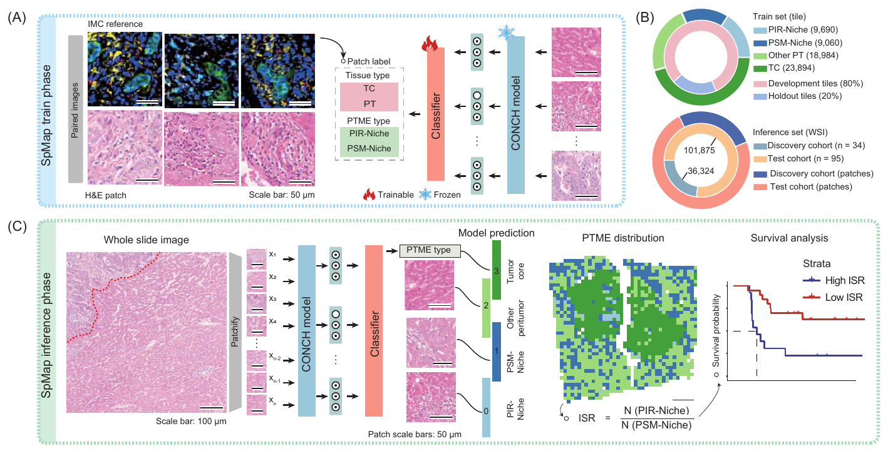
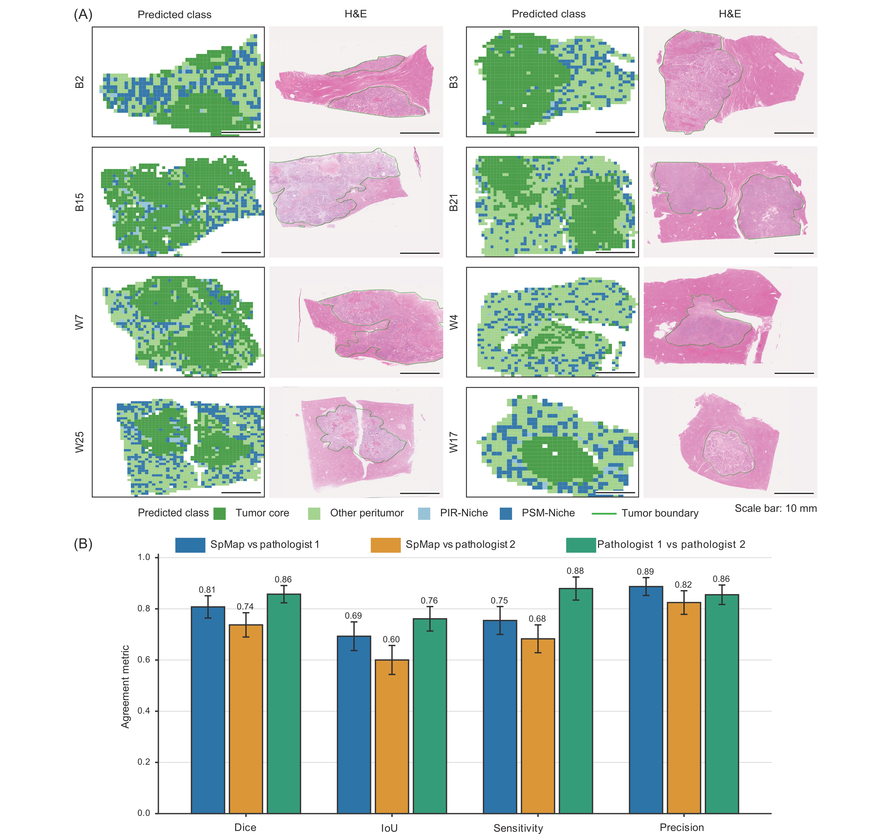
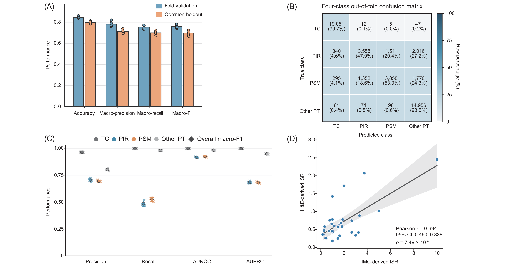

## Purpose

Figure 5 describes how SpMap transfers IMC-defined tissue and peritumor microenvironment labels to H&E tiles and aggregates predicted PIR- and PSM-Niche tiles into an immune-stromal ratio (ISR). Supplementary Figure 11 evaluates tile classification and compares IMC-derived and H&E-derived ISR in matched discovery-cohort patients. Supplementary Figure 12 shows whole-slide prediction maps and agreement with pathologist-defined tumor regions.

## Inputs and analytical units

The workflow requires registered IMC structure coordinates, selected TC and other peritumoral (PT) reference regions, matched H&E images, paired CONCH representations, and explicit tile and split manifests. WSI inference additionally requires the slide level, stain-normalization and CONCH adapters, and a selected model checkpoint. The four classes are `0=TC`, `1=PIR`, `2=PSM`, and `3=OTHER_PT`; reference tiles measure 256 × 256 pixels. Tiles are grouped by their source structure or ROI through `parent_id`.

The evaluation consumers require two five-row fold-metric CSVs; four-class pooled out-of-fold (OOF) confusion counts and row proportions; per-class and overall metric tables for seeds 24, 101, 202, 303, and 404; and unique-patient IMC and H&E ISR tables. Fold-metric fields are `fold`, `accuracy`, `precision_macro`, `recall_macro`, and `f1_macro`. IMC score fields are `PID`, `n_bdme_i`, `n_bdme_s`, and `easy_bdme_score`; H&E fields are `wsi_id`, `bile_1_count`, `bile_2_count`, and `ratio_bile1_to_bile2`. Classification is evaluated at the tile level, fold and seed summaries describe model evaluations, and ISR correlation uses one paired observation per patient. The five common-holdout evaluations share the same reserved tiles.

## Figure 5A/C: reference-label transfer and WSI inference

The [Python workflow](02_run_spmap_workflow.py) orders reference-region construction, tile preprocessing and CONCH extraction, grouped splitting and training, and WSI inference. Its stage switches and input adapters are defined in `CONFIG`. The [shared SpMap library](../../src/spmap/README.md) supplies [reference tiling](../../src/spmap/reference_tiles.py), [preprocessing](../../src/spmap/preprocessing.py), [paired CONCH extraction](../../src/spmap/conch_features.py), [grouped splits](../../src/spmap/splits.py), [MLP training](../../src/spmap/mlp.py), [WSI reading](../../src/spmap/wsi.py), [inference](../../src/spmap/inference.py), and [ISR aggregation](../../src/spmap/isr.py).

The final `primary_1280` model concatenates 768- and 512-dimensional CONCH representations and uses a `1280 → 450 → 4` MLP with ReLU and dropout 0.25. Training uses inverse-frequency weighted cross-entropy, AdamW with learning rate 0.001 and weight decay 0.0001, batch size 256, and 100 epochs; checkpoint selection uses validation accuracy. Splitting uses seed 42 and disjoint parent groups for the development and common internal-holdout subsets, with five-fold stratified grouped validation inside development. Features are loaded from the canonical tar shards into RAM before training loops.

For WSI inference, the configured slide level is tiled on a 256-pixel grid. Tiles containing more than 80% white observed pixels are filtered, retained regions undergo the supplied Macenko normalization, and border regions are padded to the tile size. Each retained tile receives four class probabilities and an argmax class. H&E-derived ISR is the predicted PIR tile count divided by the predicted PSM tile count within a WSI, requiring a nonzero PSM count.

## Figure 5B: reference-tile composition and grouped split

The [count-preparation entry point](01_prepare_panel_b_counts.py) reconciles canonical labels with the development and internal-holdout manifests, checking complete tile coverage and disjoint parent groups. Its output distinguishes class counts, split tile counts, and split parent-group counts. The [count-plot entry point](04_plot_panel_b_counts.py) consumes this table to draw an outer ring of class counts and an inner ring of development/holdout tile counts.

The canonical input contract contains 61,628 reference tiles: 23,894 TC, 9,690 PIR, 9,060 PSM, and 18,984 other PT. The grouped development subset contains 49,001 tiles and the common internal holdout contains 12,627 tiles.



**Figure 5. SpMap translates spatial proteomic labels to H&E images.** (A) Paired IMC reference images and H&E patches supply tissue and niche labels for a classifier using frozen CONCH features. (B) Published reference-tile composition and development/holdout split, together with discovery/test inference cohort and tile totals. (C) Whole-slide tile classification, predicted spatial distribution, and PIR-Niche/PSM-Niche tile-count ratio for ISR-based survival stratification. Tiles measure 256 × 256 pixels at 20× magnification and 0.5 μm/pixel. Scale bars: 50 μm in A and the H&E tiles in C; 100 μm in the whole-slide view in C.

[Original Figure 5 PDF](report_assets/figure5_publication.pdf).

## Supplementary Figure 12: whole-slide predictions and tumor-region agreement

WSI prediction maps place the four predicted tissue classes at their tile coordinates. The [inference module](../../src/spmap/inference.py) returns coordinates, model identity, class probabilities, and predicted class; these outputs connect the spatial maps to the WSI-level class counts and ISR. The published examples pair eight prediction maps with matched H&E views. Tumor-region agreement is summarized across 33 WSIs, using each WSI as the observational unit.



**Supplementary Figure 12. SpMap predictions on whole-slide H&E images.** (A) Predicted tumor core, other peritumor, PIR-Niche, and PSM-Niche regions with matched H&E images for B2, B3, B15, B21, W7, W4, W25, and W17. Green outlines show tumor boundaries delineated by Pathologist 1; scale bars, 10 mm. (B) Dice, intersection over union (IoU), sensitivity, and precision for SpMap versus each pathologist and for interobserver agreement. Bars show WSI-level means and error bars show two-sided 95% t confidence intervals. Sensitivity and precision use the corresponding pathologist as reference for model comparisons and Pathologist 1 as reference for the interobserver comparison.

[Original tumor-region agreement panel PDF](report_assets/wsi_pathologist_agreement.pdf).

## Supplementary Figure 11: internal evaluation and patient-level ISR comparison

### A: fold-validation and common-holdout metrics

The [R entry point](supplementary/FigureS11/01_plot_fold_holdout_metrics.R) reads five fold-validation rows and five common-holdout rows, converts the four metrics to long format, and calculates the mean and sample SD for each metric and evaluation. Bars show means, error bars show SD, and points identify individual model evaluations.

The first source block defines the plotting dependency and editable input/output paths.

<!-- source: supplementary/FigureS11/01_plot_fold_holdout_metrics.R; lines: 1-17 -->
```{r figure5_s11a_configuration, eval=FALSE}
#!/usr/bin/env Rscript

# Target/purpose: plot Supplementary Figure 11A fold-validation and common-
# holdout metrics. Inputs: two five-row CSVs selected in CONFIG. Outputs: one
# PDF plus plotted-data and summary TSVs in output_dir. Ordered workflow:
# validate both tables, construct long-form and summary data, render the panel,
# then write the TSVs and PDF.

suppressPackageStartupMessages(library(ggplot2))

# Edit these paths before running this interactive supplementary-figure entry point.
CONFIG <- list(
  validation = "/path/to/fold_validation_metrics.csv",
  holdout = "/path/to/common_holdout_metrics.csv",
  output_dir = "/path/to/FigureS11"
)

```

The input validator requires one finite metric row for each fold from 1 to 5.

<!-- source: supplementary/FigureS11/01_plot_fold_holdout_metrics.R; lines: 18-40 -->
```{r figure5_s11a_validate, eval=FALSE}
#' Purpose: Validate one five-fold metric table against the Figure S11A contract.
#'
#' @param frame Data frame loaded from a fold-metric CSV.
#' @param path Character scalar identifying the source file in error messages.
#' @return Data frame containing the required metric columns in fold order.
require_metrics <- function(frame, path) {
  # Select the fixed fold and metric schema before combining evaluation sources.
  required <- c("fold", "accuracy", "precision_macro", "recall_macro", "f1_macro")
  missing <- setdiff(required, names(frame))
  if (length(missing) > 0) {
    stop(paste(path, "is missing columns:", paste(missing, collapse = ", ")))
  }
  frame <- frame[, required]
  if (nrow(frame) != 5 || anyDuplicated(frame$fold) || !setequal(frame$fold, 1:5)) {
    stop(paste(path, "must contain one row for each fold 1 through 5."))
  }
  numeric_values <- as.matrix(frame[, setdiff(required, "fold")])
  if (any(!is.finite(numeric_values))) {
    stop(paste(path, "contains non-finite metric values."))
  }
  frame
}

```

The next function retains fold and evaluation identities while arranging metrics for plotting.

<!-- source: supplementary/FigureS11/01_plot_fold_holdout_metrics.R; lines: 41-71 -->
```{r figure5_s11a_plot_data, eval=FALSE}
#' Purpose: Convert validation and holdout metrics to long format for plotting.
#'
#' @param validation Validated five-fold metric data frame for fold validation.
#' @param holdout Validated five-fold metric data frame for common-holdout evaluation.
#' @return Data frame with one row per evaluation, fold, and displayed metric.
build_plot_data <- function(validation, holdout) {
  # Preserve evaluation identity while mapping wide metric columns to plotted rows.
  validation$evaluation <- "Fold validation"
  holdout$evaluation <- "Common holdout"
  results <- rbind(validation, holdout)
  metric_columns <- c("accuracy", "precision_macro", "recall_macro", "f1_macro")
  metric_labels <- c("Accuracy", "Macro-precision", "Macro-recall", "Macro-F1")
  rows <- vector("list", length(metric_columns))
  for (index in seq_along(metric_columns)) {
    rows[[index]] <- data.frame(
      metric = metric_labels[[index]],
      evaluation = results$evaluation,
      fold = results$fold,
      value = results[[metric_columns[[index]]]],
      stringsAsFactors = FALSE
    )
  }
  plot_data <- do.call(rbind, rows)
  plot_data$metric <- factor(plot_data$metric, levels = metric_labels)
  plot_data$evaluation <- factor(
    plot_data$evaluation,
    levels = c("Fold validation", "Common holdout")
  )
  plot_data
}

```

Metric summaries use the mean and sample SD across the five model evaluations.

<!-- source: supplementary/FigureS11/01_plot_fold_holdout_metrics.R; lines: 72-100 -->
```{r figure5_s11a_summary, eval=FALSE}
#' Purpose: Summarize each metric and evaluation combination by mean and SD.
#'
#' @param plot_data Long-form data frame returned by `build_plot_data()`.
#' @return Data frame with one summary row per displayed metric and evaluation.
build_summary_data <- function(plot_data) {
  # Summaries retain one row for every displayed metric-by-evaluation combination.
  keys <- unique(plot_data[c("metric", "evaluation")])
  rows <- vector("list", nrow(keys))
  for (index in seq_len(nrow(keys))) {
    values <- plot_data$value[
      plot_data$metric == keys$metric[[index]] &
        plot_data$evaluation == keys$evaluation[[index]]
    ]
    rows[[index]] <- data.frame(
      metric = keys$metric[[index]],
      evaluation = keys$evaluation[[index]],
      mean = mean(values),
      sd = sd(values)
    )
  }
  summary_data <- do.call(rbind, rows)
  summary_data$metric <- factor(summary_data$metric, levels = levels(plot_data$metric))
  summary_data$evaluation <- factor(
    summary_data$evaluation,
    levels = levels(plot_data$evaluation)
  )
  summary_data
}

```

The panel overlays individual evaluations on the mean ± SD bars using fixed evaluation colors.

<!-- source: supplementary/FigureS11/01_plot_fold_holdout_metrics.R; lines: 101-123 -->
```{r figure5_s11a_panel, eval=FALSE}
#' Purpose: Construct the Supplementary Figure 11A metric panel.
#'
#' @param plot_data Long-form data frame containing fold-level metric values.
#' @param summary_data Data frame containing metric means and standard deviations.
#' @return A ggplot object ready for PDF export.
build_panel <- function(plot_data, summary_data) {
  # Overlay fold observations on mean-SD bars using a shared evaluation encoding.
  colors <- c("Fold validation" = "#76AACB", "Common holdout" = "#F5B079")
  bar_dodge <- position_dodge(width = 0.72)
  point_dodge <- position_jitterdodge(
    jitter.width = 0.035, jitter.height = 0, dodge.width = 0.72, seed = 24
  )
  ggplot(summary_data, aes(x = metric, y = mean, fill = evaluation)) +
    geom_col(position = bar_dodge, width = 0.64, color = "#333333", linewidth = 0.35) +
    geom_errorbar(aes(ymin = pmax(0, mean - sd), ymax = pmin(1, mean + sd)), position = bar_dodge, width = 0.14, linewidth = 0.55, color = "#333333") +
    geom_point(data = plot_data, aes(y = value), position = point_dodge, size = 2.5, stroke = 0.55, shape = 21, color = "#252525", show.legend = FALSE) +
    scale_fill_manual(values = colors, name = NULL) +
    scale_y_continuous(limits = c(0, 1), breaks = seq(0, 1, by = 0.2), labels = sprintf("%.1f", seq(0, 1, by = 0.2)), expand = expansion(mult = c(0, 0.015))) +
    labs(x = NULL, y = "Performance") +
    theme_classic(base_size = 10, base_family = "Helvetica") +
    theme(axis.title.y = element_text(size = 11, face = "bold", margin = margin(r = 8)), axis.text.x = element_text(size = 9, color = "#222222", margin = margin(t = 5)), axis.text.y = element_text(size = 9, color = "#222222"), axis.ticks = element_line(linewidth = 0.4, color = "#333333"), axis.line = element_line(linewidth = 0.55, color = "#333333"), panel.grid.major.y = element_line(linewidth = 0.3, color = "#E5E5E5"), panel.grid.minor = element_blank(), legend.position = "right", legend.text = element_text(size = 9), plot.margin = margin(8, 10, 8, 8))
}

```

The final block connects input validation, summaries, plotting, and the PDF and TSV exports.

<!-- source: supplementary/FigureS11/01_plot_fold_holdout_metrics.R; lines: 124-144 -->
```{r figure5_s11a_export, eval=FALSE}
#' Purpose: Execute the Supplementary Figure 11A workflow.
#'
#' @param config List containing `validation`, `holdout`, and `output_dir` paths.
#' @return Invisibly returns `NULL` after writing two TSV files and one PDF.
run <- function(config) {
  # Orchestrate metric preparation, panel construction, and matched data exports.
  validation <- require_metrics(read.csv(config$validation, check.names = FALSE), config$validation)
  holdout <- require_metrics(read.csv(config$holdout, check.names = FALSE), config$holdout)
  plot_data <- build_plot_data(validation, holdout)
  summary_data <- build_summary_data(plot_data)
  panel <- build_panel(plot_data, summary_data)
  dir.create(config$output_dir, recursive = TRUE, showWarnings = FALSE)
  write.table(plot_data, file.path(config$output_dir, "FigureS11A_plotted_data.tsv"), sep = "\t", row.names = FALSE, quote = FALSE)
  write.table(summary_data, file.path(config$output_dir, "FigureS11A_summary.tsv"), sep = "\t", row.names = FALSE, quote = FALSE)
  ggsave(file.path(config$output_dir, "FigureS11A_fold_holdout_metrics.pdf"), panel, device = cairo_pdf, width = 7.2, height = 4.3, units = "in")
  invisible(NULL)
}

if (sys.nframe() == 0) {
  run(CONFIG)
}
```

### B–C: pooled OOF confusion and class-specific performance

The [Python evaluation consumer](supplementary/FigureS11/02_plot_oof_class_metrics.py) checks a 49,001-tile confusion matrix against its true-class row proportions. It summarizes precision, recall, one-versus-rest AUROC, and one-versus-rest AUPRC for each class across five training seeds, using two-sided 95% t intervals with four degrees of freedom. The consumer also exports and plots overall macro-F1 across seeds.

The [public artifact exporter](03_prepare_public_spmap_artifacts.py) packages the selected saved evaluation metrics and OOF predictions, and separately packages the five final `primary_1280` fold checkpoints with portable manifests. Input and output contracts are described in the [Figure README](README.md) and [public artifact index](../../docs/public_artifacts.md).

### D: matched-patient ISR correlation

The [Python ISR consumer](supplementary/FigureS11/03_plot_isr_correlation.py) validates the saved IMC score as `(n_bdme_i + 1) / (n_bdme_s + 1)`, clipped to `[0.1, 10]`, and the H&E score as `bile_1_count / bile_2_count`. A one-to-one inner join pairs 33 discovery-cohort patients. The analysis reports Pearson correlation, its two-sided nominal P value, and a Fisher-z 95% confidence interval. The plot overlays an ordinary least-squares line and a pointwise 95% confidence band for the fitted mean.

### Saved results



**Supplementary Figure 11. Internal evaluation of SpMap and patient-level comparison of IMC-derived and H&E-derived immune-stromal ratio.** (A) Accuracy, macro-precision, macro-recall, and macro-F1 for five fold-specific models; bars show means, error bars show SD, and points show model evaluations. (B) Seed-24 pooled OOF confusion counts and percentages within true-class rows. (C) Class-specific precision, recall, AUROC, and AUPRC across five seeds; crosses show seeds, circles show means, and error bars show 95% t intervals. (D) Paired ISR values with the fitted regression line, its 95% confidence band, and Pearson statistics.

Original component PDFs: [fold-validation/common-holdout metrics](report_assets/fold_holdout_metrics.pdf), [pooled OOF confusion](report_assets/oof_confusion.pdf), and [five-seed performance](report_assets/five_seed_performance.pdf).

Mean fold-validation accuracy was 0.847 (SD 0.010), compared with 0.799 (SD 0.011) on the common internal holdout. Corresponding macro-F1 means were 0.761 (SD 0.017) and 0.698 (SD 0.022). The OOF confusion matrix showed higher recall for TC (99.7%) and other PT (98.5%) than for PIR (47.9%) and PSM (53.0%). Across seeds, the PIR and PSM precision, recall, and AUPRC values remained below those of TC and other PT. IMC-derived and H&E-derived ISR were positively associated in 33 matched patients (Pearson r = 0.694; 95% CI 0.460–0.838; nominal two-sided P = 7.49 × 10^-6).
