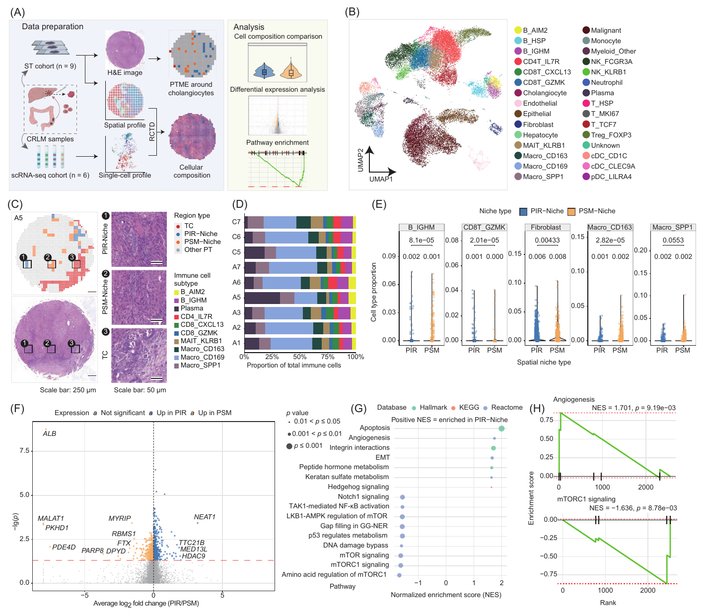
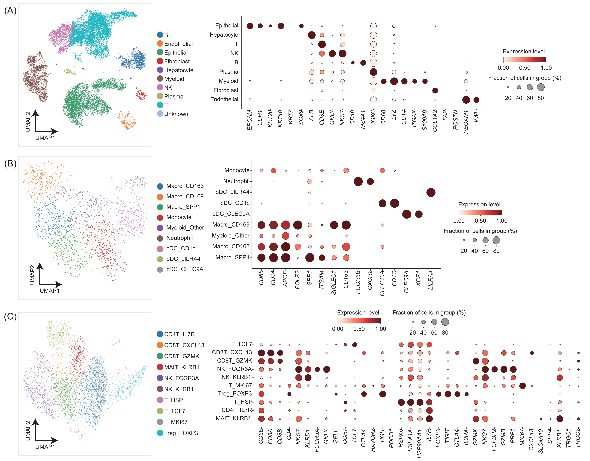
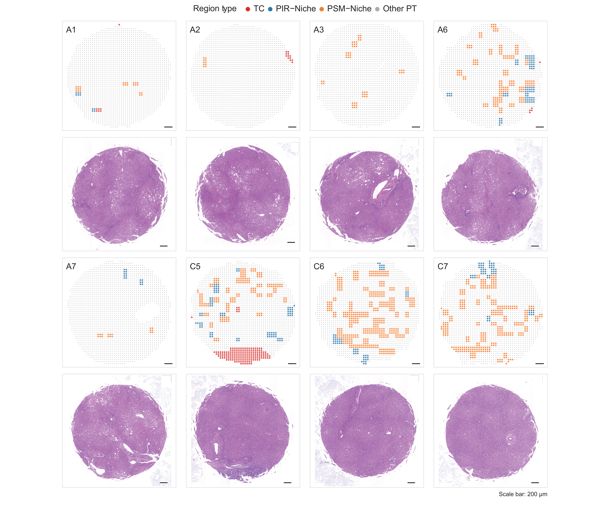
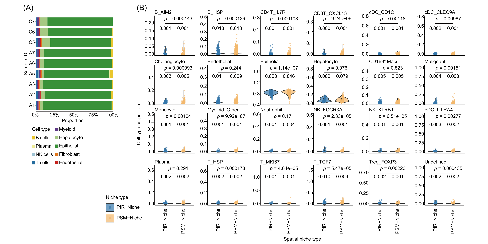
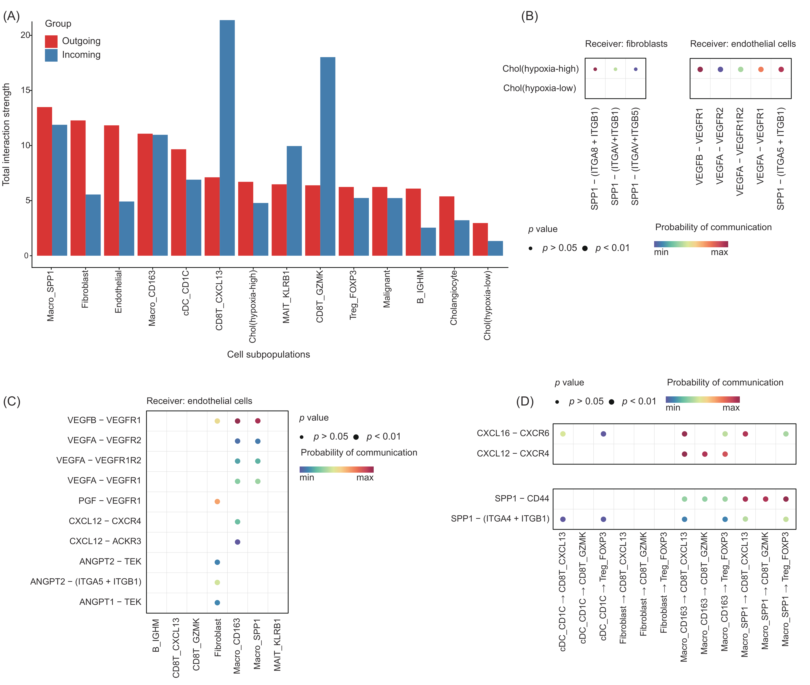

## Purpose

Figure 7 links the FDZS-3 single-cell RNA reference to FDZS-4 spatial transcriptomics to describe cell composition and transcriptional programs associated with PIR and PSM niches. The workflow integrates scRNA annotation, RCTD deconvolution, registered SpMap classes, differential expression and pathway enrichment. Supplementary Figures 15–18 provide annotation, inferred communication and spatial context.

## Inputs and analytical units

The [workflow README](README.md) specifies the configuration fields and file schemas. The upstream Python entry requires a processed FDZS-3 MatrixMarket bundle with genes as rows and cells as columns, `patient`, `doublet` and `sample_id` metadata, and a gene-coordinate GTF. Its annotated reference contains 35,900 singlets from six samples. The R entries require the exported cell-by-gene scRNA bundle (`expression_profile.mtx`, `metadata.csv`, `row_names.csv`, `column_names.csv`), including `Sub_type`, and the FDZS-4 Bin100 bundle with a spot-by-gene matrix, matching axes and `core_name`, `x`, `y` metadata.

Spatial mapping additionally requires registered tile bounds (`tile_left`, `tile_right`, `tile_top`, `tile_bottom`), `sample_id` and `pred_class` in the Bin100 coordinate system. Composition uses normalized subtype weights keyed by string `spot_id`; DEG/GSEA uses the resulting `rctd_intersection_spots.tsv`. GSEA requires an offline RDS containing Hallmark, KEGG and Reactome gene sets, together with one `collection`/`resource_version` manifest row per collection. Shared implementations are linked in [ST functions](../../src/st/st_functions.R) and [scRNA/CellChat functions](../../src/scrna/cellchat.R).

Cells are the observations for annotation and cholangiocyte scoring. RCTD estimates mixtures for Bin100 spots; composition summaries average these weights within each spatial sample. Niche comparisons use pooled Bin100 spots, nested within nine spatial samples. Pathway enrichment uses genes ranked from that spot comparison. CellChat summarizes inferred communication between annotated cell groups.

| Spatial population | Total spots | TC | PIR | PSM | Other PT |
|---|---:|---:|---:|---:|---:|
| All mapped Bin100 spots | 18,186 | 463 | 382 | 1,526 | 15,815 |
| RCTD intersection | 17,902 | 449 | 377 | 1,522 | 15,554 |

The [public data contract](../../docs/data_contract.md) describes the released H5AD objects. The full mapping workflow uses the complete Bin100 bundle and registered tile table; the released FDZS-4 object contains the 17,902 retained spots.

## Figure 7: cross-modal transcriptomic characterization



**Figure 7. Cross-modal transcriptomic characterization of molecular programs associated with PIR- and PSM-Niches.** (A) Workflow linking six scRNA-seq samples with nine spatial transcriptomics samples. (B) Reference UMAP colored by cell subtype. (C) Representative A5 niche map, matched H&E section and magnified PIR, PSM and tumor-core regions; scale bars, 250 μm in the overview and 50 μm in magnified views. (D) Immune subtype fractions across nine slides. (E) Spot-level RCTD proportions for B_IGHM, CD8T_GZMK, fibroblasts, Macro_CD163 and Macro_SPP1; blue denotes PIR and orange PSM, with nominal Wilcoxon P values and mean proportions. (F) Spot-level PIR/PSM differential expression: average log2 fold change versus −log10 nominal P; dot size indicates the P-value category. (G) Selected pathway NES values, with color identifying Hallmark, KEGG or Reactome. (H) Angiogenesis and mTORC1 signaling enrichment curves; titles report NES and nominal P.

[Download publication PDF](report_assets/figure7_publication.pdf).

## Figure 7B and Figure S15: scRNA reference

The [integration and annotation entry](01_integrate_annotate_scrna.py) normalizes counts to 10,000, applies log1p transformation, selects 2,000 patient-batched variable genes, scales to a maximum of 10, computes 50 PCs and integrates patients with Harmony. Major clustering uses 10 neighbors, 40 Harmony PCs and Leiden resolution 0.8. B/plasma subclustering uses resolution 0.8; T/NK and myeloid subclustering use 1.0. Curated labels and epithelial inferCNV (window 250) refine the reference before export. Epithelial cells from the configured FDZS3-P006 sample are omitted from the R reference bundle.

The [processed-object plotting entry](05_plot_public_scrna_annotations.py) reads stored `Major_type`, `Sub_type`, `X_umap` and `raw.X` from the released FDZS-3 H5AD. Its lineage views subset the stored global UMAP; the integration workflow retains lineage-specific embeddings. Supporting Python functions are in [integration](../../src/scrna/integration.py), [annotation](../../src/scrna/annotation.py) and [R interoperability](../../src/scrna/interop.py).



**Figure S15. Cell subpopulation annotation in single-cell transcriptomics data.** UMAPs and corresponding canonical-marker dot plots show major cell types (A), myeloid subpopulations (B), and T/NK subpopulations (C). Each UMAP point represents one cell. Dot size denotes the expressing-cell fraction and color denotes scaled expression.

EPCAM and keratins distinguish epithelial cells; ALB, CD3E, GNLY/NKG7, B-cell markers, myeloid markers and PECAM1/VWF support the other broad annotations. Myeloid subtypes show distinct CD163, SIGLEC1 and SPP1 profiles. The T/NK panel includes CD4T_IL7R, CD8T_CXCL13, CD8T_GZMK, MAIT_KLRB1, NK_FCGR3A, NK_KLRB1, T_HSP, T_TCF7, T_MKI67 and Treg_FOXP3.

## RCTD: spot-level cell mixtures

The [RCTD entry](02_run_rctd.R) balances the annotated reference at 100 cells per eligible subtype, retaining subtypes with at least 10 cells and using seed 619. It rounds spatial counts, runs RCTD in `full` mode with eight cores, normalizes subtype weights and aligns canonical spot identifiers. The retained weights feed the spatial composition analyses.

### Configuration and table export

The source declares the two spatial population sizes, input paths and TSV writer.

<!-- source: 02_run_rctd.R; lines: 1-33 -->
```{r figure7_rctd_config, eval=FALSE}
# Target: Figure 7 RCTD deconvolution outputs.
# Purpose: deconvolve FDZS-4 Bin100 spots with the annotated FDZS-3 reference.
# Inputs: edit the paths in CONFIG for the scRNA bundle, ST bundle, helpers, and output.
# Outputs: normalized RCTD weights, spot-status records, reference counts, and run summary TSVs.
# Ordered workflow: load helpers and bundles, validate spots, balance reference, run RCTD, and export tables.

EXPECTED_ALL_SPOTS <- 18186L
EXPECTED_RCTD_SPOTS <- 17902L

# Edit these paths for the Figure 7 analysis.
CONFIG <- list(
    sc_bundle = "/path/to/figure7_scrna_output/r_bundle",
    st_bundle = "/path/to/fdzs4_bin100_bundle",
    output_dir = "/path/to/figure7_rctd_output",
    st_functions = "src/st/st_functions.R",
    scrna_functions = "src/scrna/cellchat.R"
)

#' Purpose: write a data frame as a tab-separated output table.
#'
#' @param data Data frame to write.
#' @param path Character scalar destination path for the TSV file.
#' @return Invisibly returns `NULL` after writing the table.
write_tsv <- function(data, path) {
    utils::write.table(
        data,
        file = path,
        sep = "\t",
        row.names = FALSE,
        quote = FALSE
    )
}

```

### Reference balancing, estimation and export

The workflow reads both bundles, balances subtype representation, estimates spot mixtures and exports weights, retention records and reference counts.

<!-- source: 02_run_rctd.R; lines: 34-215 -->
```{r figure7_rctd_workflow, eval=FALSE}
#' Purpose: execute the configured Figure 7 subtype RCTD workflow.
#'
#' @param config List containing scRNA, spatial, helper, and output paths.
#' @return Invisibly returns `NULL` after writing the RCTD output tables.
main <- function(config = CONFIG) {
    # Initialize helper functions and destinations before loading reference cells or spatial spots.
    output_dir <- config[["output_dir"]]
    dir.create(output_dir, recursive = TRUE, showWarnings = FALSE)

    source(config[["st_functions"]])
    source(config[["scrna_functions"]])

    # Load the annotated scRNA reference; columns remain individual cells keyed by Sub_type.
    sc_object <- read_anndata_to_seurat(
        config[["sc_bundle"]],
        verbose = TRUE
    )
    if (!"Sub_type" %in% colnames(sc_object[[]])) {
        stop("The scRNA R bundle metadata must contain Sub_type", call. = FALSE)
    }
    sc_data <- SummarizedExperiment::SummarizedExperiment(
        assays = list(
            counts = Seurat::GetAssayData(
                sc_object,
                assay = "RNA",
                layer = "counts"
            )
        ),
        colData = S4Vectors::DataFrame(sc_object[[]])
    )

    # Load all Bin100 spots and preserve their count columns and spatial-coordinate row correspondence.
    st_data <- read_anndata_to_spe(config[["st_bundle"]], verbose = TRUE)
    if (ncol(st_data) != EXPECTED_ALL_SPOTS) {
        stop(
            "The all-spot Bin100 input contains ",
            EXPECTED_ALL_SPOTS, " spots; observed ", ncol(st_data),
            call. = FALSE
        )
    }

    # Balance cell-level subtype representation before constructing the RCTD reference matrix.
    balanced <- balance_cell_types(
        sc_data,
        cell_type_col = "Sub_type",
        k = 100,
        min_cells = 10,
        seed = 619
    )
    balanced_sc <- balanced$sc_data
    cell_types <- SummarizedExperiment::colData(balanced_sc)[["Sub_type"]]
    names(cell_types) <- colnames(balanced_sc)
    reference <- spacexr::Reference(
        SummarizedExperiment::assay(balanced_sc),
        as.factor(cell_types)
    )

    # Prepare integer spot counts and coordinates with identical spot ordering for SpatialRNA.
    counts <- Matrix::as(SummarizedExperiment::assay(st_data), "dgCMatrix")
    counts@x <- as.numeric(round(counts@x))
    coordinates <- as.data.frame(SpatialExperiment::spatialCoords(st_data))
    rownames(coordinates) <- colnames(st_data)
    puck <- spacexr::SpatialRNA(coordinates, counts)

    # Estimate subtype mixtures per Bin100 spot and normalize weights within retained spots.
    rctd <- spacexr::create.RCTD(puck, reference, max_cores = 8)
    rctd <- spacexr::run.RCTD(rctd, doublet_mode = "full")
    normalized_weights <- spacexr::normalize_weights(rctd@results$weights)

    # Canonicalize spot identities before alignment; each retained spot must occur exactly once.
    weight_ids <- .canonicalize_spot_ids(rownames(normalized_weights))
    spot_ids <- .canonicalize_spot_ids(colnames(st_data))
    if (length(weight_ids) != EXPECTED_RCTD_SPOTS) {
        stop(
            "The normalized RCTD result contains ",
            EXPECTED_RCTD_SPOTS, " spots; observed ", length(weight_ids),
            call. = FALSE
        )
    }
    if (anyDuplicated(weight_ids)) {
        stop(
            "Normalized RCTD weights contain duplicate canonical spot IDs",
            call. = FALSE
        )
    }
    if (anyDuplicated(spot_ids)) {
        stop(
            "The Bin100 input contains duplicate canonical spot IDs",
            call. = FALSE
        )
    }

    # Export one normalized subtype-composition row per retained Bin100 spot.
    weight_table <- data.frame(
        spot_id = weight_ids,
        as.data.frame(as.matrix(normalized_weights), check.names = FALSE),
        check.names = FALSE
    )
    write_tsv(
        weight_table,
        file.path(output_dir, "rctd_normalized_weights.tsv")
    )

    # Classify every input spot by RCTD retention while retaining the all-spot denominator.
    retained <- spot_ids %in% weight_ids
    spot_audit <- data.frame(
        spot_id = spot_ids,
        rctd_status = ifelse(retained, "retained", "excluded"),
        reason = ifelse(
            retained,
            "present_in_normalized_weights",
            "absent_from_normalized_weights"
        ),
        stringsAsFactors = FALSE
    )
    retained_audit_rows <- sum(spot_audit$rctd_status == "retained")
    excluded_audit_rows <- sum(spot_audit$rctd_status == "excluded")
    expected_excluded_rows <- EXPECTED_ALL_SPOTS - EXPECTED_RCTD_SPOTS
    if (retained_audit_rows != EXPECTED_RCTD_SPOTS ||
        excluded_audit_rows != expected_excluded_rows) {
        stop(
            "The RCTD spot audit must contain ", EXPECTED_RCTD_SPOTS,
            " retained and ", expected_excluded_rows,
            " excluded rows; observed ", retained_audit_rows,
            " retained and ", excluded_audit_rows, " excluded",
            call. = FALSE
        )
    }
    write_tsv(spot_audit, file.path(output_dir, "rctd_spot_audit.tsv"))

    # Summarize reference-cell balancing by subtype for interpretation of the deconvolution input.
    original_counts <- table(
        SummarizedExperiment::colData(sc_data)[["Sub_type"]]
    )
    balanced_counts <- table(
        SummarizedExperiment::colData(balanced_sc)[["Sub_type"]]
    )
    reference_counts <- data.frame(
        subtype = names(original_counts),
        input_cells = as.integer(original_counts),
        balanced_cells = as.integer(balanced_counts[names(original_counts)]),
        stringsAsFactors = FALSE
    )
    reference_counts$balanced_cells[is.na(reference_counts$balanced_cells)] <- 0L
    write_tsv(
        reference_counts,
        file.path(output_dir, "rctd_reference_subtype_counts.tsv")
    )

    # Export fixed population sizes and RCTD settings used by this run.
    run_summary <- data.frame(
        metric = c(
            "input_st_spots",
            "normalized_weight_spots",
            "excluded_st_spots",
            "reference_input_cells",
            "reference_balanced_cells",
            "reference_subtypes_retained",
            "balance_k",
            "balance_min_cells",
            "balance_seed",
            "rctd_cores",
            "rctd_mode"
        ),
        value = c(
            length(spot_ids),
            length(weight_ids),
            length(spot_ids) - length(weight_ids),
            ncol(sc_data),
            ncol(balanced_sc),
            sum(reference_counts$balanced_cells > 0),
            100,
            10,
            619,
            8,
            "full"
        ),
        stringsAsFactors = FALSE
    )
    write_tsv(run_summary, file.path(output_dir, "rctd_run_summary.tsv"))
}

```

The direct-execution block invokes the configured workflow.

<!-- source: 02_run_rctd.R; lines: 216-218 -->
```{r figure7_rctd_entry, eval=FALSE}
if (sys.nframe() == 0L) {
    main()
}
```

## Figure 7C–E and Figures S17–S18: spatial mapping and composition

The [mapping and composition entry](03_map_spmap_plot_composition.R) assigns each spot to a registered SpMap tile within its sample. It uses inclusive containment, the first source row when several tiles contain a spot, and the nearest tile top-left coordinate when no tile contains it. Classes are TC (0), PIR-Niche (1), PSM-Niche (2) and Other PT (3).

After intersecting mapped spots with RCTD weights, subtype weights are summed into the configured cell groups, averaged by sample and normalized across displayed groups. The PIR/PSM abundance comparison uses 377 and 1,522 spots, respectively, with two-sided unpaired Wilcoxon tests. The source exports BH-adjusted results and displays nominal P values. Its focused panel selects B_IGHM, CD8T_GZMK, fibroblasts, Macro_CD163 and Macro_SPP1.

### Populations, cell groups and configuration

The fixed class counts, subtype aggregation maps, palettes and five focused subtypes define the plotted populations.

<!-- source: 03_map_spmap_plot_composition.R; lines: 1-78 -->
```{r figure7_mapping_config, eval=FALSE}
# Target: Figure 7C-E and Supplementary Figures 17-18 spatial composition outputs.
# Purpose: map registered SpMap tiles to Bin100 spots and compare RCTD compositions.
# Inputs: edit the paths in CONFIG for the ST bundle, tile annotations, RCTD weights, helpers, and output.
# Outputs: mapping records, composition and test TSVs, and Figure 7/Supplementary PDF panels.
# Ordered workflow: load ST and tiles, map classes, intersect RCTD weights, summarize composition, test, plot.

EXPECTED_ALL_SPOTS <- 18186L
EXPECTED_RCTD_SPOTS <- 17902L
EXPECTED_ALL_COUNTS <- c("0" = 463L, "1" = 382L, "2" = 1526L, "3" = 15815L)
EXPECTED_RCTD_COUNTS <- c("0" = 449L, "1" = 377L, "2" = 1522L, "3" = 15554L)

CLASS_LABELS <- c(
    "0" = "TC", "1" = "PIR-Niche", "2" = "PSM-Niche", "3" = "Other PT"
)
CLASS_COLORS <- c(
    "0" = "#E41A1C", "1" = "#1F78B4", "2" = "#FF7F00", "3" = "grey70"
)

MAIN_CELLTYPE_MAPPING <- list(
    B = c("RCTD_B_AIM2", "RCTD_B_HSP", "RCTD_B_IGHM"),
    Plasma = "RCTD_Plasma",
    Epithelial = c("RCTD_Epithelial", "RCTD_Malignant"),
    Hepatocyte = c("RCTD_Hepatocyte", "RCTD_Cholangiocyte"),
    Fibroblast = "RCTD_Fibroblast",
    Endothelial = "RCTD_Endothelial",
    Myeloid = c(
        "RCTD_Macro_CD163", "RCTD_Macro_CD169", "RCTD_Macro_SPP1",
        "RCTD_Monocyte", "RCTD_cDC_CD1C", "RCTD_cDC_CLEC9A",
        "RCTD_Neutrophil", "RCTD_Myeloid_Other", "RCTD_pDC_LILRA4"
    ),
    NK = c("RCTD_NK_FCGR3A", "RCTD_NK_KLRB1"),
    T = c(
        "RCTD_CD4T_IL7R", "RCTD_CD8T_CXCL13", "RCTD_CD8T_GZMK",
        "RCTD_MAIT_KLRB1", "RCTD_T_HSP", "RCTD_T_MKI67",
        "RCTD_T_TCF7", "RCTD_Treg_FOXP3"
    )
)

IMMUNE_SUBTYPE_MAPPING <- list(
    B_AIM2 = "RCTD_B_AIM2",
    B_IGHM = "RCTD_B_IGHM",
    CD4_IL7R = "RCTD_CD4T_IL7R",
    CD8_CXCL13 = "RCTD_CD8T_CXCL13",
    CD8_GZMK = "RCTD_CD8T_GZMK",
    MAIT_KLRB1 = "RCTD_MAIT_KLRB1",
    Macro_CD163 = "RCTD_Macro_CD163",
    Macro_CD169 = "RCTD_Macro_CD169",
    Macro_SPP1 = "RCTD_Macro_SPP1",
    Plasma = "RCTD_Plasma"
)

MAIN_COLORS <- c(
    B = "#FFD700", Plasma = "#FFFF99", Epithelial = "#33A02C",
    Hepatocyte = "#B2DF8A", Fibroblast = "#FF7F00",
    Endothelial = "#E31A1C", Myeloid = "#6A3D9A",
    NK = "#A6CEE3", T = "#1F78B4"
)

IMMUNE_COLORS <- c(
    B_AIM2 = "#FFD700", B_IGHM = "#FFDAB9", CD4_IL7R = "#1F78B4",
    CD8_CXCL13 = "#3C8DBC", CD8_GZMK = "#5DA5D8",
    MAIT_KLRB1 = "#7EBDEF", Macro_CD163 = "#6A3D9A",
    Macro_CD169 = "#8A63A9", Macro_SPP1 = "#AA89B8", Plasma = "#FFFF00"
)

FOCUSED_CELLTYPES <- c(
    "B_IGHM", "CD8T_GZMK", "Fibroblast", "Macro_CD163", "Macro_SPP1"
)

# Edit these paths for the Figure 7 analysis.
CONFIG <- list(
    st_bundle = "/path/to/fdzs4_bin100_bundle",
    tile_annotations = "/path/to/registered_spmap_tiles.tsv",
    rctd_weights = "/path/to/figure7_rctd_output/rctd_normalized_weights.tsv",
    output_dir = "/path/to/figure7_composition_output",
    st_functions = "src/st/st_functions.R"
)

```

### Table readers and writers

Input parsing preserves the RCTD identifier as text and retains source column names.

<!-- source: 03_map_spmap_plot_composition.R; lines: 79-131 -->
```{r figure7_mapping_io, eval=FALSE}
#' Purpose: read a CSV, TSV, or TXT table while retaining an optional string identifier.
#'
#' @param path Character scalar path to the input table.
#' @param first_column_character Logical scalar indicating whether to read the first
#'   column as character data.
#' @return A data frame containing the parsed table.
read_delimited <- function(path, first_column_character = FALSE) {
    # Infer the delimiter once and preserve source column names for downstream identity matching.
    separator <- if (tolower(tools::file_ext(path)) %in% c("tsv", "txt")) {
        "\t"
    } else {
        ","
    }
    header <- utils::read.table(
        path,
        header = TRUE,
        sep = separator,
        nrows = 0,
        quote = "\"",
        comment.char = "",
        check.names = FALSE
    )
    column_classes <- rep(NA_character_, ncol(header))
    if (first_column_character) {
        column_classes[[1]] <- "character"
    }
    utils::read.table(
        path,
        header = TRUE,
        sep = separator,
        quote = "\"",
        comment.char = "",
        check.names = FALSE,
        stringsAsFactors = FALSE,
        colClasses = column_classes
    )
}

#' Purpose: write a data frame as a tab-separated output table.
#'
#' @param data Data frame to write.
#' @param path Character scalar destination path for the TSV file.
#' @return Invisibly returns `NULL` after writing the table.
write_tsv <- function(data, path) {
    utils::write.table(
        data,
        file = path,
        sep = "\t",
        row.names = FALSE,
        quote = FALSE
    )
}

```

### Class assignment records

These functions check class totals and summarize the selected tile and assignment route for each spot.

<!-- source: 03_map_spmap_plot_composition.R; lines: 132-248 -->
```{r figure7_mapping_assignment, eval=FALSE}
#' Purpose: verify class counts against the specified Figure 7 population contract.
#'
#' @param classes Vector of mapped class labels.
#' @param expected Named vector of expected class counts.
#' @param expected_total Integer scalar expected population size.
#' @param population Character scalar naming the checked population.
#' @return Invisibly returns `NULL` when the observed counts match the contract.
assert_class_counts <- function(classes, expected, expected_total, population) {
    # Count mapped Bin100 spots on a fixed four-class axis, including classes with zero observations.
    observed <- table(factor(as.character(classes), levels = names(expected)))
    if (length(classes) != expected_total ||
        !identical(as.integer(observed), as.integer(expected))) {
        stop(
            population, " does not match the fixed Figure 7 class contract. ",
            "Observed total/classes: ", length(classes), "/",
            paste(as.integer(observed), collapse = ","),
            call. = FALSE
        )
    }
}

#' Purpose: record the tile-selection route for every mapped spatial spot.
#'
#' @param spatial_df Data frame containing spatial spot identifiers and coordinates.
#' @param tile_anno Data frame containing tile boundaries and predicted classes.
#' @param assigned_classes Vector of mapped class labels, one per spatial spot.
#' @return A spot-level mapping-record data frame.
build_mapping_audit <- function(spatial_df, tile_anno, assigned_classes) {
    # Index candidate tiles by sample so spatial containment is evaluated only within each specimen.
    tile_rows_by_sample <- split(seq_len(nrow(tile_anno)), tile_anno$sample_id)
    records <- vector("list", nrow(spatial_df))

    # Record one selected registered tile per Bin100 spot, using containment before nearest-top-left.
    for (i in seq_len(nrow(spatial_df))) {
        tile_rows <- tile_rows_by_sample[[as.character(spatial_df$sample_id[[i]])]]
        sample_tiles <- tile_anno[tile_rows, , drop = FALSE]
        in_tile <- which(
            spatial_df$x[[i]] >= sample_tiles$tile_left &
                spatial_df$x[[i]] <= sample_tiles$tile_right &
                spatial_df$y[[i]] >= sample_tiles$tile_top &
                spatial_df$y[[i]] <= sample_tiles$tile_bottom
        )
        if (length(in_tile) > 0) {
            selected_local <- in_tile[[1]]
            assignment_mode <- "contained"
        } else {
            distances <- sqrt(
                (sample_tiles$tile_left - spatial_df$x[[i]])^2 +
                    (sample_tiles$tile_top - spatial_df$y[[i]])^2
            )
            selected_local <- which.min(distances)
            assignment_mode <- "nearest_top_left"
        }
        selected_row <- tile_rows[[selected_local]]
        selected_distance <- sqrt(
            (tile_anno$tile_left[[selected_row]] - spatial_df$x[[i]])^2 +
                (tile_anno$tile_top[[selected_row]] - spatial_df$y[[i]])^2
        )
        records[[i]] <- data.frame(
            assignment_mode = assignment_mode,
            containing_tile_count = length(in_tile),
            selected_tile_source_row = selected_row,
            distance_to_selected_top_left = selected_distance,
            stringsAsFactors = FALSE
        )
    }

    # Reconcile the independently recorded tile route with the assigned class for every spot.
    audit <- cbind(spatial_df, do.call(rbind, records))
    audit$pred_class <- as.integer(assigned_classes)
    selected_classes <- as.integer(as.character(
        tile_anno$pred_class[audit$selected_tile_source_row]
    ))
    if (!identical(selected_classes, audit$pred_class)) {
        stop("Mapping audit disagrees with assign_predictions_to_spots", call. = FALSE)
    }
    audit$class_label <- unname(CLASS_LABELS[as.character(audit$pred_class)])
    audit
}

#' Purpose: summarize mapped SpMap classes and assignment modes by sample.
#'
#' @param audit Spot-level mapping records returned by `build_mapping_audit()`.
#' @return A data frame containing per-sample and total mapping summaries.
summarize_mapping <- function(audit) {
    # Aggregate spot-level mapping outcomes by sample while retaining the all-sample denominator.
    grouped <- split(audit, audit$sample_id)
    rows <- lapply(names(grouped), function(sample_id) {
        data <- grouped[[sample_id]]
        data.frame(
            sample_id = sample_id,
            all_spots = nrow(data),
            TC = sum(data$pred_class == 0L),
            PIR = sum(data$pred_class == 1L),
            PSM = sum(data$pred_class == 2L),
            other_PT = sum(data$pred_class == 3L),
            contained = sum(data$assignment_mode == "contained"),
            nearest_top_left = sum(data$assignment_mode == "nearest_top_left"),
            multiple_containing_tiles = sum(data$containing_tile_count > 1L),
            stringsAsFactors = FALSE
        )
    })
    total <- data.frame(
        sample_id = "Total",
        all_spots = nrow(audit),
        TC = sum(audit$pred_class == 0L),
        PIR = sum(audit$pred_class == 1L),
        PSM = sum(audit$pred_class == 2L),
        other_PT = sum(audit$pred_class == 3L),
        contained = sum(audit$assignment_mode == "contained"),
        nearest_top_left = sum(audit$assignment_mode == "nearest_top_left"),
        multiple_containing_tiles = sum(audit$containing_tile_count > 1L),
        stringsAsFactors = FALSE
    )
    do.call(rbind, c(rows, list(total)))
}

```

### Sample composition summaries

Mean spot weights are converted into fractions across the cell groups displayed in each stacked bar.

<!-- source: 03_map_spmap_plot_composition.R; lines: 249-305 -->
```{r figure7_composition_summary, eval=FALSE}
#' Purpose: calculate per-sample cell-type composition fractions from RCTD proportions.
#'
#' @param proportions Data frame containing sample IDs and cell-type proportions.
#' @return A long-format composition data frame with normalized display fractions.
summarize_composition <- function(proportions) {
    # Average spot-level RCTD proportions within each sample before display normalization.
    value_columns <- setdiff(colnames(proportions), "sample_id")
    means <- stats::aggregate(
        proportions[, value_columns, drop = FALSE],
        by = list(sample_id = proportions$sample_id),
        FUN = mean
    )
    long <- tidyr::pivot_longer(
        means,
        cols = -sample_id,
        names_to = "cell_type",
        values_to = "mean_proportion"
    )
    # Normalize only across displayed cell types within a sample so each stacked bar sums to one.
    totals <- ave(long$mean_proportion, long$sample_id, FUN = sum)
    long$display_fraction <- long$mean_proportion / totals
    long
}

#' Purpose: construct a stacked composition plot.
#'
#' @param data Long-format composition data returned by `summarize_composition()`.
#' @param colors Named character vector mapping cell types to colors.
#' @param title Character scalar plot title.
#' @param legend_title Character scalar legend title.
#' @return A ggplot composition object.
make_composition_plot <- function(data, colors, title, legend_title) {
    # Keep cell-type factor order synchronized with the named palette across samples.
    data$cell_type <- factor(data$cell_type, levels = names(colors))
    ggplot2::ggplot(
        data,
        ggplot2::aes(x = display_fraction, y = sample_id, fill = cell_type)
    ) +
        ggplot2::geom_col(width = 0.8) +
        ggplot2::scale_fill_manual(values = colors, drop = FALSE) +
        ggplot2::scale_x_continuous(
            labels = scales::percent,
            expand = c(0, 0)
        ) +
        ggplot2::labs(
            title = title,
            x = "Proportion",
            y = "Sample ID",
            fill = legend_title
        ) +
        ggplot2::theme_classic(base_size = 10) +
        ggplot2::theme(
            plot.title = ggplot2::element_text(hjust = 0.5, face = "bold"),
            legend.position = "right"
        )
}

```

### Niche abundance tests and plotting

The comparison functions test each subtype and annotate the spot-level violin and box plots with nominal P values.

<!-- source: 03_map_spmap_plot_composition.R; lines: 306-374 -->
```{r figure7_abundance_tests, eval=FALSE}
#' Purpose: test spot-level RCTD abundance between PIR and PSM niches.
#'
#' @param long_data Data frame containing cell type, niche, and abundance columns.
#' @return A BH-adjusted Wilcoxon-test data frame with annotation positions.
run_spot_wilcoxon <- function(long_data) {
    # Compare PIR and PSM at the Bin100-spot level separately for each RCTD cell type.
    grouped_data <- dplyr::group_by(long_data, cell_type)
    tests <- rstatix::wilcox_test(
        grouped_data,
        abundance ~ niche,
        paired = FALSE,
        alternative = "two.sided"
    )
    tests <- rstatix::adjust_pvalue(tests, method = "BH")
    tests <- rstatix::add_significance(tests, p.col = "p.adj")
    # Derive annotation heights from each cell type independently of the test statistics.
    maxima <- stats::aggregate(
        abundance ~ cell_type,
        data = long_data,
        FUN = max
    )
    names(maxima)[[2]] <- "maximum"
    tests <- merge(tests, maxima, by = "cell_type", sort = FALSE)
    tests$y.position <- pmax(0.02, tests$maximum * 1.12)
    tests$analysis_unit <- "Bin100_spot"
    tests
}

#' Purpose: construct faceted spot-level abundance violin plots.
#'
#' @param data Data frame containing spot-level cell-type abundances.
#' @param tests Data frame containing P-value annotations and positions.
#' @param title Character scalar plot title.
#' @param columns Integer scalar number of facet columns.
#' @return A ggplot abundance-comparison object.
make_spot_plot <- function(data, tests, title, columns) {
    # Display spot-level abundance distributions with their matching per-cell-type tests.
    ggplot2::ggplot(
        data,
        ggplot2::aes(x = niche, y = abundance, fill = niche)
    ) +
        ggplot2::geom_violin(alpha = 0.7, width = 0.8, trim = TRUE) +
        ggplot2::geom_boxplot(width = 0.15, outlier.shape = NA, alpha = 0.8) +
        ggpubr::stat_pvalue_manual(
            tests,
            label = "p",
            tip.length = 0.01,
            hide.ns = FALSE,
            inherit.aes = FALSE
        ) +
        ggplot2::facet_wrap(~cell_type, scales = "free_y", ncol = columns) +
        ggplot2::scale_fill_manual(
            values = c("PIR-Niche" = "#377EB8", "PSM-Niche" = "#FDBF6F")
        ) +
        ggplot2::labs(
            title = title,
            x = "Spatial niche",
            y = "RCTD proportion",
            fill = "Spatial niche"
        ) +
        ggplot2::theme_classic(base_size = 10) +
        ggplot2::theme(
            plot.title = ggplot2::element_text(hjust = 0.5, face = "bold"),
            axis.text.x = ggplot2::element_text(angle = 45, hjust = 1),
            legend.position = "bottom"
        ) +
        ggplot2::scale_y_continuous(expand = ggplot2::expansion(mult = c(0.05, 0.18)))
}

```

### Mapping, RCTD intersection and panel generation

The complete workflow maps classes, attaches normalized RCTD weights, exports both spatial populations and creates the composition and abundance panels.

<!-- source: 03_map_spmap_plot_composition.R; lines: 375-638 -->
```{r figure7_mapping_workflow, eval=FALSE}
#' Purpose: execute the configured SpMap mapping and RCTD composition workflow.
#'
#' @param config List containing ST, tile, RCTD, helper, and output paths.
#' @return Invisibly returns the path to the final saved PDF after writing all outputs.
main <- function(config = CONFIG) {
    # Load the complete Bin100 spatial object; its columns define the all-spot mapping population.
    output_dir <- config[["output_dir"]]
    dir.create(output_dir, recursive = TRUE, showWarnings = FALSE)

    source(config[["st_functions"]])
    spe <- read_anndata_to_spe(config[["st_bundle"]], verbose = TRUE)
    if (ncol(spe) != EXPECTED_ALL_SPOTS) {
        stop(
            "The all-spot Bin100 input contains ", EXPECTED_ALL_SPOTS,
            " spots; observed ", ncol(spe), call. = FALSE
        )
    }

    # Map registered SpMap tiles to spot coordinates within samples and retain each selected tile.
    tile_anno <- read_delimited(config[["tile_annotations"]])
    spatial_coordinates <- SpatialExperiment::spatialCoords(spe)
    spatial_df <- data.frame(
        spot_id = as.character(colnames(spe)),
        x = spatial_coordinates[, "x"],
        y = spatial_coordinates[, "y"],
        sample_id = as.character(
            SummarizedExperiment::colData(spe)[["sample_id"]]
        ),
        stringsAsFactors = FALSE
    )
    assigned_classes <- assign_predictions_to_spots(spatial_df, tile_anno)
    assert_class_counts(
        assigned_classes,
        EXPECTED_ALL_COUNTS,
        EXPECTED_ALL_SPOTS,
        "All-spot SpMap mapping"
    )
    mapping_audit <- build_mapping_audit(
        spatial_df,
        tile_anno,
        assigned_classes
    )
    spe$pred_class <- assigned_classes
    spe$class_label <- unname(CLASS_LABELS[as.character(assigned_classes)])

    # Align normalized RCTD rows to spatial spot identities, yielding the retained-spot intersection.
    weight_table <- read_delimited(
        config[["rctd_weights"]],
        first_column_character = TRUE
    )
    if (!"spot_id" %in% colnames(weight_table)) {
        stop("RCTD weights must contain a spot_id column", call. = FALSE)
    }
    if (anyDuplicated(weight_table$spot_id)) {
        stop("RCTD weights contain duplicate spot_id values", call. = FALSE)
    }
    weight_columns <- setdiff(colnames(weight_table), "spot_id")
    weights <- data.frame(
        lapply(weight_table[, weight_columns, drop = FALSE], as.numeric),
        check.names = FALSE
    )
    rownames(weights) <- weight_table$spot_id
    spe_rctd <- combine_deconvolution(spe, weights, deconv_method = "RCTD")
    assert_class_counts(
        spe_rctd$pred_class,
        EXPECTED_RCTD_COUNTS,
        EXPECTED_RCTD_SPOTS,
        "RCTD-intersection SpMap mapping"
    )

    # Export both all-spot mapping records and the fixed RCTD-intersection analysis population.
    retained_ids <- as.character(colnames(spe_rctd))
    mapping_audit$rctd_status <- ifelse(
        mapping_audit$spot_id %in% retained_ids,
        "retained",
        "excluded"
    )
    write_tsv(
        mapping_audit,
        file.path(output_dir, "spmap_spot_assignments.tsv")
    )
    write_tsv(
        summarize_mapping(mapping_audit),
        file.path(output_dir, "spmap_mapping_summary.tsv")
    )

    intersection_spots <- data.frame(
        spot_id = retained_ids,
        sample_id = as.character(spe_rctd$sample_id),
        pred_class = as.integer(spe_rctd$pred_class),
        class_label = as.character(spe_rctd$class_label),
        stringsAsFactors = FALSE
    )
    write_tsv(
        intersection_spots,
        file.path(output_dir, "rctd_intersection_spots.tsv")
    )
    denominator_summary <- data.frame(
        population = c("all_mapped_spots", "rctd_intersection"),
        total_spots = c(EXPECTED_ALL_SPOTS, EXPECTED_RCTD_SPOTS),
        TC = c(EXPECTED_ALL_COUNTS[["0"]], EXPECTED_RCTD_COUNTS[["0"]]),
        PIR = c(EXPECTED_ALL_COUNTS[["1"]], EXPECTED_RCTD_COUNTS[["1"]]),
        PSM = c(EXPECTED_ALL_COUNTS[["2"]], EXPECTED_RCTD_COUNTS[["2"]]),
        other_PT = c(EXPECTED_ALL_COUNTS[["3"]], EXPECTED_RCTD_COUNTS[["3"]])
    )
    write_tsv(
        denominator_summary,
        file.path(output_dir, "rctd_intersection_summary.tsv")
    )

    # Plot mapped classes from all spots, preserving each sample's native spatial coordinates.
    map_plot <- ggplot2::ggplot(
        mapping_audit,
        ggplot2::aes(x = x, y = y, color = factor(pred_class))
    ) +
        ggplot2::geom_point(size = 0.3, alpha = 0.8) +
        ggplot2::scale_color_manual(
            values = CLASS_COLORS,
            labels = CLASS_LABELS,
            name = "Region type"
        ) +
        ggplot2::scale_y_reverse() +
        ggplot2::facet_wrap(~sample_id, ncol = 3, scales = "free") +
        ggplot2::labs(x = "X coordinate", y = "Y coordinate") +
        ggplot2::theme_minimal(base_size = 9) +
        ggplot2::theme(
            panel.grid = ggplot2::element_blank(),
            strip.text = ggplot2::element_text(face = "bold"),
            aspect.ratio = 1,
            legend.position = "bottom"
        )
    ggplot2::ggsave(
        file.path(output_dir, "Figure7C_FigureS17_spmap_class_maps.pdf"),
        map_plot,
        width = 12,
        height = 12
    )

    # Aggregate subtype weights only after restricting to spots retained by RCTD.
    col_data <- as.data.frame(SummarizedExperiment::colData(spe_rctd))
    required_rctd_columns <- unique(c(
        unlist(MAIN_CELLTYPE_MAPPING),
        unlist(IMMUNE_SUBTYPE_MAPPING)
    ))
    missing_rctd_columns <- setdiff(required_rctd_columns, colnames(col_data))
    if (length(missing_rctd_columns) > 0) {
        stop(
            "RCTD weights are missing required subtype column(s): ",
            paste(missing_rctd_columns, collapse = ", "),
            call. = FALSE
        )
    }

    main_proportions <- aggregate_celltype_proportions(
        col_data,
        MAIN_CELLTYPE_MAPPING
    )
    immune_proportions <- aggregate_celltype_proportions(
        col_data,
        IMMUNE_SUBTYPE_MAPPING
    )
    main_summary <- summarize_composition(main_proportions)
    immune_summary <- summarize_composition(immune_proportions)
    write_tsv(
        main_summary,
        file.path(output_dir, "major_celltype_composition_by_sample.tsv")
    )
    write_tsv(
        immune_summary,
        file.path(output_dir, "immune_subtype_composition_by_sample.tsv")
    )

    # Export sample-level major and immune composition panels from the same retained spots.
    major_plot <- make_composition_plot(
        main_summary,
        MAIN_COLORS,
        "Cellular composition across spatial transcriptomics samples",
        "Cell type"
    )
    immune_plot <- make_composition_plot(
        immune_summary,
        IMMUNE_COLORS,
        "Immune-cell subtype composition across spatial transcriptomics samples",
        "Immune subtype"
    )
    ggplot2::ggsave(
        file.path(output_dir, "FigureS18A_major_cell_composition.pdf"),
        major_plot,
        width = 8,
        height = 6
    )
    ggplot2::ggsave(
        file.path(output_dir, "Figure7D_immune_subtype_composition.pdf"),
        immune_plot,
        width = 9,
        height = 6
    )

    # Reshape PIR and PSM spot weights for cell-type-specific spot-level comparisons.
    rctd_columns <- grep("^RCTD_", colnames(col_data), value = TRUE)
    niche_data <- col_data[col_data$pred_class %in% c(1L, 2L), , drop = FALSE]
    abundance_long <- tidyr::pivot_longer(
        niche_data[, c("sample_id", "pred_class", rctd_columns), drop = FALSE],
        cols = tidyselect::all_of(rctd_columns),
        names_to = "cell_type",
        values_to = "abundance"
    )
    abundance_long$cell_type <- sub("^RCTD_", "", abundance_long$cell_type)
    abundance_long$niche <- factor(
        abundance_long$pred_class,
        levels = c(1L, 2L),
        labels = c("PIR-Niche", "PSM-Niche")
    )
    spot_tests <- run_spot_wilcoxon(abundance_long)
    write_tsv(
        spot_tests,
        file.path(output_dir, "celltype_abundance_spot_wilcoxon.tsv")
    )

    # Produce the prespecified focused panel and the complete subtype companion panel.
    focused_data <- abundance_long[
        abundance_long$cell_type %in% FOCUSED_CELLTYPES,
        ,
        drop = FALSE
    ]
    focused_tests <- spot_tests[
        spot_tests$cell_type %in% FOCUSED_CELLTYPES,
        ,
        drop = FALSE
    ]
    focused_data$cell_type <- factor(
        focused_data$cell_type,
        levels = FOCUSED_CELLTYPES
    )
    focused_tests$cell_type <- factor(
        focused_tests$cell_type,
        levels = FOCUSED_CELLTYPES
    )
    focused_plot <- make_spot_plot(
        focused_data,
        focused_tests,
        "Selected RCTD proportions in PIR-Niche and PSM-Niche spots",
        5
    )
    all_subtype_plot <- make_spot_plot(
        abundance_long,
        spot_tests,
        "RCTD subtype proportions in PIR-Niche and PSM-Niche spots",
        6
    )
    ggplot2::ggsave(
        file.path(output_dir, "Figure7E_focused_celltypes_spot_level.pdf"),
        focused_plot,
        width = 12,
        height = 6
    )
    ggplot2::ggsave(
        file.path(output_dir, "FigureS18B_all_subtypes_spot_level.pdf"),
        all_subtype_plot,
        width = 16,
        height = 12
    )
}

```

The direct-execution block invokes the configured mapping and composition workflow.

<!-- source: 03_map_spmap_plot_composition.R; lines: 639-641 -->
```{r figure7_mapping_entry, eval=FALSE}
if (sys.nframe() == 0L) {
    main()
}
```



**Figure S17. SpMap niche predictions on spatial transcriptomics slides.** Spot maps and matched H&E sections show A1, A2, A3, A6, A7, C5, C6 and C7. Red, blue, orange and grey denote tumor core, PIR-Niche, PSM-Niche and Other PT. The representative A5 section appears in Figure 7C. Scale bars, 200 μm.



**Figure S18. Cellular composition of predicted niches in spatial transcriptomics data.** (A) Average estimated major-cell proportions across nine ST samples. (B) Spot-level RCTD proportions for the 24 displayed subpopulations, comparing PIR-Niches (blue) with PSM-Niches (orange). Numbers above brackets are nominal Wilcoxon rank-sum P values; paired numbers below are mean proportions. Figure 7E shows the five selected subpopulations.

Epithelial-associated weights dominate the major-cell composition. Figure 7D shows variation in macrophage, B-cell, plasma-cell and T-cell fractions among the nine samples. In Figure 7E, mean B_IGHM and CD8T_GZMK proportions are higher in PIR, whereas fibroblast and Macro_CD163 proportions are higher in PSM; Macro_SPP1 has nominal P = 0.0553.

## Figure 7F–H: differential expression and pathway enrichment

The [DEG/GSEA entry](04_run_deg_gsea.R) compares the 377 PIR-Niche and 1,522 PSM-Niche spots in the RCTD intersection. Seurat Wilcoxon testing uses `min.pct = 0.01`, `logfc.threshold = 0` and both expression directions. The volcano plot uses nominal P < 0.05 and bounds displayed log2 fold changes at −8 and 8.

For GSEA, genes are excluded when the absolute difference between group-specific detection fractions is smaller than both detection fractions. The 2,559 retained genes are ranked by descending PIR/PSM average log2 fold change. Each pathway collection uses `minSize = 3`, `maxSize = 500` and `eps = 0`. The bubble display selects pathways by nominal P ≤ 0.05 and the configured topic keywords. Positive NES indicates PIR enrichment; negative NES indicates PSM enrichment.

### Spatial populations, pathways and configuration

The source fixes the two niche sizes, rank length, collections and exact Figure 7H pathway identifiers.

<!-- source: 04_run_deg_gsea.R; lines: 1-53 -->
```{r figure7_deg_config, eval=FALSE}
# Target: Figure 7F-H spot-level DEG and GSEA outputs.
# Purpose: compare PIR-Niche and PSM-Niche Bin100 spots and display pathway enrichment.
# Inputs: edit the paths in CONFIG for the ST bundle, labels, gene sets, manifest, helpers, and output.
# Outputs: DEG, GSEA, resource, and summary TSVs plus Figure 7F-H PDF panels.
# Ordered workflow: validate labels, select niches, run DEG, build ranks, run GSEA, export and plot.

EXPECTED_ALL_SPOTS <- 18186L
EXPECTED_RCTD_SPOTS <- 17902L
EXPECTED_PIR_SPOTS <- 377L
EXPECTED_PSM_SPOTS <- 1522L
EXPECTED_GSEA_RANK_GENES <- 2559L
GSEA_COLLECTIONS <- c("Hallmark", "KEGG", "Reactome")

FIGURE7H_PATHWAYS <- c(
    Hallmark = "HALLMARK_ANGIOGENESIS",
    Reactome = "REACTOME_MTORC1_MEDIATED_SIGNALLING"
)

PATHWAY_KEYWORDS <- c(
    "bile", "cholangiocyte", "cholestasis", "liver", "hepatic",
    "jaundice", "cholesterol", "lipid metabolism",
    "immune", "immunity", "inflammatory", "interferon", "cytokine",
    "interleukin", "chemokine", "t cell", "b cell", "nk cell",
    "dendritic", "macrophage", "leukocyte", "lymphocyte",
    "tnf", "nfkb", "nf kappa b", "jak stat", "pd1", "pd l1",
    "ctla4", "checkpoint", "immunotherapy", "antigen presentation",
    "extracellular matrix", "ecm", "collagen", "fibrillin", "elastin",
    "fibronectin", "laminin", "integrin", "focal adhesion",
    "cell adhesion", "cell migration", "wound healing",
    "fibrosis", "scarring", "stroma", "mesenchymal",
    "epithelial mesenchymal transition", "emt",
    "drug", "xenobiotic", "detoxification", "cyp450", "cytochrome",
    "metabolism", "metabolic", "chemotherapy", "5 fu", "fluorouracil",
    "oxaliplatin", "irinotecan", "bevacizumab", "cetuximab",
    "targeted therapy", "egfr", "vegf", "angiogenesis",
    "apoptosis", "cell death", "autophagy", "senescence",
    "cell cycle", "proliferation", "dna repair", "dna damage",
    "hypoxia", "oxygen", "reactive oxygen", "oxidative stress",
    "wnt", "notch", "hedgehog", "tgf beta", "tgfb", "bmp",
    "pi3k", "akt", "mtor", "ras", "mapk", "erk", "myc",
    "metastasis", "invasion", "migration", "motility"
)

# Edit these paths for the Figure 7 analysis.
CONFIG <- list(
    st_bundle = "/path/to/fdzs4_bin100_bundle",
    spot_labels = "/path/to/figure7_composition_output/rctd_intersection_spots.tsv",
    gene_sets = "/path/to/offline_gene_sets.rds",
    resource_manifest = "/path/to/offline_gene_set_resource_manifest.tsv",
    output_dir = "/path/to/figure7_deg_gsea_output",
    st_functions = "src/st/st_functions.R"
)

```

### Table input and export

The label reader retains spot IDs as strings; the writer exports the resulting gene and pathway tables.

<!-- source: 04_run_deg_gsea.R; lines: 54-89 -->
```{r figure7_deg_io, eval=FALSE}
#' Purpose: read a TSV while retaining the spot identifier as a character value.
#'
#' @param path Character scalar path to the input TSV file.
#' @return A data frame containing the parsed table.
read_tsv_with_character_id <- function(path) {
    # Preserve the leading spot identifier as text so it can align exactly to ST columns.
    header <- utils::read.delim(
        path,
        nrows = 0,
        check.names = FALSE
    )
    column_classes <- rep(NA_character_, ncol(header))
    column_classes[[1]] <- "character"
    utils::read.delim(
        path,
        check.names = FALSE,
        stringsAsFactors = FALSE,
        colClasses = column_classes
    )
}

#' Purpose: write a data frame as a tab-separated output table.
#'
#' @param data Data frame to write.
#' @param path Character scalar destination path for the TSV file.
#' @return Invisibly returns `NULL` after writing the table.
write_tsv <- function(data, path) {
    utils::write.table(
        data,
        file = path,
        sep = "\t",
        row.names = FALSE,
        quote = FALSE
    )
}

```

### Detection-fraction filter and ranking

The rank builder applies the specified filter and checks the 2,559-gene rank length.

<!-- source: 04_run_deg_gsea.R; lines: 90-129 -->
```{r figure7_gsea_ranks, eval=FALSE}
#' Purpose: construct the specified filtered and ranked GSEA gene table.
#'
#' @param de_results Data frame containing Seurat differential-expression results.
#' @param expected_rows Integer scalar expected number of retained genes.
#' @return The descending log2-fold-change rank table with filter fields.
build_gsea_rank_table <- function(de_results, expected_rows = EXPECTED_GSEA_RANK_GENES) {
    # Require the gene-level effect and detection fractions used by the prespecified rank filter.
    required <- c("gene", "avg_log2FC", "pct.1", "pct.2")
    missing <- setdiff(required, colnames(de_results))
    if (length(missing) > 0) {
        stop(
            "DEG results are missing GSEA filter column(s): ",
            paste(missing, collapse = ", "),
            call. = FALSE
        )
    }
    # Filter genes by spot detection contrast, then rank the retained genes by PIR-versus-PSM effect.
    rank_table <- de_results
    rank_table$delta_pct <- abs(rank_table$pct.1 - rank_table$pct.2)
    rank_table$filter_pct <-
        rank_table$delta_pct < rank_table$pct.1 &
        rank_table$delta_pct < rank_table$pct.2
    rank_table <- rank_table[!rank_table$filter_pct, , drop = FALSE]
    rank_table <- rank_table[!is.na(rank_table$avg_log2FC), , drop = FALSE]
    rank_table <- rank_table[
        order(rank_table$avg_log2FC, decreasing = TRUE),
        ,
        drop = FALSE
    ]
    if (nrow(rank_table) != expected_rows) {
        stop(
            "The pre-GSEA detection-fraction filter retains ",
            expected_rows, " genes; observed ", nrow(rank_table),
            call. = FALSE
        )
    }
    rank_table$rank_position <- seq_len(nrow(rank_table))
    rank_table
}

```

### Pathway resources and result export

The resource validator requires the three named collections and version metadata; the export helper flattens leading-edge gene lists.

<!-- source: 04_run_deg_gsea.R; lines: 130-182 -->
```{r figure7_gsea_resources, eval=FALSE}
#' Purpose: validate the configured offline pathway collections and version manifest.
#'
#' @param pathways Named list of pathway collections.
#' @param manifest Data frame recording the version of each pathway collection.
#' @return Invisibly returns `TRUE` when the resource contract is satisfied.
validate_gene_set_resource <- function(pathways, manifest) {
    # Keep pathway collections and their version rows in a one-to-one named correspondence.
    if (!is.list(pathways) || length(pathways) != length(GSEA_COLLECTIONS) ||
        anyDuplicated(names(pathways)) ||
        !setequal(names(pathways), GSEA_COLLECTIONS)) {
        stop(
            "The offline gene-set RDS must contain exactly Hallmark, KEGG, and Reactome",
            call. = FALSE
        )
    }
    required_manifest <- c("collection", "resource_version")
    missing <- setdiff(required_manifest, colnames(manifest))
    if (length(missing) > 0) {
        stop(
            "Resource manifest is missing column(s): ",
            paste(missing, collapse = ", "),
            call. = FALSE
        )
    }
    if (anyDuplicated(manifest$collection) ||
        !setequal(manifest$collection, GSEA_COLLECTIONS) ||
        any(is.na(manifest$resource_version) | manifest$resource_version == "")) {
        stop(
            "Resource manifest must provide one versioned row for each configured collection",
            call. = FALSE
        )
    }
    invisible(TRUE)
}

#' Purpose: convert GSEA list columns into TSV-compatible fields.
#'
#' @param results An fgsea-compatible result table.
#' @return A data frame suitable for TSV export.
export_gsea_results <- function(results) {
    # Flatten each gene-level leading edge into one field while preserving one row per pathway.
    exported <- as.data.frame(results)
    if ("leadingEdge" %in% colnames(exported)) {
        exported$leadingEdge <- vapply(
            exported$leadingEdge,
            paste,
            collapse = ";",
            FUN.VALUE = character(1)
        )
    }
    exported
}

```

### Spot comparison and enrichment panels

The complete workflow aligns niche labels, tests expression, builds gene ranks, runs enrichment and writes the volcano, bubble and selected-curve panels.

<!-- source: 04_run_deg_gsea.R; lines: 183-507 -->
```{r figure7_deg_gsea_workflow, eval=FALSE}
#' Purpose: execute the configured Figure 7 PIR-versus-PSM DEG and GSEA workflow.
#'
#' @param config List containing ST, label, resource, helper, and output paths.
#' @return Invisibly returns `NULL` after writing DEG/GSEA tables and PDF panels.
main <- function(config = CONFIG) {
    # Load the retained-spot label table; each row is one unique Bin100 analysis unit.
    output_dir <- config[["output_dir"]]
    dir.create(output_dir, recursive = TRUE, showWarnings = FALSE)

    source(config[["st_functions"]])
    spot_labels <- read_tsv_with_character_id(config[["spot_labels"]])
    required_labels <- c("spot_id", "sample_id", "pred_class", "class_label")
    missing_labels <- setdiff(required_labels, colnames(spot_labels))
    if (length(missing_labels) > 0) {
        stop(
            "Spot-label table is missing column(s): ",
            paste(missing_labels, collapse = ", "),
            call. = FALSE
        )
    }
    if (nrow(spot_labels) != EXPECTED_RCTD_SPOTS ||
        anyDuplicated(spot_labels$spot_id)) {
        stop(
            "The DEG/GSEA spot-label input must contain 17,902 unique RCTD-intersection spots",
            call. = FALSE
        )
    }
    niche_counts <- table(factor(spot_labels$pred_class, levels = c(1L, 2L)))
    if (!identical(
        as.integer(niche_counts),
        c(EXPECTED_PIR_SPOTS, EXPECTED_PSM_SPOTS)
    )) {
        stop(
            "The DEG/GSEA intersection contains 377 PIR and 1,522 PSM spots",
            call. = FALSE
        )
    }

    # Align the fixed RCTD-intersection labels to the complete ST object by spot identity.
    spe <- read_anndata_to_spe(config[["st_bundle"]], verbose = TRUE)
    if (ncol(spe) != EXPECTED_ALL_SPOTS) {
        stop(
            "The all-spot Bin100 input contains ", EXPECTED_ALL_SPOTS,
            " spots; observed ", ncol(spe), call. = FALSE
        )
    }
    label_positions <- match(spot_labels$spot_id, colnames(spe))
    if (anyNA(label_positions)) {
        stop("Some RCTD-intersection spot IDs are absent from the Bin100 input", call. = FALSE)
    }
    spe_intersection <- spe[, label_positions]
    spe_intersection$pred_class <- as.integer(spot_labels$pred_class)
    spe_intersection$class_label <- as.character(spot_labels$class_label)
    niche_mask <- spe_intersection$pred_class %in% c(1L, 2L)
    spe_niche <- spe_intersection[, niche_mask]

    # Compare PIR and PSM spots at the Bin100 level using the shared gene-count matrix.
    seurat_object <- Seurat::as.Seurat(spe_niche, counts = "counts", data = NULL)
    seurat_object$BDME_class <- factor(
        ifelse(spe_niche$pred_class == 1L, "PIR-Niche", "PSM-Niche"),
        levels = c("PIR-Niche", "PSM-Niche")
    )
    Seurat::Idents(seurat_object) <- "BDME_class"
    de_results <- Seurat::FindMarkers(
        seurat_object,
        ident.1 = "PIR-Niche",
        ident.2 = "PSM-Niche",
        test.use = "wilcox",
        min.pct = 0.01,
        logfc.threshold = 0,
        only.pos = FALSE,
        verbose = TRUE
    )
    de_results$gene <- rownames(de_results)
    de_results$de_status <- ifelse(
        de_results$p_val < 0.05 & de_results$avg_log2FC > 0,
        "Up in PIR",
        ifelse(
            de_results$p_val < 0.05 & de_results$avg_log2FC < 0,
            "Up in PSM",
            "Not significant"
        )
    )
    write_tsv(
        de_results,
        file.path(output_dir, "Task2_Differential_Expression_All_Genes.tsv")
    )

    # Export DEG population sizes, test settings, and nominal direction counts.
    de_summary <- data.frame(
        metric = c(
            "analysis_unit", "rctd_intersection_spots", "pir_spots", "psm_spots",
            "tested_genes", "nominal_p_lt_0.05_pir_up",
            "nominal_p_lt_0.05_psm_up", "test", "min_pct", "logfc_threshold"
        ),
        value = c(
            "Bin100_spot", EXPECTED_RCTD_SPOTS, EXPECTED_PIR_SPOTS,
            EXPECTED_PSM_SPOTS, nrow(de_results),
            sum(de_results$de_status == "Up in PIR"),
            sum(de_results$de_status == "Up in PSM"),
            "Seurat Wilcoxon rank-sum", 0.01, 0
        ),
        stringsAsFactors = FALSE
    )
    write_tsv(de_summary, file.path(output_dir, "deg_run_summary.tsv"))

    # Display the exported gene-level fold changes and nominal P values on bounded plot axes.
    volcano_data <- de_results
    volcano_data$plot_log2fc <- pmax(-8, pmin(8, volcano_data$avg_log2FC))
    top_genes <- volcano_data[volcano_data$p_val < 0.05, , drop = FALSE]
    top_genes <- head(
        top_genes[order(abs(top_genes$plot_log2fc), decreasing = TRUE), , drop = FALSE],
        20
    )
    volcano_plot <- ggplot2::ggplot(
        volcano_data,
        ggplot2::aes(x = plot_log2fc, y = -log10(p_val), color = de_status)
    ) +
        ggplot2::geom_point(alpha = 0.6, size = 1) +
        ggplot2::scale_color_manual(values = c(
            "Up in PIR" = "#377EB8",
            "Up in PSM" = "#FDBF6F",
            "Not significant" = "grey70"
        )) +
        ggplot2::geom_hline(
            yintercept = -log10(0.05),
            linetype = "dashed",
            color = "red"
        ) +
        ggplot2::geom_vline(xintercept = 0, linetype = "dashed") +
        ggplot2::geom_text(
            data = top_genes,
            ggplot2::aes(label = gene),
            size = 3,
            vjust = -0.5,
            check_overlap = TRUE
        ) +
        ggplot2::coord_cartesian(xlim = c(-8, 8)) +
        ggplot2::labs(
            title = "Differential expression: PIR-Niche versus PSM-Niche",
            x = "Average log2 fold change (PIR/PSM)",
            y = "-Log10 nominal P value",
            color = "Expression"
        ) +
        ggplot2::theme_bw() +
        ggplot2::theme(
            legend.position = "bottom",
            plot.title = ggplot2::element_text(hjust = 0.5, face = "bold")
        )
    ggplot2::ggsave(
        file.path(output_dir, "Figure7F_DEG_volcano.pdf"),
        volcano_plot,
        width = 10,
        height = 8
    )

    # Build the single ordered gene statistic shared by all configured pathway collections.
    rank_table <- build_gsea_rank_table(de_results)
    write_tsv(rank_table, file.path(output_dir, "gsea_rank_table_2559_genes.tsv"))
    gene_ranks <- stats::setNames(rank_table$avg_log2FC, rank_table$gene)

    # Load offline gene sets and require one versioned manifest row per collection.
    pathway_databases <- readRDS(config[["gene_sets"]])
    resource_manifest <- utils::read.delim(
        config[["resource_manifest"]],
        check.names = FALSE,
        stringsAsFactors = FALSE
    )
    validate_gene_set_resource(pathway_databases, resource_manifest)

    # Run pathway enrichment independently by collection against the same Bin100-derived rank vector.
    gsea_results <- lapply(GSEA_COLLECTIONS, function(database) {
        run_gsea_analysis(
            gene_ranks,
            pathway_databases[[database]],
            database
        )
    })
    names(gsea_results) <- GSEA_COLLECTIONS
    combined_gsea <- as.data.frame(do.call(rbind, gsea_results))
    combined_gsea_export <- export_gsea_results(combined_gsea)
    write_tsv(
        combined_gsea_export,
        file.path(output_dir, "Task3_GSEA_PIR_vs_PSM_All_Results.tsv")
    )

    # Select nominally significant, topic-matched pathways for display while retaining all results.
    significant <- combined_gsea[combined_gsea$pval <= 0.05, , drop = FALSE]
    keyword_pattern <- paste(PATHWAY_KEYWORDS, collapse = "|")
    selected <- significant[
        grepl(keyword_pattern, significant$pathway_clean, ignore.case = TRUE),
        ,
        drop = FALSE
    ]
    selected <- selected[order(selected$NES, decreasing = TRUE), , drop = FALSE]
    if (nrow(selected) == 0) {
        stop("No nominally significant pathways match the display filter", call. = FALSE)
    }
    write_tsv(
        export_gsea_results(selected),
        file.path(output_dir, "Figure7G_selected_pathways.tsv")
    )

    # Encode selected pathway direction, nominal significance, and collection in one bubble panel.
    bubble_data <- as.data.frame(selected)
    bubble_data$neg_log_pval <- -log10(bubble_data$pval)
    bubble_data$pathway_display <- tools::toTitleCase(
        gsub("_", " ", bubble_data$pathway)
    )
    bubble_data$pathway_display <- factor(
        bubble_data$pathway_display,
        levels = bubble_data$pathway_display[order(bubble_data$NES)]
    )
    bubble_plot <- ggplot2::ggplot(
        bubble_data,
        ggplot2::aes(x = NES, y = pathway_display)
    ) +
        ggplot2::geom_point(
            ggplot2::aes(size = neg_log_pval, fill = database),
            shape = 21,
            alpha = 0.8
        ) +
        ggplot2::geom_vline(xintercept = 0, linetype = "dashed") +
        ggplot2::scale_fill_brewer(palette = "Set2", name = "Database") +
        ggplot2::labs(
            title = "Selected pathway enrichment in PIR-Niche versus PSM-Niche",
            x = "Normalized enrichment score",
            y = "Pathway",
            size = "-Log10 nominal P"
        ) +
        ggplot2::theme_minimal(base_size = 10) +
        ggplot2::theme(
            plot.title = ggplot2::element_text(hjust = 0.5, face = "bold")
        )
    ggplot2::ggsave(
        file.path(output_dir, "Figure7G_GSEA_bubble_plot.pdf"),
        bubble_plot,
        width = 14,
        height = 10
    )

    # Require both prespecified Figure 7H pathways in the resources and computed results.
    for (database in names(FIGURE7H_PATHWAYS)) {
        pathway <- FIGURE7H_PATHWAYS[[database]]
        if (!pathway %in% names(pathway_databases[[database]])) {
            stop(
                "Figure 7H pathway is absent from the offline resource: ", pathway,
                call. = FALSE
            )
        }
        if (!pathway %in% combined_gsea$pathway) {
            stop("Figure 7H pathway is absent from GSEA results: ", pathway, call. = FALSE)
        }
    }
    #' Purpose: construct an enrichment curve for one prespecified Figure 7H pathway.
    #'
    #' @param database Character scalar naming the pathway collection.
    #' @param pathway Character scalar naming the gene set.
    #' @return A ggplot enrichment-curve object.
    make_enrichment_plot <- function(database, pathway) {
        # Pair one pathway's running enrichment curve with its result from the shared rank vector.
        result <- combined_gsea[combined_gsea$pathway == pathway, , drop = FALSE]
        fgsea::plotEnrichment(pathway_databases[[database]][[pathway]], gene_ranks) +
            ggplot2::labs(
                title = tools::toTitleCase(gsub("_", " ", pathway)),
                subtitle = sprintf("NES = %.3f, nominal P = %.3g", result$NES, result$pval)
            ) +
            ggplot2::theme_minimal() +
            ggplot2::theme(
                plot.title = ggplot2::element_text(hjust = 0.5, face = "bold"),
                plot.subtitle = ggplot2::element_text(hjust = 0.5)
            )
    }
    angiogenesis_plot <- make_enrichment_plot(
        "Hallmark",
        FIGURE7H_PATHWAYS[["Hallmark"]]
    )
    mtor_plot <- make_enrichment_plot(
        "Reactome",
        FIGURE7H_PATHWAYS[["Reactome"]]
    )
    figure7h <- patchwork::wrap_plots(angiogenesis_plot, mtor_plot, ncol = 2)
    ggplot2::ggsave(
        file.path(output_dir, "Figure7H_enrichment_curves.pdf"),
        figure7h,
        width = 12,
        height = 5
    )

    # Export pathway-resource coverage and run dimensions after all DEG/GSEA panels are complete.
    resource_summary <- merge(
        resource_manifest,
        data.frame(
            collection = GSEA_COLLECTIONS,
            pathways_loaded = vapply(
                pathway_databases[GSEA_COLLECTIONS],
                length,
                integer(1)
            )
        ),
        by = "collection",
        sort = FALSE
    )
    write_tsv(
        resource_summary,
        file.path(output_dir, "gsea_resource_summary.tsv")
    )
    gsea_summary <- data.frame(
        metric = c(
            "analysis_unit", "input_deg_genes", "rank_genes_after_filter",
            "filter_excluded_genes", "collections", "gsea_min_size",
            "gsea_max_size", "gsea_eps", "nominal_significant_pathways",
            "selected_display_pathways"
        ),
        value = c(
            "gene_rank_from_Bin100_spot_comparison", nrow(de_results),
            nrow(rank_table), nrow(de_results) - nrow(rank_table),
            paste(GSEA_COLLECTIONS, collapse = ";"), 3, 500, 0,
            nrow(significant), nrow(selected)
        ),
        stringsAsFactors = FALSE
    )
    write_tsv(gsea_summary, file.path(output_dir, "gsea_run_summary.tsv"))
}

```

The direct-execution block invokes the configured DEG/GSEA workflow.

<!-- source: 04_run_deg_gsea.R; lines: 508-510 -->
```{r figure7_deg_entry, eval=FALSE}
if (sys.nframe() == 0L) {
    main()
}
```

Figure 7F shows the pooled spot comparison. Among 19,756 tested genes, the saved result table contains 673 PIR-up and 551 PSM-up genes at nominal P < 0.05. The GSEA table contains 44 pathways with nominal P ≤ 0.05 across the three collections; Figure 7G displays selected pathways associated with immune, stromal and metabolic programs.

Figure 7H shows angiogenesis enriched toward PIR (NES = 1.701, nominal P = 0.00919) and mTORC1 signaling enriched toward PSM (NES = −1.636, nominal P = 0.00878). The public code selects `HALLMARK_ANGIOGENESIS` and `REACTOME_MTORC1_MEDIATED_SIGNALLING`; their saved adjusted P values are 0.202 and 0.378, respectively.

## Figure S16: inferred communication by cholangiocyte state

The [CellChat entry](supplementary/FigureS16/01_run_plot_cellchat.R) retains the 12 configured subtypes and scores cholangiocytes by mean normalized expression of CA9, SLC2A1, LDHA, PGK1, ENO1 and ALDOA. Scores at or below the 30th percentile define Hypoxia-Low; scores at or above the 70th percentile define Hypoxia-High. Intermediate cholangiocytes retain their original subtype label. CellChat uses `CellChatDB.human`, normalized RNA data, `raw.use = TRUE`, a minimum of 10 cells per group, pathway probability estimation and network aggregation. The output unit is an inferred interaction between cell groups.

### Cell groups, pathways and configuration

The source defines sender/receiver groups and the pathway sets for the five saved panels.

<!-- source: supplementary/FigureS16/01_run_plot_cellchat.R; lines: 1-29 -->
```{r figure7_cellchat_config, eval=FALSE}
# Target: Supplementary Figure 16 CellChat outputs.
# Purpose: define cholangiocyte states and generate CellChat interaction summaries and panels.
# Inputs: edit the paths in CONFIG for the annotated scRNA R bundle, helpers, and output.
# Outputs: CellChat RDS, interaction and parameter TSVs, and Supplementary Figure 16 PDF panels.
# Ordered workflow: load reference, assign states, compute CellChat, summarize interactions, plot panels.

FIBROBLAST_PATHWAYS <- c("TGFb", "SPP1", "PDGF", "TNF", "COL1A1", "FN1")
ENDOTHELIAL_PATHWAYS <- c("VEGF", "SPP1", "TGFb", "ANGPT")
VASCULAR_PATHWAYS <- c("ANGPT", "FGF", "CXCL", "PDGF", "VEGF")
RECRUITMENT_PATHWAYS <- c("CXCL", "CCL")
SUPPRESSION_PATHWAYS <- c("TGFb", "SPP1", "LGALS9")

CHOLANGIOCYTE_GROUPS <- c("Chol_HypoxiaHigh", "Chol_HypoxiaLow")
VASCULAR_SUPPORTERS <- c(
    "Fibroblast", "Macro_CD163", "Macro_SPP1", "B_IGHM", "CD8T_GZMK",
    "CD8T_CXCL13", "MAIT_KLRB1"
)
REGULATORY_SENDERS <- c(
    "Fibroblast", "Macro_SPP1", "Macro_CD163", "cDC_CD1C"
)
LYMPHOID_RECEIVERS <- c("CD8T_GZMK", "CD8T_CXCL13", "Treg_FOXP3")

# Edit these paths for the Figure 7 analysis.
CONFIG <- list(
    sc_bundle = "/path/to/figure7_scrna_output/r_bundle",
    output_dir = "/path/to/figureS16_cellchat_output",
    scrna_functions = "src/scrna/cellchat.R"
)

```

### Communication plot helpers

These functions retain available groups and pathways and save CellChat bubble plots.

<!-- source: supplementary/FigureS16/01_run_plot_cellchat.R; lines: 30-101 -->
```{r figure7_cellchat_plot_helpers, eval=FALSE}
#' Purpose: write a data frame as a tab-separated output table.
#'
#' @param data Data frame to write.
#' @param path Character scalar destination path for the TSV file.
#' @return Invisibly returns `NULL` after writing the table.
write_tsv <- function(data, path) {
    utils::write.table(
        data,
        file = path,
        sep = "\t",
        row.names = FALSE,
        quote = FALSE
    )
}

#' Purpose: retain requested cell groups present in a CellChat result.
#'
#' @param requested Character vector of requested group names.
#' @param available Character vector of available group names.
#' @return Character vector of requested groups present in `available`.
existing_groups <- function(requested, available) {
    # Preserve requested plot order while limiting selections to modeled cell groups.
    requested[requested %in% available]
}

#' Purpose: retain requested signaling pathways present in a CellChat result.
#'
#' @param requested Character vector of requested signaling pathways.
#' @param cellchat A computed CellChat object.
#' @return Character vector of requested pathways present in `cellchat@netP$pathways`.
existing_pathways <- function(requested, cellchat) {
    # Preserve requested plot order while limiting selections to inferred pathways.
    requested[requested %in% cellchat@netP$pathways]
}

#' Purpose: generate and save one CellChat bubble-plot PDF.
#'
#' @param cellchat A computed CellChat object.
#' @param path Character scalar destination path for the PDF.
#' @param sources Character vector of source group names.
#' @param targets Character vector of target group names.
#' @param pathways Character vector of signaling pathways to display.
#' @param title Character scalar plot title.
#' @param width Numeric scalar PDF width in inches.
#' @param height Numeric scalar PDF height in inches.
#' @return The CellChat bubble-plot object after writing the PDF.
plot_bubble_pdf <- function(
    cellchat,
    path,
    sources,
    targets,
    pathways,
    title,
    width,
    height
) {
    # Plot inferred group-to-group communication only for pathways present in this CellChat result.
    plot <- CellChat::netVisual_bubble(
        cellchat,
        sources.use = sources,
        targets.use = targets,
        signaling = existing_pathways(pathways, cellchat),
        remove.isolate = FALSE,
        angle.x = 45,
        title.name = title
    )
    grDevices::pdf(path, width = width, height = height)
    print(plot)
    grDevices::dev.off()
    plot
}

```

### Panel-specific interaction selection

The specifications define cholangiocyte-to-stromal, vascular and immune sender/receiver comparisons.

<!-- source: supplementary/FigureS16/01_run_plot_cellchat.R; lines: 102-159 -->
```{r figure7_cellchat_selections, eval=FALSE}
#' Purpose: define the group and pathway selections for Supplementary Figure 16 panels.
#'
#' @param available_groups Character vector of groups retained by CellChat.
#' @return A named list of plot specifications.
build_plot_specs <- function(available_groups) {
    # Define each panel's sender, receiver, and pathway subset on the modeled group axis.
    list(
        FigureS16B_fibroblast = list(
            source = CHOLANGIOCYTE_GROUPS,
            target = "Fibroblast",
            pathway = FIBROBLAST_PATHWAYS
        ),
        FigureS16B_endothelial = list(
            source = CHOLANGIOCYTE_GROUPS,
            target = "Endothelial",
            pathway = ENDOTHELIAL_PATHWAYS
        ),
        FigureS16C_vascular = list(
            source = existing_groups(VASCULAR_SUPPORTERS, available_groups),
            target = "Endothelial",
            pathway = VASCULAR_PATHWAYS
        ),
        FigureS16D_recruitment = list(
            source = existing_groups(REGULATORY_SENDERS, available_groups),
            target = existing_groups(LYMPHOID_RECEIVERS, available_groups),
            pathway = RECRUITMENT_PATHWAYS
        ),
        FigureS16D_suppression = list(
            source = existing_groups(REGULATORY_SENDERS, available_groups),
            target = existing_groups(LYMPHOID_RECEIVERS, available_groups),
            pathway = SUPPRESSION_PATHWAYS
        )
    )
}

#' Purpose: retain interaction rows represented by Supplementary Figure 16 plot specifications.
#'
#' @param interactions Data frame of inferred CellChat interactions.
#' @param plot_specs Named list defining sources, targets, and pathways for each plot.
#' @return A data frame of plotted interactions with plot identifiers.
select_plotted_interactions <- function(interactions, plot_specs) {
    # Filter the interaction table with the same group and pathway selections used by each panel.
    selected <- lapply(names(plot_specs), function(plot_id) {
        specification <- plot_specs[[plot_id]]
        rows <- interactions[
            interactions$source %in% specification$source &
                interactions$target %in% specification$target &
                interactions$pathway_name %in% specification$pathway,
            ,
            drop = FALSE
        ]
        rows$plot_id <- rep(plot_id, nrow(rows))
        rows
    })
    # Retain one row per inferred interaction-panel membership, including shared interactions.
    do.call(rbind, selected)
}

```

### State assignment, network inference and panels

The complete workflow assigns cholangiocyte states, infers communication, exports interactions and summarizes group activity before creating the panels.

<!-- source: supplementary/FigureS16/01_run_plot_cellchat.R; lines: 160-364 -->
```{r figure7_cellchat_workflow, eval=FALSE}
#' Purpose: execute the configured Supplementary Figure 16 CellChat workflow.
#'
#' @param config List containing the scRNA bundle, helper, and output paths.
#' @return Invisibly returns the path to the final saved PDF after writing all outputs.
main <- function(config = CONFIG) {
    # Initialize the CellChat runtime and output locations before loading cell-level expression.
    output_dir <- config[["output_dir"]]
    panel_dir <- file.path(output_dir, "panels")
    dir.create(panel_dir, recursive = TRUE, showWarnings = FALSE)

    suppressPackageStartupMessages({
        library(Seurat)
        library(CellChat)
        library(ggplot2)
        library(patchwork)
    })
    source(config[["scrna_functions"]])

    # Load the annotated scRNA reference and normalize expression on the existing cell identities.
    object <- read_anndata_to_seurat(config[["sc_bundle"]], verbose = TRUE)
    if (utils::packageVersion("Seurat") >= "5.0.0") {
        object <- SeuratObject::JoinLayers(object)
    }
    object <- Seurat::NormalizeData(object, verbose = FALSE)
    if (!all(CHOLANGIOCYTE_SCORE_GENES %in% rownames(object))) {
        stop(
            "The scRNA bundle must contain all six required cholangiocyte score genes",
            call. = FALSE
        )
    }
    # Assign cholangiocyte states from cell-level scores while retaining other subtype labels.
    object <- assign_cholangiocyte_states(
        object,
        genes = CHOLANGIOCYTE_SCORE_GENES,
        lower_quantile = 0.30,
        upper_quantile = 0.70,
        subtype_column = "Sub_type",
        score_column = "Metabolic_Score",
        output_column = "Sub_type_Revised"
    )

    # Export state membership and score cutoffs derived from the analyzed cholangiocyte cells.
    metadata <- object[[]]
    state_summary <- as.data.frame(table(
        original_subtype = metadata$Sub_type,
        revised_subtype = metadata$Sub_type_Revised
    ))
    state_summary <- state_summary[state_summary$Freq > 0, , drop = FALSE]
    write_tsv(
        state_summary,
        file.path(output_dir, "cellchat_state_summary.tsv")
    )
    cholangiocyte_scores <- metadata$Metabolic_Score[
        metadata$Sub_type == "Cholangiocyte"
    ]
    parameters <- data.frame(
        parameter = c(
            "input_subtypes", "cholangiocyte_score_genes", "lower_quantile",
            "upper_quantile", "lower_score_cutoff", "upper_score_cutoff",
            "database", "raw_use", "minimum_cells"
        ),
        value = c(
            paste(CELLCHAT_SUBTYPES, collapse = ";"),
            paste(CHOLANGIOCYTE_SCORE_GENES, collapse = ";"),
            0.30,
            0.70,
            unname(stats::quantile(cholangiocyte_scores, 0.30)),
            unname(stats::quantile(cholangiocyte_scores, 0.70)),
            "CellChatDB.human",
            TRUE,
            10
        ),
        stringsAsFactors = FALSE
    )
    write_tsv(parameters, file.path(output_dir, "cellchat_parameters.tsv"))

    # Infer communication between revised cell groups, requiring the configured minimum cells per group.
    cellchat <- compute_cellchat(
        object,
        group_by = "Sub_type_Revised",
        assay = "RNA",
        layer = "data",
        database = CellChat::CellChatDB.human,
        min_cells = 10
    )
    saveRDS(cellchat, file.path(output_dir, "cellchat_final.rds"))

    # Export all inferred interactions, then the subset represented by the panel specifications.
    interactions <- CellChat::subsetCommunication(cellchat)
    write_tsv(
        interactions,
        file.path(output_dir, "cellchat_interactions.tsv")
    )
    available_groups <- levels(cellchat@idents)
    plot_specs <- build_plot_specs(available_groups)
    plotted_interactions <- select_plotted_interactions(interactions, plot_specs)
    write_tsv(
        plotted_interactions,
        file.path(output_dir, "cellchat_plotted_interactions.tsv")
    )

    # Summarize incoming and outgoing interaction strength on the same modeled group axis.
    network_weights <- cellchat@net$weight
    activity <- data.frame(
        group = rep(rownames(network_weights), 2),
        direction = rep(c("Outgoing", "Incoming"), each = nrow(network_weights)),
        interaction_strength = c(
            rowSums(network_weights),
            colSums(network_weights)
        ),
        stringsAsFactors = FALSE
    )
    outgoing_order <- rownames(network_weights)[
        order(rowSums(network_weights), decreasing = TRUE)
    ]
    activity$group <- factor(activity$group, levels = outgoing_order)
    write_tsv(activity, file.path(output_dir, "cellchat_group_activity.tsv"))
    activity_plot <- ggplot2::ggplot(
        activity,
        ggplot2::aes(x = group, y = interaction_strength, fill = direction)
    ) +
        ggplot2::geom_col(position = "dodge") +
        ggplot2::scale_fill_manual(
            values = c("Outgoing" = "#E41A1C", "Incoming" = "#377EB8")
        ) +
        ggplot2::labs(
            title = "Global signaling landscape",
            x = NULL,
            y = "Total interaction strength"
        ) +
        ggplot2::theme_classic() +
        ggplot2::theme(
            axis.text.x = ggplot2::element_text(angle = 45, hjust = 1)
        )
    ggplot2::ggsave(
        file.path(panel_dir, "01_Global_Activity_Landscape.pdf"),
        activity_plot,
        width = 10,
        height = 6
    )

    # Generate cholangiocyte-state and vascular panels from prespecified signaling selections.
    plot_bubble_pdf(
        cellchat,
        file.path(panel_dir, "02A_Chol_to_Fibroblast_Activation.pdf"),
        CHOLANGIOCYTE_GROUPS,
        "Fibroblast",
        FIBROBLAST_PATHWAYS,
        "Cholangiocyte states to fibroblast signaling",
        9,
        7
    )
    plot_bubble_pdf(
        cellchat,
        file.path(panel_dir, "02B_Chol_to_Endothelial_Interference.pdf"),
        CHOLANGIOCYTE_GROUPS,
        "Endothelial",
        ENDOTHELIAL_PATHWAYS,
        "Cholangiocyte states to endothelial signaling",
        9,
        7
    )
    plot_bubble_pdf(
        cellchat,
        file.path(panel_dir, "03_Ecosystem_Vascular_Maintenance.pdf"),
        existing_groups(VASCULAR_SUPPORTERS, available_groups),
        "Endothelial",
        VASCULAR_PATHWAYS,
        "Predicted vascular signaling to endothelial cells",
        11,
        7
    )

    # Pair recruitment and suppression views using identical regulatory sender and receiver sets.
    recruitment_plot <- CellChat::netVisual_bubble(
        cellchat,
        sources.use = existing_groups(REGULATORY_SENDERS, available_groups),
        targets.use = existing_groups(LYMPHOID_RECEIVERS, available_groups),
        signaling = existing_pathways(RECRUITMENT_PATHWAYS, cellchat),
        remove.isolate = FALSE,
        angle.x = 45,
        title.name = "A. Recruitment"
    )
    suppression_plot <- CellChat::netVisual_bubble(
        cellchat,
        sources.use = existing_groups(REGULATORY_SENDERS, available_groups),
        targets.use = existing_groups(LYMPHOID_RECEIVERS, available_groups),
        signaling = existing_pathways(SUPPRESSION_PATHWAYS, cellchat),
        remove.isolate = FALSE,
        angle.x = 45,
        title.name = "B. Suppression"
    )
    immune_plot <- patchwork::wrap_plots(
        recruitment_plot,
        suppression_plot,
        ncol = 2
    )
    ggplot2::ggsave(
        file.path(panel_dir, "04_Immune_Regulation_Combined.pdf"),
        immune_plot,
        width = 16,
        height = 8
    )
}

```

The direct-execution block invokes the configured CellChat workflow.

<!-- source: supplementary/FigureS16/01_run_plot_cellchat.R; lines: 365-367 -->
```{r figure7_cellchat_entry, eval=FALSE}
if (sys.nframe() == 0L) {
    main()
}
```



**Figure S16. Cell communication patterns associated with cholangiocyte states and peritumor niches.** (A) Total outgoing (red) and incoming (blue) interaction strength by cell subpopulation. (B) Selected interactions from hypoxia-high and hypoxia-low cholangiocytes to fibroblasts and endothelial cells. (C) Signaling to endothelial cells from the labeled sender groups. (D) Selected CXCL16–CXCR6, CXCL12–CXCR4 and SPP1 interactions among immune and myeloid groups. Dot colors indicate communication probability and sizes indicate the nominal P-value categories shown in each panel.

Source PDFs: [communication activity](report_assets/figures16a_activity.pdf), [cholangiocyte–fibroblast interactions](report_assets/figures16b_chol_fibroblast.pdf), [cholangiocyte–endothelial interactions](report_assets/figures16b_chol_endothelial.pdf), [endothelial-directed signaling](report_assets/figures16c_vascular.pdf), and [immune-cell interactions](report_assets/figures16d_immune.pdf).
